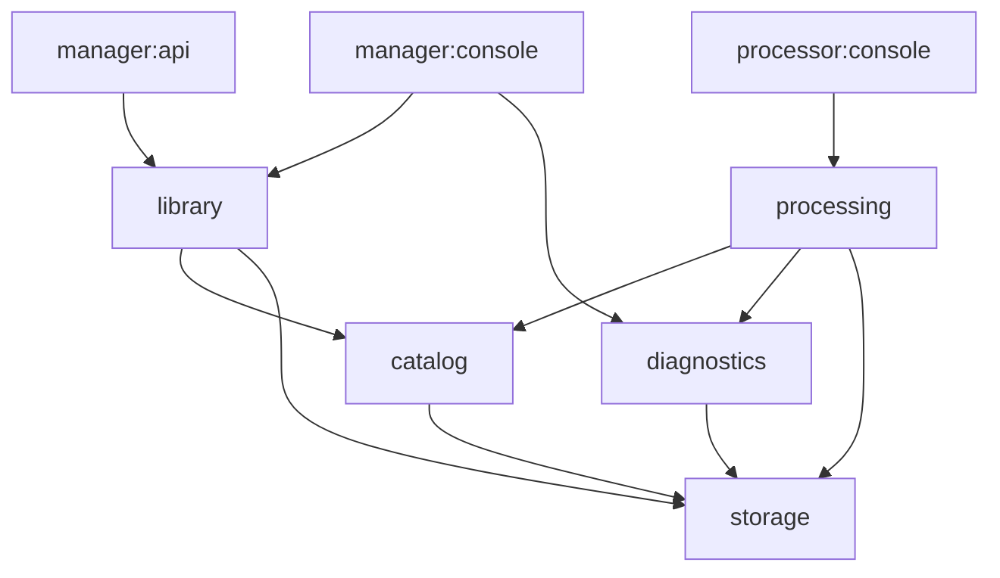

# backend のモジュール境界と公開契約

対象 Issue: [#129](https://github.com/pinfort/tsvideos/issues/129) / 親 Issue: [#128](https://github.com/pinfort/tsvideos/issues/128)

状態: 確定 (#129)。親 Issue #128 の分割方針を、2026-10-19 時点の実装 (コミット [`bd6fbf1`](https://github.com/pinfort/tsvideos/commit/bd6fbf153669ea082859892cf5cd5df75f18e0cc)) と照合して具体化したもの。以降の子 Issue (#130〜#139) はこの文書を正本として作業し、設計を変えた場合はこの文書を同じ PR で更新する。

この文書では、**現状** (いまのコードがそうなっている事実) と**契約** (移行後に守る取り決め) を区別して書く。「契約」と明記していない記述は現状の説明である。この文書自体はコードもビルド設定も変更しない。

## 目次

1. [前提と移行規則](#1-前提と移行規則)
2. [目標モジュールと依存方向](#2-目標モジュールと依存方向)
3. [現状の組み立て](#3-現状の組み立て)
4. [現行コードの所属先](#4-現行コードの所属先)
5. [DB の所有権とモジュールをまたぐ SQL](#5-db-の所有権とモジュールをまたぐ-sql)
6. [ProgramCommand と CreatedFileCommand の公開操作](#6-programcommand-と-createdfilecommand-の公開操作)
7. [トランザクションと協調操作](#7-トランザクションと協調操作)
8. [NAS (storage) の公開契約](#8-nas-storage-の公開契約)
9. [動画の HTTP 配信](#9-動画の-http-配信)
10. [NAS と DB の失敗時の責任](#10-nas-と-db-の失敗時の責任)
11. [各モジュールの公開操作と結果型 (契約)](#11-各モジュールの公開操作と結果型-契約)
12. [子 Issue への引き継ぎ](#12-子-issue-への引き継ぎ)
13. [未決事項](#13-未決事項)

## 1. 前提と移行規則

親 Issue #128 の方針をそのまま維持する。

- 実行アプリは `manager:api`、`manager:console`、`processor:console` の 3 つのまま。DB は 1 つで、デプロイ方式も変えない。
- API 応答、CLI の出力と終了コード、dry-run、ロック、claim、復旧、中断、NAS の安全性、DB スキーマの意味を変えない。
- 原則 1 Issue = 1 PR。各段階でビルドとテストが通る状態を保つ。ファイルの移動と振る舞いの変更を同じ PR に混ぜず、テストと文書は移動と一緒に移す。
- 業務責務を第一の分割軸にする。各機能モジュールの内部を `api` / `application` / `domain` / `persistence` のパッケージに分けるが、それぞれを Gradle モジュールにはしない。
- 新たな汎用 common モジュールを受け皿にしない。

移行中の依存規則 (契約):

- **抽出済みの新モジュールから旧モジュール (`core`、`processor:infrastructure`、`manager:infrastructure`) への依存は禁止する。** 新モジュールが旧 core の型を必要とする場合は、その型の所有先をこの文書で決め、同じ PR で一緒に移す。
- 旧モジュールから抽出済みモジュールへの依存は許す (旧 core → storage など)。依存は常にこの片方向に限る。
- 境界の自動チェックはモジュールを抽出する PR で追加する (§11.7)。

#139 で旧モジュール (`core`、`manager:infrastructure`。`processor:infrastructure` は #166) をすべて削除し、移行を終えた。上の移行中の規則は経緯として残す。以降は §2 の依存だけを許し、`checkModuleGraph` (§11.7) が旧モジュールの復活と §2 にない依存を拒否する。

## 2. 目標モジュールと依存方向

| モジュール | 責務 | 主な依存先 |
| --- | --- | --- |
| `catalog` | 録画・番組・分割ファイル・作成ファイルの台帳 (`executed_file` / `program` / `splitted_file` / `created_file`) と検出タグ/実施記録。両アプリが使う記録の整合性と、台帳行のロック・削除・移動の協調操作 | `storage` |
| `library` | 検索の用途別ビュー、統計、手動タグ/コレクション、重複レビュー、一括操作、クリーンアップ、ライブラリ健全性 | `catalog`, `storage` |
| `processing` | pipeline、ジョブ所有権、履歴、品質判定、再試行、中断、検証付きアップロード、reset、preflight、外部録画ツール・shell・Slack | `catalog`, `storage`, `diagnostics` |
| `storage` | NAS 上の読み出し・一時作成・検証・置換しない rename・削除・存在/サイズ確認。Samba (jcifs) 実装と NAS 設定 | 業務モジュールに依存しない |
| `diagnostics` | DB/NAS の環境診断と診断結果。Spring が起動できなくても使える入口 | `storage` |
| `database-schema` | 番号付き migration、テスト DDL 生成、DB テスト用資源。スキーマの単一の情報源 | 依存なし (データ操作 API を提供しない) |
| `console-common` (既存) | 両 CLI の端末 I/O と `--version` の情報 (`ApplicationVersion`、`generateVersionProperties`。#139 で core から移した) | 業務モジュールに依存しない |

`processing` は `processor:infrastructure` と処理専用の core コードを統合した後継である (処理専用の core コードは #164〜#165、`processor:infrastructure` は #166 で統合し、モジュールを削除した)。`manager:infrastructure` (Kotlin ソースなし、空の `application-infrastructure.yaml` のみ) と、最後に `ApplicationVersion`・`LoggerConfig`・DataSource の設定だけが残っていた `core` は #139 で削除した (§11.8)。

矢印はコンパイル時依存 (契約)。

許可する依存と禁止する依存 (契約):

| 依存元 | 許可 | 禁止 |
| --- | --- | --- |
| `storage` | (業務モジュールなし) | すべての業務モジュール |
| `diagnostics` | `storage` | `catalog`, `library`, `processing` |
| `catalog` | `storage` | `library`, `processing`, `diagnostics` |
| `library` | `catalog`, `storage` | `processing`, `diagnostics` |
| `processing` | `catalog`, `storage`, `diagnostics` | `library` |
| `database-schema` | なし | すべて |
| `manager:api`, `manager:console` | 組み立て用に `library`, `catalog`, `storage`, `diagnostics`, `console-common` (console のみ) | `processing` (TsSplitter/Amatsukaze/tsselect と処理専用設定を実行時に含めない) |
| `processor:console` | 組み立て用に `processing`, `catalog`, `storage`, `diagnostics`, `console-common` | `library` |

上の図は親 Issue と同じく、実行アプリが設定や Bean を組み立てるための依存を省略している。実行アプリは表の「許可」の範囲で下位モジュールに直接依存してよい。`database-schema` は本番の依存先にならず、DB 統合テストの `testImplementation` からだけ参照する。

## 3. 現状の組み立て

Gradle モジュール ([settings.gradle.kts](../settings.gradle.kts)) とコンパイル時依存:

| モジュール | 依存 | 備考 |
| --- | --- | --- |
| `storage` | jcifs-ng (プロジェクト依存なし) | #132 で抽出。境界チェック `checkStorageBoundaries` ([build.gradle.kts](../storage/build.gradle.kts)、§11.7) |
| `database-schema` | なし (プロジェクト依存なし、Kotlin/Java の main ソースなし) | #133 で抽出。migration、`generateTestDdl`、DB テスト用のテストフィクスチャ。境界チェック `checkDatabaseSchemaBoundaries` ([build.gradle.kts](../database-schema/build.gradle.kts)、§11.6、§11.7) |
| `catalog` | `storage`, mybatis-spring-boot。テストだけ `database-schema` のテストフィクスチャ | #135 で抽出 ([catalog/README.md](../catalog/README.md))。境界チェック `checkCatalogBoundaries` ([build.gradle.kts](../catalog/build.gradle.kts)、§11.7) |
| `library` | `catalog`, `storage`, mybatis-spring-boot。テストだけ `database-schema` のテストフィクスチャ | #157 で検索・統計・保存領域の概要・分類・重複レビューを、#158 で一括操作・クリーンアップを、#159 で健全性・検証を抽出 ([library/README.md](../library/README.md))。境界チェック `checkLibraryBoundaries` ([build.gradle.kts](../library/build.gradle.kts)、§11.7) |
| `diagnostics` | `storage`, MariaDB driver (runtime) | #136 で抽出 ([diagnostics/README.md](../diagnostics/README.md))。境界チェック `checkDiagnosticsBoundaries` ([build.gradle.kts](../diagnostics/build.gradle.kts)、§11.7) |
| `processing` | `catalog`, `storage`, `diagnostics`, mybatis-spring-boot, jackson-databind, `me.pinfort:tsselect`。テストだけ `database-schema` のテストフィクスチャ | #164 でジョブ所有権・履歴・品質・再試行・中断・preflight・外部ツール/shell・処理補助を、#165 で検証付きアップロード (`VerifiedUploadCommand` / `UploadManifest` / `UploadManifestMapper`) を core から抽出し、#166 で `processor:infrastructure` の pipeline・reset・after-encode・tsselect・TS 解析・Slack を統合 ([processing/README.md](../processing/README.md))。境界チェック `checkProcessingBoundaries` ([build.gradle.kts](../processing/build.gradle.kts)、§11.7)。`library`・`manager:*`・`processor:*` には依存しない |
| `console-common` | spring-context | 両 CLI の端末 I/O と `ApplicationVersion`。`generateVersionProperties` タスク ([build.gradle.kts](../console-common/build.gradle.kts)) は #139 で core から移した |
| `manager:api` | `storage`, `catalog`, `library`, `diagnostics`, MariaDB driver (runtime) | [build.gradle.kts](../manager/api/build.gradle.kts)。#164 で移行中だけ入れた `processing` は #165 で、`core`・`manager:infrastructure` は #139 で外した。実行時クラスパスに processing が入らないことを `checkProcessingRuntimeIsolation`、処理専用ツールも入らないことを `checkModuleGraph` が検査する (§11.7) |
| `manager:console` | `storage`, `catalog`, `library`, `diagnostics`, `console-common`, MariaDB driver (runtime) | [build.gradle.kts](../manager/console/build.gradle.kts)。`processing` と実行時の検査は manager:api と同じ |
| `processor:console` | `storage`, `catalog`, `diagnostics`, `processing`, `console-common`, MariaDB driver (runtime) | [build.gradle.kts](../processor/console/build.gradle.kts)。`core` は #139 で外した。#166 で `processor:infrastructure` (`storage`, `catalog`, `processing`, `core`, `me.pinfort:tsselect` に依存していた) を processing に統合して削除し、その依存を外した。pipeline の入口は processing の公開 API (`processing.api` の `PathProcessingRunner` / `AfterEncodeRunner` / `ResetRunner`) だけを使う。#157 で移行中だけ入れた `library` は、core → library の依存がなくなった #158 で外した (§2 の目標どおり library を含めない。実行時クラスパスに library が入らないことを `checkModuleGraph` が検査する) |

`processing` は storage と catalog の公開型 (`NasStore`、`Program` など) を自分の公開シグネチャにも出すが、依存は `implementation` にしている (#165 より前は core も同様)。storage / catalog / processing の型を使うモジュールはそれぞれ `implementation(project(":storage"))` / `implementation(project(":catalog"))` / `implementation(project(":processing"))` を明示的に宣言する。

Spring の組み立て:

- 3 つの実行アプリはすべて `scanBasePackages` に `me.pinfort.tsvideos.storage` (#132 以降)、`me.pinfort.tsvideos.catalog` (#135 以降)、`me.pinfort.tsvideos.diagnostics` (#136 以降) と自分のパッケージ (`me.pinfort.tsvideos.manager` / `me.pinfort.tsvideos.processor`。自分の `config/LoggerConfig` を含む) を含め (`me.pinfort.tsvideos.core` は #165〜#139 は `LoggerConfig` のためだけで、#139 で外した。両 CLI はさらに `me.pinfort.tsvideos.console.common`)、`@MapperScan` に `CatalogPersistence.MAPPER_PACKAGE` を含める。processor:console はさらに `me.pinfort.tsvideos.processing` (#164 以降) をスキャンし、`@MapperScan` に `ProcessingPersistence.MAPPER_PACKAGE` を加える。manager の 2 アプリはさらに `me.pinfort.tsvideos.library` (#157 以降) をスキャンし、`@MapperScan` に `LibraryPersistence.MAPPER_PACKAGE` を加える。processor:console は #157 で移行中だけ library をスキャンしていたが、#158 で外した (catalog・library・processing の Mapper パッケージ `persistence` は internal なので、名前は公開定数 `CatalogPersistence.MAPPER_PACKAGE` / `LibraryPersistence.MAPPER_PACKAGE` / `ProcessingPersistence.MAPPER_PACKAGE` で受け取る)。core の Mapper パッケージ (`me.pinfort.tsvideos.core.external.database.mapper`) は唯一の Mapper `UploadManifestMapper` が processing に移った #165 でなくなり、どのアプリも登録しない。全 Mapper が実行アプリの 1 つの `SqlSessionFactory` と `PlatformTransactionManager` を共有する ([ApiApplication](../manager/api/src/main/kotlin/me/pinfort/tsvideos/manager/api/ApiApplication.kt) と [MyBatisConfig](../manager/api/src/main/kotlin/me/pinfort/tsvideos/manager/api/config/MyBatisConfig.kt)、manager の [ConsoleApplication](../manager/console/src/main/kotlin/me/pinfort/tsvideos/manager/console/ConsoleApplication.kt)、processor の [ConsoleApplication](../processor/console/src/main/kotlin/me/pinfort/tsvideos/processor/console/ConsoleApplication.kt))。#164〜#165 の移行中は、core に残っていた `VerifiedUploadCommand` (manager も core をスキャンする) が processing の Bean を要求したため、manager の 2 アプリも processing をスキャンし `processing` プロファイルを include していた (`TsSplitterClient`、`ProcessorToolConfigurationProperties` などの処理専用 Bean も登録されていた)。#165 でアップロードを processing へ移し、manager の processing の依存・スキャン・Mapper 登録・プロファイルを外したので、manager の実行時には処理専用ツール/設定が入らない (§11.7 の `checkProcessingRuntimeIsolation` と `ApiApplicationTest`)。
- `@ConfigurationPropertiesScan` は processor:console では `me.pinfort.tsvideos.processing.api.config` (#164 より前は `me.pinfort.tsvideos.core.config`)、を対象にする。manager の 2 アプリは #139 で `@ConfigurationPropertiesScan` を外した (それまでは存在しない `manager.infrastructure.config` だけ、#164〜#165 は移行中だけ processing の設定パッケージも対象にしていた)。storage の `samba.*` 設定クラスは storage 内部の `SambaStorageConfiguration` (`@EnableConfigurationProperties`) が登録するので、実行アプリはパッケージのスキャンだけでよい。
- 設定は各実行アプリの `application-datasource.yaml` (`datasource` プロファイル、[manager:api](../manager/api/src/main/resources/application-datasource.yaml)・[manager:console](../manager/console/src/main/resources/application-datasource.yaml)・[processor:console](../processor/console/src/main/resources/application-datasource.yaml)。#139 で core の `application-core.yaml` から同じ内容で移し、3 つが同じ内容であることを `checkModuleGraph` が検査する) に `spring.datasource`、processing の [application-processing.yaml](../processing/src/main/resources/application-processing.yaml) に `processor-tool`、`processor-preflight` が入る (#164 で core から移した。キー・既定値・環境変数は同じ)。`samba` は #132 で storage の [application-storage.yaml](../storage/src/main/resources/application-storage.yaml) に移した (キーと環境変数は同じ)。各アプリが `datasource`・`storage` プロファイルを (#139 までは `core`・`storage`)、processor:console はさらに `processing` プロファイルを include する (processor:console が include していた `infrastructure` プロファイルは、中身が空の `application-infrastructure.yaml` とともに #166 で `processor:infrastructure` を削除したときに外した。[processor:console](../processor/console/src/main/resources/application.yaml)、[manager:console](../manager/console/src/main/resources/application.yaml)、[manager:api](../manager/api/src/main/resources/application.yml)。manager の `processing` は #164〜#165 の移行中だけで、#165 で外した。各アプリは自分の設定で明示する。#139 で削除した core の `application.yaml` (`core` と `storage` だけ) にはそれ以前から頼っていない)。両 CLI は `lazy-initialization: true` を使う ([processor](../processor/console/src/main/resources/application-console.yaml)、[manager](../manager/console/src/main/resources/application-console.yaml))。
- `manager:console doctor` と `processor:console preflight` (および `process` の事前ゲート) は Spring コンテキストを作らずに診断部品を手で組み立てる ([DoctorBootstrap](../manager/console/src/main/kotlin/me/pinfort/tsvideos/manager/console/DoctorBootstrap.kt)、[PreflightBootstrap](../processor/console/src/main/kotlin/me/pinfort/tsvideos/processor/console/PreflightBootstrap.kt))。NAS の診断用接続は storage の `DiagnosticNasClient.create()` で作る (実装クラスは storage の internal)。組み立てる診断部品 (`EnvironmentDiagnosticCommand`、`DatabaseDiagnosticProbe`、`NasDiagnosticProbe`、`DiagnosticEnvironment`) は #136 から diagnostics モジュールの公開 API で、`preflight` の処理用の検査 (`ProcessingPreflightCommand`、`LocalPreflightProbe`、`EncoderConnectivityProbe`) は #164 から processing の公開 API (`processing.api`) である。`preflight` は `processing` プロファイルの `processor-tool.*` / `processor-preflight.*` を `Environment` から読む。
- DataSource は Spring Boot 自動構成の Hikari 1 つ (`auto-commit: false`、最大 10 接続)。`PlatformTransactionManager` もアプリごとに自動構成の 1 つだけで、独自の DataSource/TransactionManager/SqlSessionFactory の Bean 定義はない。独自の `@Bean` は各実行アプリの `config/LoggerConfig` ([manager:api](../manager/api/src/main/kotlin/me/pinfort/tsvideos/manager/api/config/LoggerConfig.kt)・[manager:console](../manager/console/src/main/kotlin/me/pinfort/tsvideos/manager/console/config/LoggerConfig.kt)・[processor:console](../processor/console/src/main/kotlin/me/pinfort/tsvideos/processor/console/config/LoggerConfig.kt)。#139 で core から移した) の注入先ごとの slf4j `Logger` (prototype) だけである。JDBC ドライバ (MariaDB) も #139 から各実行アプリが `runtimeOnly` で宣言する。

## 4. 現行コードの所属先

本番ソースの全 Command・Mapper・DTO・設定・外部クライアントと、それらが使う補助クラスの移動先 (契約)。パスの基点は `core/src/main/kotlin/me/pinfort/tsvideos/core/` (`core/…` と略記) と `processor/infrastructure/src/main/kotlin/me/pinfort/tsvideos/processor/infrastructure/` (`pi/…` と略記)。「分割」は 1 つのクラスを複数の移動先に分けることを表す。移動先が `catalog` の行は #135 で移動済みで、リンクは移動後の場所を指す (公開操作は `catalog/…/api`、モデルは `catalog/…/domain`、Mapper・DTO・SQL プロバイダは internal の `catalog/…/persistence`。`catalog/…` は `catalog/src/main/kotlin/me/pinfort/tsvideos/catalog/` の略)。#157〜#159 で library に移した行も同様にリンクは移動後の場所を指す (`library/…/api`、`library/…/domain`、internal の `library/…/persistence`。`library/…` は `library/src/main/kotlin/me/pinfort/tsvideos/library/` の略)。#164 で processing に移した行も同様にリンクは移動後の場所を指す (公開操作・補助部品は `processing/…/api`、設定クラスは `api/config`、shell は `api/shell`、外部ツールは `api/tool`、モデルと例外は `processing/…/domain`、Mapper は internal の `processing/…/persistence`。`processing/…` は `processing/src/main/kotlin/me/pinfort/tsvideos/processing/` の略)。`pi/…` の行は #166 で processing に移し、リンクは移動後の場所を指す (pipeline の入口は公開の `processing/…/api`、pipeline の内部は internal の `processing/…/pipeline`、tsselect・TS 解析・Slack は internal の `processing/…/external/{tsselect,ts,slack}`)。`pi/…` と `core/…` のパスは削除前の場所を表す (core は #139 で削除した)。

### 4.1 Command

| 現行クラス | 移動先 | 補足 |
| --- | --- | --- |
| [ProgramCommand](../catalog/src/main/kotlin/me/pinfort/tsvideos/catalog/api/ProgramCommand.kt) | `catalog` (分割) | 読み取り、登録/状態更新、協調削除/移動を用途別の公開操作に分ける (§6.1)。#134 で検索を台帳の条件だけにした (ライブラリ絞り込みは `LibraryProgramSearchCommand`、§13 U1) |
| [ProgramInventory](../catalog/src/main/kotlin/me/pinfort/tsvideos/catalog/api/ProgramInventory.kt) | `catalog` | #134 で追加。library 向けの番組の読み取り (重複検出の入力 `recordedPrograms`、検証対象 `allPrograms`、`allIds`、存在確認 `exists`、複数 ID による取得 `summaries`、状態/ドロップ別 `withStatus` / `withDrops`)。結果は `Program` と `ProgramSummary` |
| [LedgerSnapshots](../catalog/src/main/kotlin/me/pinfort/tsvideos/catalog/api/LedgerSnapshots.kt) | `catalog` | #134 で追加。一括スナップショットの読み取り (`programSnapshot`、`allCreatedFiles`、`createdFilesOfPrograms`、`referencingPrograms`、#112 でパスとそのエイリアスの行を索引で引く `createdFilesAt`)。結果は `ProgramSnapshot` / `CreatedFileSnapshot` |
| [LedgerLocks](../catalog/src/main/kotlin/me/pinfort/tsvideos/catalog/api/LedgerLocks.kt) | `catalog` | #134 で追加。台帳行のロック (`lockCreatedFilePaths` → `lockCreatedFileRows` (ガード付きは `lockCreatedFiles` → `lockWholeLedger`) → `lockProgramGraph`、関連付け用の `lockProgramRow`)。すべて `MANDATORY` (§7.3) |
| [CatalogStatistics](../catalog/src/main/kotlin/me/pinfort/tsvideos/catalog/api/CatalogStatistics.kt) | `catalog` | #134 で追加。統計の集計元 (`programs` / `files`) と保存領域の参照 (`storageReferences`)。結果は `ProgramStatsRow` / `FileStatsRow` / `StorageReference` |
| [LibraryProgramSearchCommand](../library/src/main/kotlin/me/pinfort/tsvideos/library/api/LibraryProgramSearchCommand.kt) | `library` (#157 で移動済み) | #134 で追加。`GET /api/v1/programs` の検索。絞り込みがなければ catalog の検索そのもの、あれば library の参照クエリ `LibraryProgramSearchMapper` (§5.2、§13 U1) |
| [CreatedFileCommand](../catalog/src/main/kotlin/me/pinfort/tsvideos/catalog/api/CreatedFileCommand.kt) | `catalog` | #131 で登録・配信を分離済み。残る協調削除・移動 (`delete` / `moveResource` / `recordMove` / `restoreMoved`。移動は #112 で NAS と行の更新に分けた) と読み取り (`selectBySplittedFileId`) は catalog、NAS 操作は storage (§6.2) |
| [CreatedFileCatalog](../catalog/src/main/kotlin/me/pinfort/tsvideos/catalog/api/CreatedFileCatalog.kt) | `catalog` | #131 で追加。`created_file` の読み取り (`find`、配信できる動画の判定 `findStreamableVideo`)、登録 (`register`、`MANDATORY`。#112 からパスと split のガードを取り、split が消えていれば拒否)、未設定メタデータの補完 (`fillMimeIfMissing` / `fillResolutionIfMissing`、`MANDATORY`)、`path_key` の埋め戻し (`fillMissingPathKeys`、`MANDATORY`、#112)。NAS と HTTP の型を持たない (§6.2、§7.6、§9) |
| [ExecutedFileCommand](../catalog/src/main/kotlin/me/pinfort/tsvideos/catalog/api/ExecutedFileCommand.kt) | `catalog` | `delete` はタグ/実施記録も消す |
| [SplittedFileCommand](../catalog/src/main/kotlin/me/pinfort/tsvideos/catalog/api/SplittedFileCommand.kt) | `catalog` | |
| [ExecutedFileTagCommand](../catalog/src/main/kotlin/me/pinfort/tsvideos/catalog/api/ExecutedFileTagCommand.kt) | `catalog` | 検出タグ。手動タグ (library) とは別物 |
| [BulkLibraryCommand](../library/src/main/kotlin/me/pinfort/tsvideos/library/api/BulkLibraryCommand.kt) | `library` (#158 で移動済み) | ロック取得と削除/移動は catalog の協調操作を呼ぶ形にする (§7.3) |
| [CleanupPlanCommand](../library/src/main/kotlin/me/pinfort/tsvideos/library/api/CleanupPlanCommand.kt) | `library` (#158 で移動済み) | 重複候補は library の `DuplicateReviewCommand`、番組 ID と録画済み番組は catalog の `ProgramInventory` で読む |
| [DuplicateProgramCommand](../library/src/main/kotlin/me/pinfort/tsvideos/library/api/DuplicateProgramCommand.kt) | `library` (#157 で移動済み) | `ProgramMapper.selectAll` の代わりに catalog の読み取り操作を使う |
| [DuplicateReviewCommand](../library/src/main/kotlin/me/pinfort/tsvideos/library/api/DuplicateReviewCommand.kt) | `library` (#157 で移動済み) | `CreatedFileMapper.selectMovedByExecutedFileIds` の代わりに catalog の読み取り操作を使う |
| [LibraryOrganizationCommand](../library/src/main/kotlin/me/pinfort/tsvideos/library/api/LibraryOrganizationCommand.kt) | `library` (#157 で移動済み) | `program` 行のロックは catalog の操作を使う (§5.3) |
| [LibraryStatsCommand](../library/src/main/kotlin/me/pinfort/tsvideos/library/api/LibraryStatsCommand.kt) | `library` (#157 で移動済み) | 集計クエリは catalog の用途別読み取り操作にする (§5.2) |
| [StorageOverviewCommand](../library/src/main/kotlin/me/pinfort/tsvideos/library/api/StorageOverviewCommand.kt) | `library` (#157 で移動済み) | 同上 |
| [LibraryVerificationCommand](../library/src/main/kotlin/me/pinfort/tsvideos/library/api/LibraryVerificationCommand.kt) | `library` (#159 で移動済み) | NAS の低レベル確認は storage の `NasFileVerifier` を使う |
| [LibraryHealthCommand / LibraryHealthScanCommand](../library/src/main/kotlin/me/pinfort/tsvideos/library/api/LibraryHealthCommand.kt) | `library` (#159 で移動済み) | |
| [HealthVerificationStore](../library/src/main/kotlin/me/pinfort/tsvideos/library/api/HealthVerificationStore.kt) | `library` (#159 で移動済み) | |
| [EnvironmentDiagnosticCommand](../diagnostics/src/main/kotlin/me/pinfort/tsvideos/diagnostics/api/EnvironmentDiagnosticCommand.kt) | `diagnostics` | #136 で移動済み (`diagnostics.api`)。Spring なしで構築できる状態を保つ |
| [ProcessingPreflightCommand](../processing/src/main/kotlin/me/pinfort/tsvideos/processing/api/ProcessingPreflightCommand.kt) | `processing` (#164 で移動済み) | diagnostics の `EnvironmentDiagnosticCommand` とツール検査を組み立てる。processing → diagnostics の片方向。公開コンストラクタで Spring なしに組み立てられる状態を保つ (`PreflightBootstrap`) |
| [ProcessingJobCommand](../processing/src/main/kotlin/me/pinfort/tsvideos/processing/api/ProcessingJobCommand.kt) / [ProcessingJobClaimCommand](../processing/src/main/kotlin/me/pinfort/tsvideos/processing/api/ProcessingJobClaimCommand.kt) | `processing` (#164 で移動済み) | コンストラクタは internal (引数が internal の Mapper)。`reconcileSubmission` など本番の呼び出し元がない操作も残す (§13 U4) |
| [ProcessingHistoryCommand](../processing/src/main/kotlin/me/pinfort/tsvideos/processing/api/ProcessingHistoryCommand.kt) | `processing` (#164 で移動済み) | コンストラクタは internal |
| [RecordingQualityCommand](../processing/src/main/kotlin/me/pinfort/tsvideos/processing/api/RecordingQualityCommand.kt) | `processing` (#164 で移動済み) | コンストラクタは internal |
| [VerifiedUploadCommand](../processing/src/main/kotlin/me/pinfort/tsvideos/processing/api/VerifiedUploadCommand.kt) | `processing` (#165 で移動済み) | claim・REGISTERED 判定・ローカル削除許可は processing が所有。NAS 操作は storage、`created_file` 登録は catalog (§7.6)。#164 では core に残し (processing の再試行・中断・`ProcessingIdentity` を移行中だけの core → processing で使った)、#165 で移した。コンストラクタは internal (引数が internal の Mapper) |

### 4.2 Mapper と SQL

| 現行 Mapper | 参照するテーブル (書き込みは太字) | 移動先 |
| --- | --- | --- |
| [ProgramMapper](../catalog/src/main/kotlin/me/pinfort/tsvideos/catalog/persistence/ProgramMapper.kt) + [ProgramSearchSql](../catalog/src/main/kotlin/me/pinfort/tsvideos/catalog/persistence/ProgramSearchSql.kt) | **program**, executed_file, splitted_file, created_file | `catalog`。検索 SQL の library テーブル参照は #134 で外した (§13 U1)。#134 で library 向けの `findId` / `summariesByIds` / `summariesByStatus` / `summariesWithDrops` を追加 (`ProgramInventory` 経由で使う) |
| [ExecutedFileMapper](../catalog/src/main/kotlin/me/pinfort/tsvideos/catalog/persistence/ExecutedFileMapper.kt) | **executed_file** | `catalog` |
| [SplittedFileMapper](../catalog/src/main/kotlin/me/pinfort/tsvideos/catalog/persistence/SplittedFileMapper.kt) | **splitted_file** | `catalog` |
| [CreatedFileMapper](../catalog/src/main/kotlin/me/pinfort/tsvideos/catalog/persistence/CreatedFileMapper.kt) | **created_file**, splitted_file | `catalog` |
| [ExecutedFileTagMapper](../catalog/src/main/kotlin/me/pinfort/tsvideos/catalog/persistence/ExecutedFileTagMapper.kt) / [ExecutedFileCheckMapper](../catalog/src/main/kotlin/me/pinfort/tsvideos/catalog/persistence/ExecutedFileCheckMapper.kt) | **executed_file_tag**, **executed_file_check** | `catalog` |
| [BulkLibraryMapper](../catalog/src/main/kotlin/me/pinfort/tsvideos/catalog/persistence/BulkLibraryMapper.kt) | program, executed_file, splitted_file, created_file (読み取りと `FOR UPDATE`)、**created_file_path_guard** (パスのガードの upsert、#112) | `catalog` (ロックと一括スナップショットの読み取りは台帳行に対する操作のため。library は公開操作 `LedgerLocks` / `LedgerSnapshots` 経由で使う。#134 で関連付け用の `lockProgramRow` を `LibraryOrganizationMapper.lockProgram` から移した) |
| [StorageOverviewMapper](../catalog/src/main/kotlin/me/pinfort/tsvideos/catalog/persistence/StorageOverviewMapper.kt) | program, splitted_file, created_file | `catalog` の用途別読み取り操作 (library 向け、#134 で `CatalogStatistics.storageReferences`) |
| [LibraryStatsMapper](../catalog/src/main/kotlin/me/pinfort/tsvideos/catalog/persistence/LibraryStatsMapper.kt) | program, executed_file, splitted_file, created_file | `catalog` の用途別読み取り操作 (library 向け、#134 で `CatalogStatistics.programs` / `files`。引数は library の `LibraryStatsQuery` ではなく録画日時の範囲だけ) |
| [LibraryProgramSearchMapper](../library/src/main/kotlin/me/pinfort/tsvideos/library/persistence/LibraryProgramSearchMapper.kt) + `LibraryProgramSearchSql` | program, executed_file, splitted_file, created_file, library_collection_program, library_tag_program (読み取りのみ、ロックなし) | `library` (#157 で移動済み、internal)。#134 で追加した、手動コレクション/タグで絞り込む番組検索の明示的な参照クエリ (§5.2、§13 U1) |
| [LibraryOrganizationMapper](../library/src/main/kotlin/me/pinfort/tsvideos/library/persistence/LibraryOrganizationMapper.kt) + [LibraryOrganizationSql](../library/src/main/kotlin/me/pinfort/tsvideos/library/persistence/LibraryOrganizationSql.kt) | **library_collection**, **library_tag**, **library_collection_program**, **library_tag_program**, program (件数/絞り込みの JOIN) | `library` (#157 で移動済み、internal)。#134 で `lockProgram`/`findProgram` を削除し、catalog の `LedgerLocks.lockProgramRow` / `ProgramInventory.exists` に置き換えた。JOIN は §5.2 の明示的な参照クエリとして残す |
| [LibraryHealthMapper](../library/src/main/kotlin/me/pinfort/tsvideos/library/persistence/LibraryHealthMapper.kt) | **health_verification_run**, **health_verification_finding** | `library` (#159 で移動済み、internal)。#134 で `failedPrograms` / `droppedPrograms` / `findingPrograms` を削除した。前 2 つは catalog の `ProgramInventory.withStatus(ERROR)` / `withDrops`、`findingPrograms` は library が自分の findings から program ID を得て catalog の `ProgramInventory.summaries` を呼ぶ形に分けた (§5.2)。この Mapper は台帳テーブルを読まない |
| [ProcessingJobMapper](../processing/src/main/kotlin/me/pinfort/tsvideos/processing/persistence/ProcessingJobMapper.kt) | **processing_job** | `processing` (#164 で移動済み、internal) |
| [ProcessingHistoryMapper](../processing/src/main/kotlin/me/pinfort/tsvideos/processing/persistence/ProcessingHistoryMapper.kt) | **processing_history_identity**, **processing_attempt**, **processing_stage_event**, processing_job | `processing` (#164 で移動済み、internal) |
| [RecordingQualityMapper](../processing/src/main/kotlin/me/pinfort/tsvideos/processing/persistence/RecordingQualityMapper.kt) | **processing_quality_report**, **processing_job**, processing_attempt | `processing` (#164 で移動済み、internal) |
| [UploadManifestMapper](../processing/src/main/kotlin/me/pinfort/tsvideos/processing/persistence/UploadManifestMapper.kt) | **upload_manifest** | `processing` (#165 で移動済み、internal。#164 では `VerifiedUploadCommand` とともに core に残っていた) |
| GeneratedKeyHolder | — | 永続化を持つ各モジュールの `persistence` に internal で複製する (数行の補助型を共有モジュールにしない)。#135 で catalog に internal の [GeneratedKeyHolder](../catalog/src/main/kotlin/me/pinfort/tsvideos/catalog/persistence/GeneratedKeyHolder.kt) を、#157 で library に internal の [GeneratedKeyHolder](../library/src/main/kotlin/me/pinfort/tsvideos/library/persistence/GeneratedKeyHolder.kt) を置いた。core の型は唯一の利用者 `ProcessingHistoryMapper` とともに #164 で processing の internal の [GeneratedKeyHolder](../processing/src/main/kotlin/me/pinfort/tsvideos/processing/persistence/GeneratedKeyHolder.kt) になり、core には残っていない |

Mapper は XML を使わず、すべてアノテーションまたは `*Sql` プロバイダで定義されている。移動時に MyBatis の namespace を書き換える XML はない。

### 4.3 DTO

| 現行 DTO | 移動先 | 補足 |
| --- | --- | --- |
| [ProgramDto](../catalog/src/main/kotlin/me/pinfort/tsvideos/catalog/persistence/ProgramDto.kt), [ExecutedFileDto](../catalog/src/main/kotlin/me/pinfort/tsvideos/catalog/persistence/ExecutedFileDto.kt), [SplittedFileDto](../catalog/src/main/kotlin/me/pinfort/tsvideos/catalog/persistence/SplittedFileDto.kt), [CreatedFileDto](../catalog/src/main/kotlin/me/pinfort/tsvideos/catalog/persistence/CreatedFileDto.kt), [ExecutedCreatedFileDto](../catalog/src/main/kotlin/me/pinfort/tsvideos/catalog/persistence/ExecutedCreatedFileDto.kt) | `catalog` (internal) | #134 より前は `ExecutedFileDto`/`SplittedFileDto`/`CreatedFileDto` が [BulkSnapshot](../library/src/main/kotlin/me/pinfort/tsvideos/library/domain/BulkPlan.kt) を通じて `POST /api/v1/programs/bulk/preview` の JSON にそのまま出ていた。#134 で `ExecutedFile` / `SplittedFile` (DTO と同じプロパティ名・enum 名) と catalog の `CreatedFileSnapshot` (`CreatedFileDto` と同じ 9 プロパティ。`CreatedFile` の派生プロパティを持たない) に置き換えた。JSON のプロパティ名・値・enum 名とフィンガープリントの直列化は変わらない (`BulkLibraryControllerTest`、`BulkLibraryCommandTest`) |
| [StatsDto](../catalog/src/main/kotlin/me/pinfort/tsvideos/catalog/persistence/StatsDto.kt) (`StatsProgramDto`, `StatsFileDto`), [StorageReferenceDto](../catalog/src/main/kotlin/me/pinfort/tsvideos/catalog/persistence/StorageReferenceDto.kt) | `catalog` (internal) | #134 で `CatalogStatistics` が `ProgramStatsRow` / `FileStatsRow` / `StorageReference` に変換して公開する |
| [HealthDto](../library/src/main/kotlin/me/pinfort/tsvideos/library/persistence/HealthDto.kt) (`HealthRunDto`, `HealthFindingDto`) | `library` (internal、#159 で移動済み) | |

`ProcessingJob` や `UploadManifest` など processing の Mapper は DTO を介さずドメイン型へ直接マップしている。processing 内部に閉じるのでそのままでよい。

### 4.4 設定

| 現行 | 設定キー | 移動先 |
| --- | --- | --- |
| `spring.datasource.*` (旧 `core` の `application-core.yaml`) | `DATABASE_*` | 実行アプリ (#139 で各アプリの `application-datasource.yaml` に移動済み。キー・既定値・環境変数は同じ。DataSource は §7.1 の共有契約) |
| [SambaConfigurationProperties](../storage/src/main/kotlin/me/pinfort/tsvideos/storage/samba/SambaConfigurationProperties.kt) | `samba.*` | `storage` (#132 で移動済み。internal) |
| [ProcessorToolConfigurationProperties](../processing/src/main/kotlin/me/pinfort/tsvideos/processing/api/config/ProcessorToolConfigurationProperties.kt) | `processor-tool.*` | `processing` (#164 で移動済み。既定値は [application-processing.yaml](../processing/src/main/resources/application-processing.yaml)) |
| [ProcessingRetryConfigurationProperties](../processing/src/main/kotlin/me/pinfort/tsvideos/processing/api/config/ProcessingRetryConfigurationProperties.kt) | `processor-retry.*` | `processing` (#164 で移動済み。既定値はクラス内) |
| [RecordingQualityConfigurationProperties](../processing/src/main/kotlin/me/pinfort/tsvideos/processing/api/config/RecordingQualityConfigurationProperties.kt) | `processor-quality.*` | `processing` (#164 で移動済み。既定値はクラス内) |
| `processor-preflight.space-multiplier` (`ProcessingPreflightCommand` が `Environment` から読む) | | `processing` (#164 で [application-processing.yaml](../processing/src/main/resources/application-processing.yaml) に移動済み) |
| `processor.upload.verify-sha256` (`VerifiedUploadCommand` の `@Value`) | | `processing` (#165 で移動済み。既定値は `@Value` 内) |
| `processor.shutdown.grace-seconds` ([ConsoleRunner](../processor/console/src/main/kotlin/me/pinfort/tsvideos/processor/console/ConsoleRunner.kt)) | | `processor:console` (現状どおり) |
| `SLACK_WEBHOOK_URL` ([SlackClient](../processing/src/main/kotlin/me/pinfort/tsvideos/processing/external/slack/SlackClient.kt)) | | `processing` (#166 で移動済み。internal。既定値なし (空なら通知しない) は同じ) |
| [DiagnosticEnvironment](../diagnostics/src/main/kotlin/me/pinfort/tsvideos/diagnostics/api/DiagnosticEnvironment.kt) | 引数・環境変数の解釈 | `diagnostics` (#136 で移動済み、`diagnostics.api`) |
| `LoggerConfig` (旧 `core/config`) | — | 実行アプリ (#139 で各アプリの `config/LoggerConfig` に移動済み。汎用の共通モジュールは作らない)。モジュールは slf4j の `Logger` 型の注入だけを要求し、Bean 定義には依存しない。storage は注入も要求せず自前の `LoggerFactory` のロガーを使う (#132) |

`application-core.yaml` は移行中に分割する。#164 で `processor-tool` / `processor-preflight` を processing の `application-processing.yaml` (`processing` プロファイル) に移し、core には `spring.datasource` だけが残った。#139 でこれを各実行アプリの `application-datasource.yaml` に移し、`application-core.yaml` を削除した。manager の実行アプリは移行中だけ `processing` プロファイルを include していたが、#165 で include しない状態にした。

### 4.5 外部クライアント

| 現行クラス | 外部 | 移動先 |
| --- | --- | --- |
| [SambaClient](../storage/src/main/kotlin/me/pinfort/tsvideos/storage/samba/SambaClient.kt) | jcifs | `storage` (#132 で移動済み。internal 実装。公開契約 [NasPaths](../storage/src/main/kotlin/me/pinfort/tsvideos/storage/api/NasPaths.kt) (`resolvePathUnderBaseDir`) を実装する) |
| [NasComponent](../storage/src/main/kotlin/me/pinfort/tsvideos/storage/api/NasComponent.kt) | jcifs | `storage` (#132 で移動済み。公開 interface と internal の [SambaNasComponent](../storage/src/main/kotlin/me/pinfort/tsvideos/storage/samba/SambaNasComponent.kt) に分割) |
| [VerifiedUploadNas](../storage/src/main/kotlin/me/pinfort/tsvideos/storage/api/VerifiedUploadNas.kt) | jcifs | `storage` (同上。実装は [SambaVerifiedUploadNas](../storage/src/main/kotlin/me/pinfort/tsvideos/storage/samba/SambaVerifiedUploadNas.kt)) |
| [NasFileVerifier](../storage/src/main/kotlin/me/pinfort/tsvideos/storage/api/NasFileVerifier.kt) | jcifs | `storage` (同上。実装は [SambaNasFileVerifier](../storage/src/main/kotlin/me/pinfort/tsvideos/storage/samba/SambaNasFileVerifier.kt)。結果は低レベルの `NasFileVerifier.Status`、§13 U2) |
| [SambaReadHandle](../storage/src/main/kotlin/me/pinfort/tsvideos/storage/samba/SambaReadHandle.kt) (`internal`) | jcifs | `storage` (internal 実装)。#131 で `SmbFileResource` (jcifs + Spring `Resource`) を廃止し、storage の公開型 [NasReadHandle](../storage/src/main/kotlin/me/pinfort/tsvideos/storage/api/NasReadHandle.kt) の実装として置き換えた。`Resource` への包装は `manager:api` (§9) |
| [DiagnosticNasClient](../storage/src/main/kotlin/me/pinfort/tsvideos/storage/api/DiagnosticNasClient.kt) | jcifs (上限付きタイムアウトの独立コンテキスト) | `storage` (#132 で移動済み。Spring なしで使える接続口として公開し、`DiagnosticNasClient.create()` が internal の [SambaDiagnosticNasClient](../storage/src/main/kotlin/me/pinfort/tsvideos/storage/samba/SambaDiagnosticNasClient.kt) を返す) |
| [ShellClient](../processing/src/main/kotlin/me/pinfort/tsvideos/processing/api/shell/ShellClient.kt), [ShellComponent](../processing/src/main/kotlin/me/pinfort/tsvideos/processing/api/shell/ShellComponent.kt), [ShellResult](../processing/src/main/kotlin/me/pinfort/tsvideos/processing/api/shell/ShellResult.kt) | OS プロセス | `processing` (#164 で `processing.api.shell` に移動済み) |
| [TsSplitterClient](../processing/src/main/kotlin/me/pinfort/tsvideos/processing/api/tool/TsSplitterClient.kt), [AmatsukazeAddTaskClient](../processing/src/main/kotlin/me/pinfort/tsvideos/processing/api/tool/AmatsukazeAddTaskClient.kt) | Windows 専用ツール | `processing` (#164 で `processing.api.tool` に移動済み) |
| [DurationProbeClient](../processing/src/main/kotlin/me/pinfort/tsvideos/processing/api/tool/DurationProbeClient.kt), [RecordingStreamProbeClient](../processing/src/main/kotlin/me/pinfort/tsvideos/processing/api/tool/RecordingStreamProbeClient.kt), [VideoResolutionProbeClient](../processing/src/main/kotlin/me/pinfort/tsvideos/processing/api/tool/VideoResolutionProbeClient.kt) | ffprobe | `processing` (#164 で `processing.api.tool` に移動済み) |
| [TsSelectClient](../processing/src/main/kotlin/me/pinfort/tsvideos/processing/external/tsselect/TsSelectClient.kt) | `me.pinfort:tsselect` | `processing` (#166 で internal の `processing.external.tsselect` に移動済み。tsselect の依存も processing へ移した) |
| [EmergencyBroadcastDetector](../processing/src/main/kotlin/me/pinfort/tsvideos/processing/external/ts/EmergencyBroadcastDetector.kt), [AribCaptionData](../processing/src/main/kotlin/me/pinfort/tsvideos/processing/external/ts/AribCaptionData.kt), [TsUtil](../processing/src/main/kotlin/me/pinfort/tsvideos/processing/external/ts/TsUtil.kt) | TS 解析 (JVM 内) | `processing` (#166 で internal の `processing.external.ts` に移動済み) |
| [SlackClient](../processing/src/main/kotlin/me/pinfort/tsvideos/processing/external/slack/SlackClient.kt) | Slack webhook | `processing` (#166 で internal の `processing.external.slack` に移動済み) |

### 4.6 補助部品・ドメイン型・例外

| 現行 | 移動先 |
| --- | --- |
| `core/domain`: `Program`, `ProgramDetail`, `ExecutedFile`, `SplittedFile`, `CreatedFile`, `VideoResolution`, `ExecutedFileTag`/`ExecutedFileCheck`, `ProgramSearchQuery`/`ProgramSearchPage` | `catalog` (`ProgramSearchQuery` の `collectionId`/`libraryTagId` は #134 で library の `LibraryProgramFilter` に移した、§13 U1) |
| `core/domain`: `BulkPlan` 一式, `CleanupPlan` 一式, `DuplicateGroup`, `DuplicateReview`, `LibraryOrganization`, `LibraryStats`, `StorageOverview`, `LibraryHealth`, `VerificationReport` (`FileFinding`, `VerificationReport`) | `library`。`DuplicateGroup`、`DuplicateReview`、`LibraryOrganization`、`LibraryStats`、`StorageOverview` は #157 で、`BulkPlan` 一式と `CleanupPlan` 一式は #158 で、`LibraryHealth` 一式と `VerificationReport` 一式は #159 で [library.domain](../library/src/main/kotlin/me/pinfort/tsvideos/library/domain/) に移動済み |
| `core/domain`: `VerificationStatus` | `library` (#159 で `VerificationReport.kt` とともに移動済み)。#132 で storage の低レベル結果 (`NasFileVerifier.Status`) と分けた。`LibraryVerificationCommand` が対応付ける (§13 U2) |
| `core/domain`: `ProcessingJob`/`ProcessingIdentity`, `ProcessingHistory` 一式, `RecordingQuality` 一式, `RecordingQualityReport`, `FileName` | `processing` (#164 で [processing.domain](../processing/src/main/kotlin/me/pinfort/tsvideos/processing/domain/) に移動済み) |
| `core/domain`: `UploadManifest`/`VerifiedUploadReceipt` | `processing` (#165 で [processing.domain](../processing/src/main/kotlin/me/pinfort/tsvideos/processing/domain/UploadManifest.kt) に移動済み。#164 では `VerifiedUploadCommand` とともに core に残っていた。`UploadManifest.nasType` は #130 から storage の公開値型 `NasStore`) |
| `core/domain`: `DiagnosticReport` 一式 | `diagnostics` (#136 で [diagnostics.domain](../diagnostics/src/main/kotlin/me/pinfort/tsvideos/diagnostics/domain/DiagnosticReport.kt) に移動済み) |
| `core/domain`: `Sha256` (`hex`, `sha256Hex`) | `storage` (#132 で [storage.api](../storage/src/main/kotlin/me/pinfort/tsvideos/storage/api/Sha256.kt) に移動済み。NAS 側のハッシュ計算に必要。processing は storage 経由で使う) |
| `core/component`: `DirectoryNameComponent`, `NormalizeComponent` | `catalog` (移動先パスの規則。library と processing も catalog 経由で使う) |
| `core/component`: `CompressComponent`, `MainSplittedFileFinderComponent`, `NasDestinationResolver`, `MimeTypeComponent`, `ValidateCompletedComponent`, `ProcessingCancellation`, `ProcessingRetry` 一式, `RecordingQualityInspector`, `RecordingInputs`, `LocalPreflightProbe`/`EncoderConnectivityProbe`, `RunningPlatformComponent` | `processing` (#164 で [processing.api](../processing/src/main/kotlin/me/pinfort/tsvideos/processing/api/) に移動済み。pipeline が processing に移るまで (#166) processor:infrastructure が使ったので公開した。#166 以降も公開のまま (パッケージは変えていない)) |
| `core/component`: `DatabaseDiagnosticProbe`, `NasDiagnosticProbe`, `DiagnosticCancellation` | `diagnostics` (#136 で `diagnostics.api` に移動済み。`NasDiagnosticProbe` は #130 から jcifs を直接使わず storage の `DiagnosticNasClient` だけを使う。`diagnosticCancellation` は processing の `ProcessingPreflightCommand` / `LocalPreflightProbe` も使う) |
| `core/exception`: `TsVideosException`, `InvalidFileNameException`, `InvalidEnvironmentException`, `ShellCommandTimeoutException`, `QualityReleaseRefusedException` | `processing` (利用者がすべて processing 側。#164 で `processing.domain` に移動済み) |
| [ApplicationVersion](../console-common/src/main/kotlin/me/pinfort/tsvideos/console/common/version/ApplicationVersion.kt) と `generateVersionProperties` | `console-common` (#139 で移動済み。両 CLI 用、§13 U3) |
| `pi/pipeline/*` (`FileProcessingPipeline`, `AfterEncodeRunner`, `PathProcessingRunner`, `ResetRunner`, `RollbackRunner`) | `processing` (#166 で移動済み。processor:console が使う入口 [PathProcessingRunner](../processing/src/main/kotlin/me/pinfort/tsvideos/processing/api/PathProcessingRunner.kt)・[AfterEncodeRunner](../processing/src/main/kotlin/me/pinfort/tsvideos/processing/api/AfterEncodeRunner.kt)・[ResetRunner](../processing/src/main/kotlin/me/pinfort/tsvideos/processing/api/ResetRunner.kt) は公開の `processing.api`。内部型を引数に取る `PathProcessingRunner`・`AfterEncodeRunner` のコンストラクタは internal。[FileProcessingPipeline](../processing/src/main/kotlin/me/pinfort/tsvideos/processing/pipeline/FileProcessingPipeline.kt)・[RollbackRunner](../processing/src/main/kotlin/me/pinfort/tsvideos/processing/pipeline/RollbackRunner.kt) は internal の `processing.pipeline`) |
| [db/migrations](../database-schema/src/main/resources/db/migrations/), `generateTestDdl`, `ddl/02_insert_data.sql` (旧 `core/src/test/resources`) | `database-schema` (#133 で移動済み。§11.6) |
| [db/maintenance/processing_history_cleanup.sql](../database-schema/src/main/resources/db/maintenance/processing_history_cleanup.sql) | 配布は `database-schema` (#133 で移動済み)、対象テーブルの所有は `processing` |

`manager:api`、`manager:console`、`processor:console` の Kotlin ソース (controller・response・CLI コマンド・Bootstrap・表示部品) は実行アプリに残る。

## 5. DB の所有権とモジュールをまたぐ SQL

### 5.1 テーブルの所有者 (契約)

DDL は [db/migrations](../database-schema/src/main/resources/db/migrations/) にあり、`database-schema` が配布する。データの読み書き API は所有モジュールだけが提供する。

| テーブル | migration | 所有 |
| --- | --- | --- |
| `executed_file`, `splitted_file`, `created_file`, `program` | [001](../database-schema/src/main/resources/db/migrations/001_base_schema.sql), [073](../database-schema/src/main/resources/db/migrations/073_created_file_resolution.sql), [074](../database-schema/src/main/resources/db/migrations/074_created_file_chapter.sql), [076](../database-schema/src/main/resources/db/migrations/076_created_file_path_key.sql) | `catalog` |
| `created_file_path_guard` | [076](../database-schema/src/main/resources/db/migrations/076_created_file_path_key.sql) | `catalog` |
| `created_file_chapter` | [074](../database-schema/src/main/resources/db/migrations/074_created_file_chapter.sql) | `catalog` |
| `executed_file_tag`, `executed_file_check` | [002](../database-schema/src/main/resources/db/migrations/002_executed_file_tag.sql) | `catalog` |
| `health_verification_run`, `health_verification_finding` | [051](../database-schema/src/main/resources/db/migrations/051_library_health.sql) | `library` |
| `library_collection`, `library_tag`, `library_collection_program`, `library_tag_program` | [053](../database-schema/src/main/resources/db/migrations/053_library_organization.sql) | `library` |
| `processing_job` | [064](../database-schema/src/main/resources/db/migrations/064_processing_job.sql), [075](../database-schema/src/main/resources/db/migrations/075_processing_job_executed_file_unique.sql) | `processing` |
| `processing_history_identity`, `processing_attempt`, `processing_stage_event` | [067](../database-schema/src/main/resources/db/migrations/067_processing_history.sql) | `processing` |
| `processing_quality_report` | [071](../database-schema/src/main/resources/db/migrations/071_recording_quality.sql) | `processing` |
| `upload_manifest` | [072](../database-schema/src/main/resources/db/migrations/072_upload_manifest.sql) | `processing` |

### 5.2 モジュールをまたぐ読み取り

#134 より前に所有者以外のテーブルを読んでいた SQL と、その扱い。「#134」の付いた扱いは実施済み。

| SQL | 呼び出し元 (現状の所属) | 読む他モジュールのテーブル | 契約での扱い |
| --- | --- | --- | --- |
| `ProgramSearchSql` の `collectionId`/`libraryTagId` 条件 | `ProgramCommand.search` (catalog) | library_collection_program, library_tag_program | **catalog から library への逆向き参照**。#134 で解消: catalog の検索から外し、library の参照クエリ `LibraryProgramSearchMapper` に移した (§13 U1) |
| `LibraryProgramSearchSql.search` / `count` (#134 で追加) | `LibraryProgramSearchCommand` (library) | program, executed_file, splitted_file, created_file | library 所有の明示的な参照クエリ。台帳の条件・並び順・ページングは `ProgramSearchSql` と同じ文で、手動コレクション/タグの `EXISTS` を加える。読み取り専用でロックしない |
| `LibraryOrganizationSql.select` / `forProgram`、`findProgram` | `LibraryOrganizationCommand` (library) | program | library 所有の明示的な参照クエリとして残してよい (件数と絞り込みの JOIN のみ)。#134 で `findProgram` を catalog の `ProgramInventory.exists` に置き換えた |
| `LibraryHealthMapper.failedPrograms` / `droppedPrograms` | `LibraryHealthCommand` (library) | program, executed_file | #134 で catalog の `ProgramInventory.withStatus` / `withDrops` に置き換えた (SQL の条件と並び順は同じ) |
| `LibraryHealthMapper.findingPrograms` | `LibraryHealthCommand.read` (library) | program, executed_file (条件に library 所有の `health_verification_finding` の subquery を含む) | **SQL ごと catalog へ移すと catalog が library のテーブルを参照する逆依存になるため移さない。** library が自分の Mapper で対象 run の findings (`program_id` を含む) を読み、その program ID 集合で catalog の「複数 ID による番組取得」(存在しない ID は結果に含めない) を呼ぶ。両方の読み取りは `LibraryHealthCommand.read` の `readOnly` + `REPEATABLE_READ` トランザクション内で行い、catalog の操作は `REQUIRED` で参加するので同じ read snapshot になる。結果に含まれない ID を「削除済みの番組」(`programRemoved`) とする現状の判定と、名前・並び順を変えない。ID が空なら catalog を呼ばない。library の参照クエリとしては残さない。**#134 で実施**: `ProgramInventory.summaries(ids)` (重複除去・昇順・1000 件ずつ。空なら SQL を発行しない) |
| `LibraryStatsMapper.programs` / `files` | `LibraryStatsCommand` (library) | program, executed_file, splitted_file, created_file | catalog の用途別集計操作にする (全件取得してアプリ側で集計し直さない)。#134 で `CatalogStatistics.programs` / `files` (SQL は同じ) |
| `StorageOverviewMapper.references` | `StorageOverviewCommand` (library) | program, splitted_file, created_file | 同上。#134 で `CatalogStatistics.storageReferences` |
| `ProgramMapper.selectAll` / `selectAllIds` / `selectAllOrderById` | `DuplicateProgramCommand`, `CleanupPlanCommand`, `LibraryVerificationCommand` (library) | program, executed_file | catalog の読み取り操作。#134 で `ProgramInventory.recordedPrograms` / `allIds` / `allPrograms` |
| `CreatedFileMapper.selectMovedByExecutedFileIds` / `selectAllWithExecutedFileId` / `selectByExecutedFileId` | `DuplicateReviewCommand`, `LibraryVerificationCommand` (library) | created_file, splitted_file | catalog の読み取り操作。#134 で `CreatedFileCatalog.movedFilesByRecording` / `filesByRecording` / `filesOfRecording` |
| `BulkLibraryMapper` の読み取り (`allFiles`, `createdFilesOfPrograms`, `filesWithPathKeys`, `filesWithoutPathKey`, `references`) と `ExecutedFileMapper`/`SplittedFileMapper`/`CreatedFileMapper` の直接使用 | `BulkLibraryCommand` (library) | catalog の全テーブル | catalog の一括スナップショット操作 (§11.1)。#134 で `LedgerSnapshots` |
| `CreatedFileMapper.find` | `VerifiedUploadCommand` (processing) | created_file | catalog の読み取り操作。#131 で `CreatedFileCatalog.find` に置き換え済み (`VerifiedUploadCommand` は `CreatedFileMapper` を参照しない) |

読み取りの契約:

- 台帳テーブルだけで完結する集計・一覧は catalog が用途別の読み取り操作として提供する。結果型は catalog の公開型で、Mapper/DTO を公開しない。
- 機能所有テーブルと台帳テーブルの JOIN が必要な読み取りは、機能を所有するモジュール (現状は library だけ) の persistence に置く**明示的な参照クエリ**に限る。この文書の表に載っているものだけを許し、追加する場合は表を更新する。参照クエリは読み取り専用で、台帳テーブルにロックをかけない。
- catalog の SQL は library/processing のテーブルを参照しない。

### 5.3 モジュールをまたぐ書き込み・ロック・FK

現状の書き込み経路 (他モジュールの所有テーブルへの書き込み):

| 経路 | 書き込み先 | 呼び出し元 |
| --- | --- | --- |
| `ExecutedFileCommand.insert` / `updateStatus` / `delete`、`ProgramCommand.insert` / `deleteByExecutedFileId` / `updateStatusByExecutedFileId` / `delete`、`SplittedFileCommand.insert` / `updateStatus` / `delete`、`ExecutedFileTagCommand.recordCheck` | catalog | processing (`FileProcessingPipeline`, `AfterEncodeRunner`, `ResetRunner`) |
| `CreatedFileCatalog.register` / `fillMimeIfMissing` / `fillResolutionIfMissing` (#131 で `CreatedFileCommand.insert` と Mapper の直接使用から置き換え。すべて `MANDATORY`) | created_file | processing (`VerifiedUploadCommand.register`) |
| `ProgramCommand.delete` / `moveCreatedFiles`、`CreatedFileCommand.delete` | catalog の全テーブル + NAS | library (`BulkLibraryCommand`)、manager:console (`Delete`, `Modify`) |
| `LedgerLocks.lockCreatedFilePaths` / `lockCreatedFileRows` / `lockCreatedFiles` / `lockWholeLedger` / `lockProgramGraph` (#134、パスのガードと行のロックは #112。中身は `BulkLibraryMapper.lock*` の `SELECT … FOR UPDATE` と、`created_file_path_guard` への主キーの upsert) | catalog の行ロック | library (`BulkLibraryCommand`) |
| `LedgerLocks.lockProgramRow` (#134 で `LibraryOrganizationMapper.lockProgram` から移した同じ `SELECT … FOR UPDATE`) | program の行ロック | library (`LibraryOrganizationCommand`) |
| FK `ON DELETE CASCADE` | library_collection_program, library_tag_program | catalog の `program` 削除 (`ProgramMapper.deleteById` / `deleteByExecutedFileId`) |

書き込みの契約:

- **他モジュールのテーブルへの書き込みは禁止する。** 書き込みは所有モジュールの公開操作を通す。processing と library は catalog の公開操作で台帳を変更し、catalog の Mapper を参照しない。
- 台帳行のロックも catalog の公開操作として提供する (§7.3)。library が `FOR UPDATE` の SQL を持たない。
- 唯一の例外として、`library_collection_program` / `library_tag_program` の `program_id` → `program(id)` の `ON DELETE CASCADE` を維持する。これは catalog のコードが library を知らずに済む宣言的な追従であり、catalog は library のテーブルを SQL で触らない。library は「番組が消えると関連付けも消える」ことを前提にする。cascade と関連付け操作のデッドロックを避けるため、library は関連付けの変更で **program → label** の順にロックする (現状の `assign` / `assignTag` の順序)。
- これ以外にモジュールをまたぐ FK はない。`health_verification_finding.program_id` / `file_id`、`processing_job.executed_file_id`、`upload_manifest.created_file_id`、`processing_stage_event.artifact_id` は台帳の ID を FK なしで保持する (履歴・証拠として台帳の削除後も残す設計)。モジュールをまたぐ FK を新たに追加しない。

現状の観察 (移行で変えない): 一括操作・CLI の番組削除 (`ProgramCommand.delete`) は processing の `processing_job` / `upload_manifest` を削除しない。これらを整理するのは `tvpcli reset` だけである。移行中にこの振る舞いを変えない (§13 U6)。

## 6. ProgramCommand と CreatedFileCommand の公開操作

本番コード (`src/main`) からの呼び出しを `rg` で網羅した結果。テストだけが呼ぶ操作も明記する。

### 6.1 ProgramCommand

| 操作 | トランザクション | 本番の呼び出し元と用途 | 移行後 (契約) |
| --- | --- | --- | --- |
| `search(query)` | `readOnly`, `REPEATABLE_READ` | [LibraryProgramSearchCommand](../library/src/main/kotlin/me/pinfort/tsvideos/library/api/LibraryProgramSearchCommand.kt) (絞り込みなしのとき。[ProgramController.index](../manager/api/src/main/kotlin/me/pinfort/tsvideos/manager/api/controller/ProgramController.kt) の `GET /api/v1/programs`)、[Search](../manager/console/src/main/kotlin/me/pinfort/tsvideos/manager/console/commands/Search.kt) (CLI 検索。手動コレクション/タグのオプションはもともとないので直接呼ぶ)。件数とページを同じスナップショットで返す | catalog の検索 (台帳の条件のみ。#134 で library 絞り込みを外した、§13 U1) |
| `selectByName(name, limit, offset)` | なし | **本番の呼び出し元なし** (テストのみ) | **#134 で残すと決めた。** 台帳の条件だけの読み取りで境界の問題がなく、削除は振る舞いを変えない整理として別 Issue (§13 U4) で扱う |
| `find(id)` | なし | ProgramController.get、[Delete](../manager/console/src/main/kotlin/me/pinfort/tsvideos/manager/console/commands/Delete.kt) (`PROGRAM`)、[Modify](../manager/console/src/main/kotlin/me/pinfort/tsvideos/manager/console/commands/Modify.kt)、[ValidateCompletedComponent](../processing/src/main/kotlin/me/pinfort/tsvideos/processing/api/ValidateCompletedComponent.kt)、`BulkLibraryCommand` (プレビューの対象取得、適用時のロック後の再読込) | catalog の読み取り |
| `findByName(name)` | なし | [FileProcessingPipeline](../processing/src/main/kotlin/me/pinfort/tsvideos/processing/pipeline/FileProcessingPipeline.kt) (claim 前の名前衝突確認と、`inspect` での再確認) | catalog の読み取り |
| `findByExecutedFileId(id)` | なし | [AfterEncodeRunner](../processing/src/main/kotlin/me/pinfort/tsvideos/processing/api/AfterEncodeRunner.kt) (`finishProcess`)、[ResetRunner](../processing/src/main/kotlin/me/pinfort/tsvideos/processing/api/ResetRunner.kt) (`run` と中断 reset の完了判定) | catalog の読み取り |
| `updateStatusByExecutedFileId(id, status, dryRun)` | なし (文単位で確定) | AfterEncodeRunner (`COMPLETED` への完了、失敗時の `ERROR`) | catalog の登録系操作 (processing 向けの状態遷移) |
| `insert(name, executedFileId, dryRun)` | なし (文単位で確定) | FileProcessingPipeline (`registerRecording`) | catalog の登録操作 |
| `deleteByExecutedFileId(id, dryRun)` | なし (文単位で確定) | FileProcessingPipeline (`rollbackRegistration` の補償) | catalog の登録取り消し操作 |
| `videoFiles(program)` | なし | ProgramController.get (`videoFiles`)、Modify (移動予定の表示) | catalog の読み取り |
| `hasTsFile(program)` | なし | Search、[Duplicates](../manager/console/src/main/kotlin/me/pinfort/tsvideos/manager/console/commands/Duplicates.kt) (番組ごとに TS の有無を表示。1 番組 1 クエリ) | catalog の読み取り |
| `findDetail(id)` | なし | ProgramController.get、[Get](../manager/console/src/main/kotlin/me/pinfort/tsvideos/manager/console/commands/Get.kt)、Delete (`TS_FILES` の対象取得) | catalog の読み取り |
| `delete(program, dryRun)` | `REQUIRED` | Delete (`PROGRAM`、CLI の単独削除)、ResetRunner (`reset`)、`BulkLibraryCommand.applyOne` (`DELETE`) | catalog の協調削除 (§7.4) |
| `moveCreatedFiles(program, dir, dryRun)` | `REQUIRED` | Modify (`DIRECTORY_NAME`)、`BulkLibraryCommand.applyOne` (`MOVE`) | catalog の協調移動 (§7.4) |

### 6.2 CreatedFileCommand

| 操作 | トランザクション | 本番の呼び出し元と用途 | 移行後 (契約) |
| --- | --- | --- | --- |
| `selectBySplittedFileId(id)` | なし | ValidateCompletedComponent (完了判定の対象ファイル) | catalog の読み取り |
| ~~`insert(...)`~~ | — | — | **#131 で削除。** `CreatedFileCatalog.register` (`MANDATORY`、§7.6) に置き換えた。本番の呼び出し元は dry-run を使っていなかったので、dry-run 引数と任意の `status` 引数は引き継いでいない (登録は常に `FILE_MOVED`) |
| `updateStatus(...)` | なし | **本番の呼び出し元なし** (テストのみ) | **#134 で残すと決めた** (`selectByName` と同じ理由。削除は §13 U4 の別 Issue) |
| ~~`findMp4File(id)`~~ | — | — | **#131 で削除。** `CreatedFileCatalog.findStreamableVideo(id)` (§9) |
| ~~`streamCreatedFile(id)`~~ | — | — | **#131 で削除。** catalog の判定 + storage の読み出しハンドル + manager:api の `Resource` に分割 (§9) |
| `delete(file, dryRun)` | `REQUIRED` | `ProgramCommand.delete`、Delete (`TS_FILES`、ファイルごとに独立したトランザクション) | catalog の協調削除 (storage の削除を呼ぶ) |
| `moveResource(file, newFile, dryRun)` | なし (DB を触らない) | `ProgramCommand.moveCreatedFiles` のみ | catalog の内部操作 (NAS の検証付き移動) |
| `recordMove(file, newFile, dryRun)` | `REQUIRED` | `ProgramCommand.moveCreatedFiles` のみ (すべての `moveResource` の後) | catalog の内部操作 (移動先のパスのガード → 行の `file` / `path_key` 更新) |
| `restoreMoved(moved)` | なし | `ProgramCommand.moveCreatedFiles` のみ (失敗時の巻き戻し) | catalog の内部操作 |

`delete` / `moveResource` は戻り値として storage の公開値型 `NasStore` を返す (#130 で `SambaClient.NasType` から置き換え済み)。本番の呼び出し元は戻り値を使っていない。dry-run では NAS を確認せず `VIDEO_STORE_NAS` を返す。

## 7. トランザクションと協調操作

### 7.1 共有 DataSource と TransactionManager

現状:

- 各実行アプリの DataSource と `PlatformTransactionManager` は 1 つずつ (§3)。すべての `@Transactional` と `TransactionTemplate` がこれを使う。
- Spring のトランザクション外で Mapper を呼ぶと、mybatis-spring の `SqlSessionTemplate` が呼び出しごとに commit する。Hikari の `auto-commit: false` でも、**トランザクション外の Command 呼び出しは文単位で確定する**。`FileProcessingPipeline` の登録段階 (`executed_file` → `program`) や `AfterEncodeRunner` の状態更新はこの動きに依存しており、失敗時は補償 (削除) か `ERROR` 化で対処する。

契約:

- モジュールは DataSource、`PlatformTransactionManager`、`SqlSessionFactory` を定義しない。実行アプリの自動構成による 1 組を全モジュールが共有する。実行アプリは自分が組み立てるモジュールの Mapper パッケージだけを `@MapperScan` に列挙する。
- トランザクション外での文単位の確定、既存の `REQUIRES_NEW` / `NOT_SUPPORTED` の境界は、移動と同時に変えない。

### 7.2 現行のトランザクション境界

| 場所 | 伝播 / 分離レベル | 意図 |
| --- | --- | --- |
| `ProgramCommand.search`, `LibraryProgramSearchCommand.search`, `DuplicateReviewCommand.review`, `LibraryStatsCommand.summarize`, `StorageOverviewCommand.overview`, `LibraryHealthCommand.read`, `LibraryOrganizationCommand.forProgram` | `REQUIRED`, `readOnly`, `REPEATABLE_READ` | 1 スナップショットでの一貫した読み取り。#134 の catalog の読み取り (`ProgramInventory`、`LedgerSnapshots`、`CatalogStatistics`、`CreatedFileCatalog` の読み取り) はトランザクションを宣言せず、この中に参加する |
| `LedgerLocks` の全操作 (#134) | `MANDATORY` | 呼び出し元 (`BulkLibraryCommand` の `write`、`LibraryOrganizationCommand` の更新系) のトランザクションでロックし、その終了まで保持する。トランザクション外では `IllegalTransactionStateException` |
| `ProgramCommand.delete` / `moveCreatedFiles`, `CreatedFileCommand.delete` / `recordMove` | `REQUIRED` | 単独で呼ばれれば独自のトランザクション、一括適用からは参加 |
| `ExecutedFileTagCommand.recordCheck`, `ProcessingJobCommand` の更新系, `RecordingQualityCommand.record` / `release`, `LibraryOrganizationCommand` の更新系 | `REQUIRED` | 各操作を 1 トランザクションで確定 |
| `ProcessingJobClaimCommand.insert` / `retry`, `HealthVerificationStore` の全操作 | `REQUIRES_NEW` | 呼び出し元と独立に確定する短い記録 |
| `ProcessingHistoryCommand` (内部の `TransactionTemplate`) | `REQUIRES_NEW` (一部 `REPEATABLE_READ`) | 履歴の書き込みを処理本体と独立に確定 |
| `BulkLibraryCommand` の `read` / `write` テンプレート | `read`: `readOnly` + `REPEATABLE_READ`。`write`: `REQUIRES_NEW` + `REPEATABLE_READ` | 対象ごとに独立したトランザクション (§7.3) |
| `CleanupPlanCommand` の `read` テンプレート | `readOnly` + `REPEATABLE_READ` | 計画生成と dry-run |
| `VerifiedUploadCommand` (クラス) | `NOT_SUPPORTED`。内部の `TransactionTemplate` は `REQUIRES_NEW` | NAS 操作中に DB トランザクションを持たない (§7.6) |
| `CreatedFileCatalog.register` / `fillMimeIfMissing` / `fillResolutionIfMissing` | `MANDATORY` | 呼び出し元 (`VerifiedUploadCommand` の `REQUIRES_NEW`) のトランザクションに参加し、独自に commit しない。トランザクション外では `IllegalTransactionStateException` (§7.6、§7.7) |
| `CreatedFileCatalog.find` / `findStreamableVideo` | なし (呼び出し元のトランザクションがあれば参加) | 読み取り |

### 7.3 BulkLibraryCommand

[BulkLibraryCommand](../library/src/main/kotlin/me/pinfort/tsvideos/library/api/BulkLibraryCommand.kt) (#158 で library に移動済み) と [BulkLibraryMapper](../catalog/src/main/kotlin/me/pinfort/tsvideos/catalog/persistence/BulkLibraryMapper.kt)。運用上の説明は [bulk-library.md](bulk-library.md)。

**preview**: 入力を検証し (1〜100 件の一意な正の ID、DELETE はディレクトリなし、MOVE はラベル検証と正規化)、`path_key` の欠けた行を埋めてから (`CreatedFileCatalog.fillMissingPathKeys`、独立した短いトランザクション。失敗はログのみ)、`read` (`readOnly`, `REPEATABLE_READ`) の中で選択の created_file (`createdFilesOfPrograms`) と、それらのパスと移動先のエイリアスの行 (`LedgerSnapshots.createdFilesAt`、`path_key` の索引) を 1 回ずつ読み、対象ごとに program / executed / split / created のスナップショット、移動先、共有参照、適格性、SHA-256 フィンガープリントを作る。ロックは取らない。cleanup は自分のトランザクションの中から呼ぶため、埋め戻しをしない `previewInTransaction` を使う。

**apply** (`applyGuarded(input, guard = null)`):

1. 入力を検証し、全対象のフィンガープリントがそろっていることを確認する。`path_key` の欠けた行を preview と同じく埋める。
2. MOVE の選択全体の移動先件数 (`proposed`) を、別の `read` トランザクションで 1 回だけ計算する。
3. 対象ごとに、まず別の `read` トランザクションで対象の created_file を読み、触るパス (元のパスと MOVE の移動先) と行 ID を決める。次に `write` (`REQUIRES_NEW`, `REPEATABLE_READ`) を 1 つ開く。**ロックを対象をまたいで保持しない**。スレッドが割り込まれていれば新しい対象を始めない。
4. 対象トランザクション内のロック順序 (すべて `innodb_lock_wait_timeout = 10`。#134 から `BulkLibraryCommand` は catalog の `LedgerLocks` (`MANDATORY`) を呼び、括弧内の `BulkLibraryMapper` の文はその中で同じ順に実行される):
   1. `LedgerLocks.lockCreatedFilePaths(paths, splitIds)` (`lockPathGuard`): 触るパスの正規化キー (`CreatedFilePathKey`) と対象の split のキー (`CreatedFilePathKey.splitGuard`) ごとに `created_file_path_guard` の行を、まとめてキーの昇順に主キーの upsert でロックする (#112)。トランザクション最初の通常の読み取りより前に取る
   2. ガードなしなら `LedgerLocks.lockCreatedFileRows(ids)` (`lockFileRows`): 対象の created_file 行を主キーでロックする。ガード付きのときは代わりに `LedgerLocks.lockCreatedFiles()` (`lockFiles()`、`created_file` 全行の next-key ロック) → `LedgerLocks.lockWholeLedger()` (`lockAllPrograms()` → `lockAllExecuted()` → `lockAllSplits()`) の全行ロックをとり、`guard(id, 成功済み ID)` を評価する (拒否なら変更せずその結果を返す)
   3. `LedgerLocks.lockProgramGraph(id)`: `lockProgramRecording(id)` (program 行をロックしてその `executed_file_id` を返す。消えていれば null を返し NOT_FOUND)。通常の読み取り (program の読み直し) は最後のロックの後に 1 回だけ行うので、`REPEATABLE_READ` のスナップショットはすべてのロックの後に決まる
   4. 続けて同じ操作の中で `lockExecuted(executedFileId)` → `lockSplits(executedFileId)` → `lockReferences(executedFileId)` (同じ executed を参照する program)
5. ロック下でスナップショットを作り直し (`target`。#134 から `LedgerSnapshots.programSnapshot` で読む)、読み直したファイルの ID とパス、split の ID が手順 3 で決めた範囲に入っていなければ (その間に追加・改名された) STALE を返す。エイリアスの検査は `LedgerSnapshots.createdFilesAt(paths)` で対象のパスだけを読む。フィンガープリントが違えば STALE、不適格なら FAILED を返す。
6. 一致すれば `mutating = true` にしてから `ProgramCommand.delete` または `moveCreatedFiles` を呼ぶ。これらは `REQUIRED` なので対象トランザクションに参加し、行ロックは NAS 操作が終わり commit されるまで保持される。
7. 例外の分類: `PessimisticLockingFailureException` は変更前なら「Library is busy」の FAILED、変更後なら「NAS が部分的に変わった可能性」の FAILED。その他の例外も `mutating` で同様に分ける。原因の連鎖に `InterruptedException` があれば割り込みフラグを立て直す。ガード付き呼び出しは割り込みで `BulkInterruptedException` (完了済みの結果を保持) を投げて全体を止める。

ロック順序 (契約): 現行の正確な順序は手順 4 のとおり **`created_file_path_guard` (対象のパス、キー順) → `created_file` (ガードなしは対象の行、ガード付きは全体) → (ガード付きのみ `program` 全体 → `executed_file` 全体 → `splitted_file` 全体) → 対象 `program` → `executed_file` → `splitted_file` → 同じ executed を参照する `program` 群 (`lockReferences`)** であり、catalog のロック操作はこの列をそのまま保つ。`created_file` のパスを書く catalog の操作 (`CreatedFileCatalog.register`、`CreatedFileCommand.recordMove`) は、書くパスのガード → `created_file` の行の順で取る (`CreatedFileMapper.lockPathGuard`、待機はサーバーの既定値)。`register` は書くパスと登録先 split の 2 つのガードをキーの昇順に取ってから INSERT し、最後に `splitted_file` の行を共有ロック付きで読む (`lockSplitShared`。行がなければ自分の行を消して拒否し、孤児を残さない)。ガードは主キーのレコードロックだけなので、別のパスや別の split の書き込みは待たない。登録は INSERT の前に台帳の行ロックを持たないので、`created_file` 全体をロックするガード付き cleanup ともデッドロックしない。単独の `ProgramCommand.moveCreatedFiles` も最初の NAS 操作の前に同じ順序 (ガード → `lockCreatedFileRows` → `lockProgramGraph`) で取る (§7.4)。`lockReferences` は `splitted_file` の後に `program` を再びロックするので、「created_file → program → executed_file → splitted_file」は台帳テーブル間の**基礎順序** (最初のロックを取る順) の要約であって、厳密な全順序ではない。台帳行をロックする協調操作はこの基礎順序で取り始め、`lockReferences` の後置を含む上の列を省略・並べ替えしない。この順序と 10 秒の待機上限は catalog のロック操作が守り、library はそれを呼ぶだけにする。`LibraryOrganizationCommand.assign` / `assignTag` も `program` を `FOR UPDATE` でロックする (待機上限は指定せずサーバーの既定値) が、触るのは `program` 1 行と label 行で、program → label の順に取る。

NAS の副作用と復旧: 削除/移動の NAS 操作は DB トランザクションで戻らない。NAS の手順がすべて成功した後に commit が失敗した場合も補償しない。移動はファイル単位で巻き戻しを試みる (§7.4)。結果は FAILED として返り、利用者は再プレビューと `tvmcli verify` で整合させる。詳細は [bulk-library.md](bulk-library.md) を正とする。

### 7.4 ProgramCommand.delete / moveCreatedFiles

`delete(program)` (`REQUIRED`) は次の順で実行する。

1. `executed_file` を読む (なければ例外)。`splitted_file` と `created_file` の行を読む。
2. 各 `splitted_file` の行を削除する (`SplittedFileCommand.delete`、ローカルファイルは触らない)。
3. 各 `created_file` について `CreatedFileCommand.delete` (`REQUIRED` で参加): **行を削除してから** `NasComponent.deleteResource` で NAS 上のファイルを削除する。VIDEO → ORIGINAL の順に探し、両方になければ例外。例外は `RuntimeException` に包んでロールバック対象にする。
4. `ExecutedFileCommand.delete` (タグ/実施記録 → `executed_file` 行)。
5. `program` 行を削除する。DB の FK cascade で手動コレクション/タグの関連付けも消える。

途中で NAS 削除が失敗すると DB はすべてロールバックされるが、それより前に消した NAS ファイルは戻らない。

`moveCreatedFiles(program, dir)` (`REQUIRED` 相当。内部の `TransactionTemplate` で呼び出し元のトランザクションに参加し、なければ `REPEATABLE_READ` で開く) は、最初の NAS 操作の前に、元のパスと移動先と program の split のガード (`LedgerLocks.lockCreatedFilePaths`) → 対象の created_file 行 (`lockCreatedFileRows`) → program のグラフ (`lockProgramGraph`) の順にロックし (§7.3 と同じ順序、#112)、ファイルと split を読み直して計画と違えば NAS を触らずに `IllegalStateException` で拒否する。続いて各 `created_file` について `CreatedFileCommand.moveResource` (`NasComponent.moveResource` で検証付き移動。DB は触らない) を行って完了した移動を記録し、すべての NAS 移動が終わってから各行を `CreatedFileCommand.recordMove` (移動先のパスのガードを取ってから `file` と `path_key` を更新、`REQUIRED`) で更新する (#112。`file` の更新に伴う長い UNIQUE の検査の索引ロックを、残りの転送の間に持たないため)。NAS 移動か行の更新のどこかで失敗すると、完了済みの移動を新しいものから順に `restoreMoved` で戻し (戻しの失敗はログのみ)、例外を再送出して DB をロールバックする。`moveResource` 自体は、排他的に作成した移動先を、移動元が無傷と確認できたときだけ削除する。

契約: この 2 つは catalog の協調操作として、`delete` は「DB の行を変更してから NAS を変更する」順序を、`moveCreatedFiles` は「ロックを取ってから NAS を移動し、最後に行を更新する」順序 (#112) を保ち、`REQUIRED` の参加と巻き戻しの挙動を保つ。NAS 操作は storage の公開操作で行う。

### 7.5 CleanupPlanCommand (ガード付き apply)

[CleanupPlanCommand](../library/src/main/kotlin/me/pinfort/tsvideos/library/api/CleanupPlanCommand.kt) (#158 で library に移動済み) の `apply` は計画を検証し、dry-run なら `read` の中で各対象を現状と照合するだけで終わる。通常は `BulkLibraryCommand.applyGuarded` に DELETE として渡し、ガードで `checkCurrent` を実行する。ガードは §7.3 の全行ロックの下で、残りの対象・グループ・保持対象を `generate` で作り直し、計画と一致しなければ STALE を返す。`applyGuarded` は `internal` で、同じ library モジュール内の `CleanupPlanCommand` だけが呼ぶ。

契約: `CleanupPlanCommand` と `BulkLibraryCommand` は同じ library モジュールに置き、ガード付き apply は library 内部の操作のまま (`internal`) にする。ガードが必要とする全行ロックは catalog のロック操作で提供する。

### 7.6 VerifiedUploadCommand

[VerifiedUploadCommand](../processing/src/main/kotlin/me/pinfort/tsvideos/processing/api/VerifiedUploadCommand.kt) (#165 で core から processing へ移した) と [VerifiedUploadNas](../storage/src/main/kotlin/me/pinfort/tsvideos/storage/api/VerifiedUploadNas.kt)。運用上の説明は [verified-uploads.md](verified-uploads.md)、再試行は [processing-retries.md](processing-retries.md)。

トランザクション:

- クラスに `@Transactional(propagation = NOT_SUPPORTED)` が付いており、公開操作は呼び出し元のトランザクションを一時停止する。DB への読み書きはすべて内部の `REQUIRES_NEW` テンプレートで、**1 回の読み取りまたは 1 回の状態遷移ごとに短いトランザクションを確定する**。NAS 操作中に DB トランザクションも行ロックも持たない。
- 状態遷移は `manifests.transition(id, token, from, to)` の compare-and-set で、更新件数が 1 でなければ例外にする。

claim: `withClaim` が UUID のトークンで `manifests.claim` (未 claim の行だけ更新) し、処理後に `release` する。失敗時もトークンを解放しようとし、解放の失敗は元の例外に suppressed として付けて `RetryRefusedException` も添える。成功後の解放失敗は例外として返す (claim が空いたように振る舞わせない)。`retireAfterReset` は解放せず行を削除する。

`upload` の順序 (NAS 副作用の前に必ず状態を永続化する):

1. マニフェストを探すか作る (`NEW`)。ソースのフィンガープリントと SHA-256 を記録し、ハッシュ中の変更を拒否する。`DuplicateKeyException` は競合した挿入として読み直し、宛先が他ジョブの所有なら例外。
2. claim。`FINALIZED` / `REGISTERED` ならリモートを再検証して終わる。
3. 中断からの回復: `FINALIZING` は自動再試行を拒否。`CREATING` は一時パスが存在しないときだけ `NEW` に戻す。`TRANSFERRING` は所有済みの一時パスを削除して `NEW` に戻す。
4. `NEW` なら、最終パスが存在しないことを確認 → `CREATING` → 一時パスを `O_CREAT | O_EXCL` で排他的に開いた時点で `TRANSFERRING` → 送信バイトの SHA-256 を記録値と照合 → リモートのサイズ (と任意で SHA-256) を検証 → `TEMP_VERIFIED`。
5. 最終パスが存在しないことを再確認 → `FINALIZING` → 置き換えなしの rename (`renameTo(target, false)`) → 最終パスを検証 → `FINALIZED`。
6. 割り込みで止まった場合の後始末 (`discardOwnedTemporary`) は、一時ファイルの所有が確定している状態 (`OWNED_TEMPORARY` = `TRANSFERRING` / `TEMP_VERIFIED`) だけを対象にし、所有している一時ファイルを削除して `NEW` に戻す。`CREATING` (一時ファイルを作れたか不明) と `FINALIZING` (rename が済んだか不明) は曖昧な状態としてそのまま保持し、次回の回復 (手順 3) や運用者の確認に委ねる。つまり割り込みで常に `NEW` に戻るわけではない。後始末自体が失敗した場合は、その例外を元の例外に suppressed として付けて証拠を残す。

`register` は claim の下でリモートを再検証し、`REGISTERED` 済みなら既存の `created_file` 行が今回の登録と一致することを確認する (mime / 解像度が未設定なら埋める)。未登録なら **1 つの `REQUIRES_NEW` トランザクションの中で** `CreatedFileCatalog.register` (`MANDATORY`。#131 より前は `CreatedFileCommand.insert`) と `manifests.register` (claim 下で `REGISTERED` と `created_file_id` を記録) を実行し、両方を同時に確定させる。`manifests.register` が 1 件を更新できなければ例外で両方がロールバックされ、マニフェストは `FINALIZED` のまま再実行できる。既存行の読み取り (`find`) と mime / 解像度の補完 (`fillMimeIfMissing` / `fillResolutionIfMissing`、`MANDATORY`) も、それぞれ短い `REQUIRES_NEW` の中で catalog の操作を呼ぶ (#131 で `CreatedFileMapper` の直接使用を置き換えた)。`deleteLocal` は `REGISTERED`・行の一致・リモート検証・ローカルの SHA-256 再確認の後でだけローカルを消す。

再試行: `upload` / `register` / `verifyRegistered` は `ProcessingRetry` で包まれ、未 claim かつ安全な状態のときだけ一時的な失敗を再試行する。

reset との協調 ([ResetRunner](../processing/src/main/kotlin/me/pinfort/tsvideos/processing/api/ResetRunner.kt)): `prepareReset` (ジョブを RESETTING) → `validateReset` (claim・曖昧な状態・未登録の最終成果物がないこと) → `ProgramCommand.delete` → `retireAfterReset` (行が消え最終パスがないことを確認し、所有済みの一時ファイルだけ消してマニフェストを削除) → ローカル分割ファイルの削除 → `ProcessingJobCommand.reset`。途中で失敗したら同じ reset を再実行し、RESETTING のジョブから完了させる。

契約:

- `VerifiedUploadCommand` は processing に置き、`NOT_SUPPORTED` + 状態遷移ごとの `REQUIRES_NEW`、claim の CAS、「永続化 → NAS 副作用 → 短い DB 更新」の順序を変えない。
- `created_file` の登録は catalog の公開操作で行い、その操作は **`MANDATORY`** にする (登録トランザクションの外で呼ばれたら失敗させる)。catalog はこの操作の中で独自に commit しない。`find` と、mime / 解像度を未設定のときだけ埋める更新も catalog の公開操作にし、processing は `CreatedFileMapper` を参照しない。
- NAS の操作 (存在確認、サイズ、SHA-256、排他的作成と転送、置き換えなしの rename、削除) は storage の公開操作にする。どのストアに対する操作かを常に明示し、別のストアへのフォールバックをしない (現状の `VerifiedUploadNas` の性質)。

### 7.7 協調操作の参加条件 (契約)

catalog が提供する、呼び出し元のトランザクションに参加する操作 (以下、協調操作) は次の条件を満たす。

1. 共有の `PlatformTransactionManager` だけを使う (§7.1)。
2. 伝播は 2 種類に限る。
   - **`REQUIRED`**: 単独でも呼ばれる操作 (`delete` / `move` 系。CLI の単独削除や reset から呼ばれる)。呼び出し元にトランザクションがあれば参加し、なければ自分で開く。現状の挙動と同じ。
   - **`MANDATORY`**: 呼び出し元のロックやトランザクションがあって初めて正しい操作 (台帳行のロック、ロック下での削除/移動、アップロード登録時の `created_file` 挿入)。トランザクションの外で呼ばれたら失敗させる。
3. 内部で `REQUIRES_NEW` / `NOT_SUPPORTED` を開かない。途中で commit しない。例外を握りつぶさず、Spring がロールバック対象と判断できる例外 (非検査例外) として呼び出し元へ伝える。
4. 分離レベルは最も外側のトランザクションが決める (一括適用は `REPEATABLE_READ`)。参加する操作は独自の分離レベルを要求しない。
5. ロック順序 §7.3 と、関連付けの program → label の順序を守る。ロックの待機上限は現状の値 (台帳の一括ロックは 10 秒) を保つ。
6. 同じトランザクションの中で NAS の副作用を伴う場合、DB の行を先に変更し、NAS の変更を後にする。NAS が失敗すれば例外でロールバックされる。NAS の成功後の DB 失敗は補償しない (移動の巻き戻しを除く)。
7. 結果は catalog の公開型で返し、Mapper/DTO を返さない。

## 8. NAS (storage) の公開契約

### 8.1 実装型の漏出 (#130 で解消済み)

#130 より前に jcifs (Samba 実装) の型が公開シグネチャに出ていた箇所と、その解消方法。storage の公開型は、モジュール抽出 (#132) までは core 内の責務パッケージ `me.pinfort.tsvideos.core.storage` に置いていた。#132 で `storage` モジュールに移し、公開型は `me.pinfort.tsvideos.storage.api`、Samba 実装は `me.pinfort.tsvideos.storage.samba` (internal) に置いた (§8.3)。下の表の `core.storage` / `core/external/samba` は #130 時点の場所を指す。

| 箇所 | 漏れていた型 | #130 での扱い |
| --- | --- | --- |
| `SambaClient.videoStoreNas()` / `originalStoreNas()` | `jcifs.SmbResource` | `internal` にし、ストアを指定する `internal fun root(NasStore)` を追加。core 外 (manager/processor) からは呼べない。`CreatedFileCommand` は使わなくなった |
| `SambaClient.NasType` | Samba クライアントの入れ子 enum が業務の値型になっていた | 削除し、`core.storage.NasStore` に置き換え。**定数名と順序は同じ** (`VIDEO_STORE_NAS`, `ORIGINAL_STORE_NAS`)。`upload_manifest.nas_type` の保存値、設定キー、dry-run の戻り値は変わらない。適用済み migration 072 のコメントにある `SambaClient.NasType` は `NasStore` を指す |
| `NasComponent.getResource()` | `jcifs.SmbResource` (本番の呼び出し元なし) | `internal` にした。削除するかは §13 U4 |
| `SmbFileResource` | `jcifs.SmbResource` をコンストラクタに取る public クラス | コンストラクタを `internal` にし、`NasComponent.openForRead(store, file)` だけが作る。**#131 でクラスを廃止**し、`openForRead` は storage の `NasReadHandle` を返す (§9) |
| `CreatedFileCommand.streamCreatedFile` | `jcifs.CIFSException` を catch していた | `NasComponent.openForRead(VIDEO_STORE_NAS, file)` が jcifs の例外を storage の例外 (`NasAccessException` / `NasAuthenticationException`) に変換し、`CreatedFileCommand` は基底の `NasStorageException` を catch して `null` (HTTP 404) を返す。従来どの `CIFSException` も 404 だったので、認証失敗も 404 のまま。それ以外の例外は従来どおり伝播する (500)。**#131 で `streamCreatedFile` を削除し、この catch は `VideoFileController` に移した** (§9) |
| `DiagnosticNasClient.Connection.root` | `jcifs.SmbResource` (`NasDiagnosticProbe` が直接 jcifs の API と `SmbConstants` を使っていた) | `Connection` / `Directory` / `FileHandle` の jcifs を含まない interface にし、診断に必要な操作 (`directory(baseDir)`、`isDirectory`、`listFirstEntry`、排他的作成の `createExclusive`、読み戻し、削除) だけを公開。SMB の実装 (O_EXCL のフラグ、ルートとベースディレクトリの close の所有) は `DiagnosticNasClient` の内部に移した。Spring なしで組み立てられる点は変わらない |
| `ProcessingRetry` (`TransientProcessingFailure`) | `jcifs.smb.SmbAuthException` を直接判定していた | 原因の連鎖に storage の `NasAuthenticationException` があれば再試行しない。Samba 側の変換が、jcifs の例外の連鎖のどこかに `SmbAuthException` があるときにこの型にするので、認証失敗を再試行しない判定は従来と同じ |
| NAS 操作の例外 (アップロード・rename・削除・移動・存在/サイズ確認・SHA-256 の読み出し・ディレクトリ作成・読み出しハンドルとストリーム・診断用の接続/ハンドル/ストリーム) | jcifs の例外 (`CIFSException`、反復中の `RuntimeCIFSException`) がそのまま呼び出し元へ出ていた | `core/external/samba` の `SambaFailures` / `sambaOperation` が、公開操作の境界で storage の例外に変換する。読み出し・書き込みのストリームも `SambaInputStream` / `SambaOutputStream` で包み、read/write/close の失敗を変換する |

storage の例外型 (#132 以降は `storage.api`、jcifs に依存しない):

- `NasStorageException`: 基底。`IOException` のサブクラス。
- `NasAccessException`: NAS が操作を完了できなかった (共有・ファイルに到達できない、存在しない、I/O 要求の失敗)。実装はこれらを区別できない。
- `NasAuthenticationException`: NAS が設定された資格情報を拒否した。一時的な失敗ではないので再試行しない。

変換の規則:

- 変換するのは jcifs の例外だけである。パス検証 (`IllegalArgumentException`)、状態の確認 (`check` による `IllegalStateException`、「File not found」など)、割り込み (`InterruptedException`)、呼び出し元のコールバック (`onOwned` / 進捗) が投げた例外は、型もインスタンスも変えずに伝播する。
- メッセージは操作名だけにし (`NAS upload failed` など)、URL や資格情報を含めない。jcifs の例外は `cause` にそのまま残すので、その原因の連鎖 (`SocketTimeoutException` などの一時的なネットワーク障害、`InterruptedException`) と、`use` が付けた close 失敗の suppressed は変わらず観測できる。`TransientProcessingFailure` の NETWORK_UNAVAILABLE 判定と `ProcessingCancellation.isInterrupted` は原因の連鎖を見るので、結果は変換前と同じになる。
- 変換は操作の最も外側で行う。検証付き移動の部分コピーの後始末 (`discardCopy`) や `use` による close は変換前の例外のまま従来どおり動き、呼び出し元へ出る例外だけが変わる。
- `NasFileVerifier` は従来どおり例外を外へ出さず、結果 (`INACCESSIBLE` など) に変える。
- 呼び出し元 (`CreatedFileCommand.delete` / `move`、`ProgramCommand`、`BulkLibraryCommand`、`VerifiedUploadCommand`) は例外を型で分岐しておらず (`Exception` として記録・ラップするだけ)、ロールバック・claim の解放・再試行の可否は変わらない。

#130 時点では、jcifs を import してよい本番ソースは `core/external/samba` だけで、`core/storage` は実装に依存しない宣言 (`NasStore`、例外型、#131 で追加した読み出しハンドル `NasReadHandle`) だけを持ち、`NasStorageBoundaryTest` がこれを検査していた。#132 でこの検査を storage の境界チェックと呼び出し元のテストに分けて引き継いだ (§8.3、§11.7)。境界での変換は storage の `SambaFailuresTest`、`VerifiedUploadNasFailureTest`、`NasComponentTest`、`SambaDiagnosticNasClientTest` と、diagnostics の `NasDiagnosticProbeTest` (#136 まで core) が検査する。

### 8.2 公開値型と操作 (契約)

- ストアの種類は storage の公開 enum (以下 `NasStore`) にする。**定数名 `VIDEO_STORE_NAS` と `ORIGINAL_STORE_NAS` は変えない**。`upload_manifest.nas_type` に enum 名がそのまま保存されている ([072](../database-schema/src/main/resources/db/migrations/072_upload_manifest.sql) のコメント) ため、改名にはデータ移行が必要になる。適用済み migration のコメントは書き換えず、この文書で `SambaClient.NasType` → `NasStore` の対応を記録する。
- 公開操作は、ストアを明示して共有ルートからの相対パス (baseDir を含む) を受け取る。jcifs の型、`CIFSContext`、URL・資格情報を公開シグネチャに出さない。
- 現状の操作の意味を保つ。
  - 存在確認・サイズ・SHA-256・排他的作成と転送 (所有を得た時点のコールバックと進捗)・置き換えなしの rename・削除 (`VerifiedUploadNas` 相当、ストア明示、フォールバックなし)
  - VIDEO → ORIGINAL の順に探す削除と検証付き移動 (`NasComponent.deleteResource` / `moveResource` 相当。パス検証、ディレクトリ拒否、排他的作成、読み戻しの SHA-256、移動元の再 stat、失敗時の後始末)
  - 登録パスを VIDEO → ORIGINAL の順に確認する存在確認 (`resourceExists`) と、まとめて確認するためのセッション付き検証 (`NasFileVerifier` 相当)
  - baseDir を含む保存パスの組み立て (`resolvePathUnderBaseDir`)
  - 読み出し用ハンドル (§9)
  - Spring なしで使える、上限付きタイムアウトの診断用接続と、診断が必要とする読み取り・書き込み試験の操作 (`DiagnosticNasClient` / `NasDiagnosticProbe` が使う jcifs 操作の置き換え)
- 例外は storage が定義する型にし、メッセージに URL や資格情報を含めない (現状の `NasFileVerifier` / 診断と同じ方針)。
- アップロードの claim、REGISTERED の判定、ローカル削除の許可は processing、番組に関連付けた健全性の結果は library が所有する。storage はこれらを知らない。
- 本番の呼び出し元がない `NasComponent.matchesSize` / `getResource` / `uploadResource` を storage の公開操作として引き継ぐかどうかは #130/#132 で決める。削除する場合は移動と別コミットにする。#132 では削除せず、`matchesSize` / `uploadResource` は公開 interface `NasComponent` に残し、jcifs を返す `getResource` は internal 実装 `SambaNasComponent` だけのメンバーにした (§13 U4)。

現状の資源の寿命: `NasComponent` は Bean 生成時に両ストアのルート (`SmbFile`) を作って保持し、閉じない (`openForRead` だけは呼び出しごとに新しいルートを作り、返すハンドルが所有する)。`VerifiedUploadNas` は操作ごとにルートと解決したリソースを `use` で閉じる。`NasFileVerifier` はセッション単位でルートを開いて閉じる。#132 ではこの寿命を統一せずにそのまま移し、各公開 interface の KDoc に明記した (§13 U7)。

### 8.3 storage モジュール (#132 で抽出)

- Gradle モジュール `storage` ([build.gradle.kts](../storage/build.gradle.kts)、[README](../storage/README.md))。プロジェクト依存を持たず、jcifs を宣言するのはこのモジュールだけである。
- 公開パッケージ `me.pinfort.tsvideos.storage.api`: `NasStore`、`NasStorageException` / `NasAccessException` / `NasAuthenticationException`、`NasReadHandle`、`NasComponent`、`VerifiedUploadNas`、`NasFileVerifier` (低レベルの `Status` / `Result` / `Session`)、`NasPaths` (`resolvePathUnderBaseDir`)、`DiagnosticNasClient` (`create()`)、`sha256Hex` / `hex`。
- 実装パッケージ `me.pinfort.tsvideos.storage.samba`: `SambaClient`、`SambaNasComponent`、`SambaVerifiedUploadNas`、`SambaNasFileVerifier`、`SambaReadHandle`、`SambaDiagnosticNasClient`、`SambaFailures`、`SambaConfigurationProperties`、`SambaStorageConfiguration`。トップレベルの宣言はすべて `internal`。
- 移動で変えていないもの: フォールバックの順序 (VIDEO → ORIGINAL)、ストア明示の操作でフォールバックしないこと、パス検証、排他的作成 (`O_EXCL`)、置き換えなしの rename、サイズと SHA-256 の検証、失敗時の後始末、読み出しハンドルの寿命、例外の変換規則 (§8.1)、設定キーと環境変数、`NasStore` の定数名。
- 業務上の状態 (アップロードの claim・マニフェストの状態遷移・REGISTERED 判定、健全性の結果の意味、`created_file` の登録) は呼び出し元 (`VerifiedUploadCommand` (#165 で core から processing に移動)、library の `LibraryVerificationCommand` (#159 で移動) など) に残した。
- 組み立て: 3 つの実行アプリが `me.pinfort.tsvideos.storage` をスキャンし、`storage` プロファイル (`application-storage.yaml`) を include する (§3)。doctor/preflight は `DiagnosticNasClient.create()` で Spring なしに組み立てる。
- 検査: storage の `checkStorageBoundaries` と `StorageContractTest`、catalog の `CatalogStorageCallerTest`、processing の `ProcessingStorageCallerTest` (§11.7)。core の `StorageCallerBoundaryTest` は #139 で core とともに削除した。

## 9. 動画の HTTP 配信

### 9.1 現状 (#131 以降)

`GET /api/v1/video/{id}/stream` ([VideoFileController](../manager/api/src/main/kotlin/me/pinfort/tsvideos/manager/api/controller/VideoFileController.kt)):

1. catalog: [CreatedFileCatalog.findStreamableVideo(id)](../catalog/src/main/kotlin/me/pinfort/tsvideos/catalog/api/CreatedFileCatalog.kt) が、`created_file` 行がない、または `mime` が `video/mp4` でなければ `null` (**404**、NAS には触れない)。あれば `StreamableVideo(createdFileId, VIDEO_STORE_NAS, 記録済みパス)` を返す。**VIDEO_STORE_NAS だけを見る** (ORIGINAL へのフォールバックはない)。パスは記録値のまま渡し、区切り文字の正規化は storage が行う。
2. storage: controller は `ResponseResources.of(request).adopt { NasComponent.openForRead(store, path) }` で読み出しハンドルを開き、要求の寿命に登録する。`openForRead` は呼び出しごとに新しいルートを作り、パスの `\` を `/` に置き換えて解決し、`length()` を読み、[NasReadHandle](../storage/src/main/kotlin/me/pinfort/tsvideos/storage/api/NasReadHandle.kt) (実装は internal の [SambaReadHandle](../storage/src/main/kotlin/me/pinfort/tsvideos/storage/samba/SambaReadHandle.kt)) を返す。開く途中で失敗したら、解決したファイルとルートをここで閉じてから例外を投げる (close の失敗は元の例外に suppressed)。
3. jcifs の例外 (NAS に到達できない、ファイルがない、認証失敗など) は `openForRead` が storage の例外 (`NasStorageException` のサブクラス) に変換し、controller はそれを **404** にする (認証失敗も従来どおり 404)。それ以外の例外は Spring の既定処理 (500)。
4. manager:api: ハンドルを [NasVideoResource](../manager/api/src/main/kotlin/me/pinfort/tsvideos/manager/api/stream/NasVideoResource.kt) (`AbstractResource`) に包む。`Content-Type` は常に `video/mp4`。
5. Range: `headers.range.firstOrNull()` が `null` なら 200 で全体の `ResourceRegion`、あれば 206 で**最初の範囲だけ**の `ResourceRegion`。Range ヘッダの解析失敗や範囲外 (`IllegalArgumentException`) は **416** と `Content-Range: bytes */<length>` (本文ストリームは開かない)。成功時は `Accept-Ranges: bytes`。
6. 本文は controller の戻り後に Spring の `ResourceRegionHttpMessageConverter` が書き出す。`NasVideoResource.getInputStream()` は呼ばれるたびに `NasReadHandle.open()` で新しい SMB 入力ストリームを開き (開く・読む・閉じるときの jcifs の例外は storage の例外に変換される)、converter が書き出し後にそのストリームを閉じる。ハンドル自体 (解決した `SmbResource`、ルートの `SmbFile`、まだ開いているストリーム) は、[ResponseResourcesFilter](../manager/api/src/main/kotlin/me/pinfort/tsvideos/manager/api/stream/ResponseResources.kt) が要求の処理を終えた時点で 1 回閉じる。
7. ストリームを開くときの失敗 (`open` の storage の例外) は応答の本文を書き始める前でも Spring の既定処理になる (従来と同じ。404 には変えない)。書き出し中の例外は応答が確定した後なので、接続の中断として現れる。どちらの場合もハンドルはフィルタが閉じる。
8. `contentLength` はハンドルを開いたときに読んだ長さで固定され、配信中のファイル変更は検出しない。

### 9.2 契約 (#131 で実施済み)

| 責務 | 所有 |
| --- | --- |
| 配信してよい動画か (`created_file` が存在し `mime = video/mp4`) とその保存パス・ストアの判定 | `catalog` の読み取り操作 |
| NAS 上のファイルを開き、長さと、呼ぶたびに新しい入力ストリームを返す読み出しハンドル (`AutoCloseable`) を返す | `storage` |
| Spring `Resource` / `ResourceRegion` の組み立て、Range の解釈、200/206/404/416 とヘッダ、例外から HTTP 応答への変換 | `manager:api` |

- catalog と storage は Spring Web の型 (`Resource` など) を公開しない。
- 応答の挙動は §9.1 のとおり維持する: 対象は VIDEO_STORE_NAS のみ、最初の Range だけを返す、`Content-Type: video/mp4`、416 時の `Content-Range`、NAS に到達できない場合も現状どおり 404 (503 などへの変更は別 Issue の振る舞い変更として扱う)。
- ハンドルの寿命 (close 契約):
  - **寿命の所有者は manager:api**、内部資源 (解決した `SmbResource`、ルートの `SmbFile`、開いた入力ストリーム) の解放の実装は storage が持つ。storage のハンドルの `close()` は、まだ開いているストリームを含む内部資源をすべて解放し、**二重呼び出ししても安全** (2 回目以降は何もしない) にする。
  - ハンドルは複数回 `open` (新しい入力ストリームの取得) できる契約なので、**最初のストリームを閉じた時点でハンドルを破棄しない**。ハンドルは応答の寿命に合わせて、HTTP 応答の処理が終わった時点 (正常終了・例外・中断のいずれでも) に 1 回 close する。個々のストリームの close はそのストリームだけを解放する。
  - ハンドルを controller の戻り前に閉じてはならない (本文は戻り後に書き出されるため)。
  - 次のすべての経路でハンドル・ルート・ストリームを確実に解放する: 正常に書き出し終えた場合 / 416 や 404 など本文ストリームを開かずに応答する場合 / `getInputStream` (storage の `open`) が失敗した場合 / 本文の書き出し中に失敗した場合 / クライアントの切断やリクエストのキャンセル。ハンドルを開いた後に controller 内で例外になった場合も同様。
- 例外の変換は manager:api に置く。storage の「見つからない」「到達できない」は 404 に、それ以外は既定処理に任せる。
- #131 の検証には、上の各経路 (正常終了、416 などストリームを開かない応答、`open` 失敗、書き出し失敗、クライアント切断/キャンセル) でハンドルの `close()` が呼ばれ内部資源が解放されること、`close()` の二重呼び出しが安全なこと、1 つのハンドルから複数回 `open` できることを含める。

実装 (#131):

- 寿命の所有は manager:api の `ResponseResources` (要求属性) と `ResponseResourcesFilter` (`@Component` の `OncePerRequestFilter`。Spring Boot がサーブレットフィルタとして自動登録する)。controller は `adopt` で開いたハンドルを登録し、フィルタはフィルタチェーンが戻るか例外で抜けた後 (= 本文の変換・書き出しの後) に、登録済みの資源を新しいものから順に閉じる。1 つの close が失敗しても残りを閉じ、失敗はログに残す。要求の完了後の `adopt` は開かずに拒否する。フィルタが入っていなければ `ResponseResources.of` が NAS を開く前に失敗する。
- この配信は同期処理で、クライアントの切断や要求のキャンセルは書き出しの例外としてフィルタチェーンから抜けるので、正常終了と同じ `finally` で閉じる。将来ハンドラが非同期処理を始めた場合は、フィルタは閉じるのを `AsyncListener` の完了・エラー・タイムアウトまで遅らせる。
- storage の `SambaReadHandle.close()` は、まだ開いているストリーム → 解決したファイル → ルートの順に、途中の失敗に関係なくすべて閉じ、最初の失敗を storage の例外として投げる (残りは suppressed)。2 回目以降は何もしない。閉じた後の `open` は `IllegalStateException`。利用者が閉じたストリームを後でハンドルが閉じ直すことはない。
- 検証: [VideoFileControllerTest](../manager/api/src/test/kotlin/me/pinfort/tsvideos/manager/api/controller/VideoFileControllerTest.kt) (実フィルタ・controller・converter を通す MockMvc。正常 200/206、複数 Range、繰り返しの要求、416 (範囲外と解析失敗)、404、`open` 失敗、controller 内の失敗、書き出し中の切断)、[ResponseResourcesTest](../manager/api/src/test/kotlin/me/pinfort/tsvideos/manager/api/stream/ResponseResourcesTest.kt) (close の順序・冪等性・失敗の継続、チェーン失敗、非同期)、[NasComponentTest](../storage/src/test/kotlin/me/pinfort/tsvideos/storage/samba/NasComponentTest.kt) (開く失敗時の後始末、複数回の `open`、`close` の冪等性と部分失敗)、`ApiApplicationTest` (フィルタの Bean が本番の組み立てに含まれること)。

## 10. NAS と DB の失敗時の責任

| フロー | DB の確定単位 | NAS の副作用 | 失敗時の責任 (現状。移行で変えない) |
| --- | --- | --- | --- |
| `process` 登録〜圧縮 ([FileProcessingPipeline](../processing/src/main/kotlin/me/pinfort/tsvideos/processing/pipeline/FileProcessingPipeline.kt)) | 文単位 / 各 Command | なし | `RollbackRunner` が段階を逆順に補償 (分割ファイルと行の削除、部分アーカイブの削除、`program` → `executed_file` の削除)。補償が全部成功し NAS に何も届いていなければジョブを RETRYABLE に戻す |
| `process` アップロード以降 | `VerifiedUploadCommand` の短いトランザクション | 検証付きアップロード | ロールバックしない。マニフェスト・登録・分割の証拠を残し、ジョブは整合が必要な状態のまま。復旧は [verified-uploads.md](verified-uploads.md)、[processing-idempotency.md](processing-idempotency.md) |
| `after-encode` ([AfterEncodeRunner](../processing/src/main/kotlin/me/pinfort/tsvideos/processing/api/AfterEncodeRunner.kt)) | 文単位 + アップロードの短いトランザクション | 検証付きアップロード、ローカル削除 | ロールバックしない。ログ、Slack、`program` を ERROR (完了済みなら COMPLETED のまま)。コールバックの claim は finally で解放 |
| `reset` ([ResetRunner](../processing/src/main/kotlin/me/pinfort/tsvideos/processing/api/ResetRunner.kt)) | `ProgramCommand.delete` の 1 トランザクション + processing の短いトランザクション | `created_file` の NAS 削除、所有済み一時ファイルの削除 | ロールバックしない。`program.delete` の途中失敗では DB は戻るが消した NAS ファイルは戻らない。program 削除後の失敗は RESETTING のジョブから同じ reset を再実行する |
| 一括 DELETE / MOVE (`BulkLibraryCommand`) | 対象ごとの `REQUIRES_NEW` | 削除、検証付き移動 | DB は対象ごとにロールバック。NAS は削除なら戻らず、移動ならファイル単位で巻き戻しを試みる。FAILED に「部分的に変わった可能性」を明示 |
| `tvmcli cleanup apply` | 一括と同じ (ガード付き) | 削除 | 同上。割り込みで全体を止め、完了済みの結果を返す |
| `tvmcli delete program` / `modify` | `ProgramCommand.delete` / `moveCreatedFiles` の 1 トランザクション | 削除、検証付き移動 | 一括と同じ規則。削除済み NAS は戻らない |
| `tvmcli delete ts_files` | ファイルごとの `CreatedFileCommand.delete` | 削除 | ファイルごとに独立。NAS 削除の失敗はその行のロールバックだけ |
| 動画配信 | 読み取りのみ | 読み取りのみ | §9 |

契約: 移動の PR では、どのフローでもロールバックの範囲、補償の順序、ジョブ/マニフェストの状態遷移、エラーメッセージを変えない。責任の所在が新しいモジュールに移っても、上の表の「失敗時の責任」を担う呼び出し元は同じフロー (processing の pipeline、library の一括操作、実行アプリの CLI) のままとする。

## 11. 各モジュールの公開操作と結果型 (契約)

公開するのは各モジュールの `api` パッケージの操作と、そのモジュールが所有するモデル (または明示的な結果型) だけである。Mapper、DTO、内部サービスは `internal` にするか、境界チェックで外部からの参照を禁止する。最初からすべてのクラスに interface を作る必要はない。

### 11.1 catalog

- 読み取り: 番組の検索 (catalog の条件のみ) / ID・名前・`executed_file_id` による取得、詳細 (`ProgramDetail`: 作成ファイル、検出タグ、実施記録)、番組の作成ファイル一覧と TS の有無、録画・分割ファイルの取得、配信できる動画の判定 (§9)、library 向けの用途別読み取り (統計の集計元、保存領域の参照、重複検出の入力、検証対象、状態/ドロップ別の番組、複数 ID による番組取得 (存在しない ID は結果に含めない。健全性の findings の名前解決に使う、§5.2)、存在確認)。catalog の読み取りは呼び出し元の読み取りトランザクションに参加し、library と同じ snapshot で読めるようにする。
- 登録 (processing 向け): 録画の登録と状態更新、番組の登録/取り消し/状態遷移、分割ファイルの登録/状態更新/削除、作成ファイルの登録 (`MANDATORY`) と未設定メタデータの補完、検出結果の記録。
- 協調操作 (library・CLI・reset 向け): 台帳行のロック (§7.3 の順序と待機上限、`MANDATORY`)、一括スナップショット (プレビュー/再検証用、`BulkSnapshot` の後継)、番組の協調削除と協調移動 (`REQUIRED`)、作成ファイルの単独削除 (`REQUIRED`)。
- 結果型: `Program`、`ProgramDetail`、`ExecutedFile`、`SplittedFile`、`CreatedFile`、検索ページ、スナップショット型。**`BulkSnapshot` の後継は、一括プレビューの JSON 形を変えない** (§4.3)。

#134 で用意し、#135 で `catalog` モジュールの `me.pinfort.tsvideos.catalog.api` に移した公開操作 (構成は [catalog/README.md](../catalog/README.md)):

| 操作の型 | 用途 | 伝播 | 結果型 |
| --- | --- | --- | --- |
| `ProgramInventory` | library 向けの番組の読み取り (重複検出・cleanup・検証・健全性) | 宣言なし (参加) | `Program`、`ProgramSummary` |
| `LedgerSnapshots` | 一括プレビューとロック下の再検証のスナップショット | 宣言なし (参加) | `ProgramSnapshot`、`CreatedFileSnapshot` |
| `LedgerLocks` | 台帳行のロック (§7.3 の順序と 10 秒、関連付け用の 1 行ロック) | `MANDATORY` | `CreatedFileSnapshot`、`Program`、`Boolean` |
| `CatalogStatistics` | 統計と保存領域の集計元 (SQL は従来どおり) | 宣言なし (参加) | `ProgramStatsRow`、`FileStatsRow`、`StorageReference` |
| `CreatedFileCatalog` (#131 から。#134 で `filesOfRecording` / `filesByRecording` / `movedFilesByRecording` を追加) | 作成ファイルの読み取りと登録 | 読み取りは参加、登録・補完は `MANDATORY` | `CreatedFile`、`StreamableVideo` |

`ProgramCommand` / `CreatedFileCommand` / `ExecutedFileCommand` / `SplittedFileCommand` / `ExecutedFileTagCommand` は現行の操作のまま catalog の公開操作として残る (§6)。移動先パスの規則 `DirectoryNameComponent` / `NormalizeComponent` も `api` に置く (§4.6)。汎用の「台帳アクセス」型は作らず、用途ごとに型を分けた。`BulkSnapshot` は library の型 (`core/domain`) のまま、`ProgramSnapshot` から作る。

#135 のモジュール構成 (契約):

- パッケージ: `api` (公開操作、結果型、Mapper の登録先の定数 `CatalogPersistence.MAPPER_PACKAGE`)、`domain` (公開モデル `Program`、`ProgramDetail`、`ExecutedFile`、`SplittedFile`、`CreatedFile`、`VideoResolution`、`ExecutedFileTag` / `ExecutedFileCheck`、`ProgramSearchQuery` / `ProgramSearchPage`)、`persistence` (Mapper、DTO、`ProgramSearchSql`、`GeneratedKeyHolder`。トップレベルの宣言はすべて `internal`)。公開操作のほかに内部サービスがないので `application` パッケージは作っていない。作る場合は内部パッケージとして境界チェックの対象になる。
- 公開操作のコンストラクタは `internal` (引数が internal の Mapper のため)。catalog の外では Spring の Bean として注入するかモックにし、自分で組み立てない。
- catalog は DataSource・`PlatformTransactionManager`・`SqlSessionFactory`・`Logger` の Bean を定義しない。実行アプリが `scanBasePackages` に `me.pinfort.tsvideos.catalog` を、`@MapperScan` に `CatalogPersistence.MAPPER_PACKAGE` を加え、自分の 1 組を共有させる (§7.1)。注入先ごとの `Logger` は実行アプリ (#139 から各アプリの `config/LoggerConfig`。それまでは core の `LoggerConfig`) が提供し、catalog のテストは自前の `TestLoggerConfig` を使う。
- 伝播 (`REQUIRED` / `MANDATORY` / 宣言なし)、文単位の確定、ロックの順序と待機、SQL は core にあったときと同じ。

### 11.2 library

- `BulkLibraryCommand` (preview / apply)、`CleanupPlanCommand` (plan / apply、ガード付き apply は internal)、`DuplicateProgramCommand` / `DuplicateReviewCommand`、`LibraryOrganizationCommand`、`LibraryStatsCommand`、`StorageOverviewCommand`、`LibraryVerificationCommand`、`LibraryHealthCommand` / `LibraryHealthScanCommand` / `HealthVerificationStore` の現行の公開操作。
- 結果型: `BulkPlan` / `BulkResult` / `BulkOutcome`、`CleanupPlan`、`DuplicateGroup` / `DuplicateReview`、`LibraryLabel` / `ProgramOrganization`、`LibraryStats`、`StorageOverview`、`VerificationReport`、`LibraryHealth`。例外型 (`InvalidBulkRequestException`、`BulkInterruptedException`、`LibraryItemNotFoundException`、`DuplicateLibraryNameException`、`HealthScanAlreadyRunning`、`CleanupResourceMissing`) も公開する (controller/CLI が HTTP や終了コードに変換するため)。

### 11.3 processing

- pipeline の入口 (`PathProcessingRunner`、`AfterEncodeRunner`、`ResetRunner`)、`ProcessingHistoryCommand` の読み取り (`history` / `status`)、`RecordingQualityCommand` (`reports` / `release`)、`VerifiedUploadCommand` の復旧操作 (`claimed` / `releaseAbandonedClaim`、記録済みの復旧 API `cleanupTemporary`)、`ProcessingJobCommand` の CLI 向け読み取り、`ProcessingPreflightCommand`、`ProcessingCancellation`。
- processor:console が使う結果型と例外型 (`QualityReleaseRefusedException` など)。

#164 のモジュール構成 (契約、[processing/README.md](../processing/README.md)):

- 範囲: core の処理専用コードのうち、ジョブ所有権 (`ProcessingJobCommand` / `ProcessingJobClaimCommand`)、履歴 (`ProcessingHistoryCommand`)、品質 (`RecordingQualityCommand`、`RecordingQualityInspector`)、再試行 (`ProcessingRetry` 一式)、中断 (`ProcessingCancellation`)、preflight (`ProcessingPreflightCommand`、`LocalPreflightProbe`、`EncoderConnectivityProbe`)、外部ツール/shell と処理補助 (`CompressComponent`、`NasDestinationResolver` など)、ドメイン型と例外、それらの Mapper と設定を移した。`VerifiedUploadCommand` / `UploadManifest` (`VerifiedUploadReceipt` を含む) / `UploadManifestMapper` は #165 で移した (下記)。pipeline (`processor:infrastructure`) は #166 で移した (下記)。`ApplicationVersion`・`LoggerConfig`・DataSource の設定は #139 まで元の場所に残る。
- パッケージ: `api` (公開操作・補助部品・`ProcessingPersistence.MAPPER_PACKAGE`。下位に設定クラスの `api.config`、shell の `api.shell`、外部ツールの `api.tool`)、`domain` (ジョブ・履歴・品質のモデルと例外)、`persistence` (Mapper と `GeneratedKeyHolder`。トップレベルの宣言はすべて `internal`)。外部ツール・shell・補助部品は pipeline が processing に移るまで processor:infrastructure が使うので、`api` の下に置いて公開した (#166 以降もそのまま。#166 で加えた internal のパッケージは下記)。
- 公開操作のうち internal の Mapper を引数に持つもの (`ProcessingJobCommand`、`ProcessingJobClaimCommand`、`ProcessingHistoryCommand`、`RecordingQualityCommand`、#165 から `VerifiedUploadCommand`) のコンストラクタは `internal`。processing の外では Spring の Bean として注入するかモックにする。`ProcessingPreflightCommand` などは公開コンストラクタのままで、`PreflightBootstrap` が Spring なしに組み立てる。
- processing は DataSource・`PlatformTransactionManager`・`SqlSessionFactory`・`Logger` の Bean を定義しない。実行アプリが `scanBasePackages` に `me.pinfort.tsvideos.processing` を、`@MapperScan` に `ProcessingPersistence.MAPPER_PACKAGE` を、`@ConfigurationPropertiesScan` に `me.pinfort.tsvideos.processing.api.config` を加え、`processing` プロファイル ([application-processing.yaml](../processing/src/main/resources/application-processing.yaml)) を include する。テストは自前の `TestApplication` / `TestLoggerConfig` と database-schema のテストフィクスチャだけを使い、他モジュールのテストに依存しない。
- 伝播 (`REQUIRES_NEW` の claim、`MANDATORY` / 宣言なし)、プロキシ越しの呼び出し、SQL、保存する状態名・エラーコード、claim・割り込み・CLI 出力は core にあったときと同じ。`reconcileSubmission` などの記録済みの復旧 API も残す。
- 移行中の依存: core → processing (core の `VerifiedUploadCommand` が使う) と、manager の 2 アプリの processing のスキャン・Mapper 登録・`processing` プロファイルを #165 まで許していた (#165 で外した、下記)。processing → core / library / manager / processor は禁止で、`checkProcessingBoundaries` が拒否する。

#165 の検証付きアップロードの移動 (契約):

- `VerifiedUploadCommand` を `processing.api`、`UploadManifest` / `VerifiedUploadReceipt` を `processing.domain`、`UploadManifestMapper` を internal の `processing.persistence` に移した。コンストラクタは `internal` で、`processor.upload.verify-sha256` の `@Value` と既定値は同じ。SQL、claim の CAS、状態遷移の順序と `REQUIRES_NEW` / `NOT_SUPPORTED`、`created_file` の `MANDATORY` 登録、再試行と中断、REGISTERED と SHA-256 の再確認の後だけのローカル削除、復旧 API (`claimed` / `releaseAbandonedClaim` / `cleanupTemporary` / `validateReset` / `retireAfterReset`) は変えていない。`VerifiedUploadCommandTest` も内容を変えずに processing に移した。
- core は `ApplicationVersion`・`LoggerConfig`・DataSource の設定だけになり、業務モジュールへの依存 (storage・catalog・processing・mybatis) をなくした。core の `StorageCallerBoundaryTest` は core の設定の合成と core に NAS コードがないことだけを検査し、呼び出し元の公開シグネチャの検査は catalog の `CatalogStorageCallerTest` と processing の `ProcessingStorageCallerTest` に移した。
- manager の 2 アプリは processing に依存せず、スキャン・Mapper 登録・`@ConfigurationPropertiesScan`・`processing` プロファイルから processing を外した。processor:console は従来どおり processing と core (`LoggerConfig` と `ApplicationVersion`。core のスキャンは #139 で外した、§11.8) をスキャンし、catalog と processing の Mapper を 1 組の `SqlSessionFactory` とトランザクションマネージャに登録する。

#166 の pipeline の統合 (契約):

- `processor:infrastructure` の本番ソースとテストを processing に移し、モジュールを削除した (`settings.gradle.kts`、`processor:console` の依存、`backend/Dockerfile` の COPY から外した)。`me.pinfort:tsselect` の依存は processing に移した。中身が空だった `application-infrastructure.yaml` (`infrastructure` プロファイル) も削除し、processor:console の `spring.profiles.include` から外した (`core, storage, processing, console`。#139 で `core` を `datasource` に置き換えた)。
- 公開するのは processor:console が使う pipeline の入口だけ: `processing.api` の `PathProcessingRunner` (`Summary` を含む)、`AfterEncodeRunner` (`Input` を含む)、`ResetRunner`。内部型を引数に取る `PathProcessingRunner` (`FileProcessingPipeline`・`SlackClient`) と `AfterEncodeRunner` (`SlackClient`) のコンストラクタは `internal` で、`ResetRunner` は公開コンストラクタのまま。
- internal にしたもの: `processing.pipeline` (`FileProcessingPipeline`、`RollbackRunner`)、`processing.external.tsselect` (`TsSelectClient`)、`processing.external.ts` (`EmergencyBroadcastDetector`、`AribCaptionData`、`TsUtil`)、`processing.external.slack` (`SlackClient`)。processing の外からは `checkProcessingBoundaries` が参照を拒否する。#164 で `api` の下に公開した外部ツール・shell・補助部品はパッケージを変えずに残した。
- 振る舞いは変えていない: アップロード開始前の段階だけを逆順にロールバックする境界、アップロード開始後の復旧用の記録とローカルデータの保持、reset (ロールバックなし、中断 reset の完了)、after-encode のコールバック claim と解放、dry-run、中断 (INTERRUPTED と終了コード 130)、検出タグ (`EWS` / `SUPERIMPOSE` と `EMERGENCY_BROADCAST` の実施記録)、Slack 通知 (`SLACK_WEBHOOK_URL`、未設定なら通知しない)。テストはパッケージ名と import だけを変えて processing に移し、内部の型を使うテストも processing に置く。processor:console はテストを含めて `processing.api` の入口だけを参照する。

### 11.4 storage

§8.2 の操作と `NasStore`、storage の例外型、読み出しハンドル、診断用接続。Spring の `Resource` と jcifs の型は公開しない。

### 11.5 diagnostics

`EnvironmentDiagnosticCommand`、`DatabaseDiagnosticProbe`、`NasDiagnosticProbe`、`DiagnosticEnvironment`、`DiagnosticReport` 一式。**Spring コンテキストなしでコンストラクタだけで組み立てられること**を保つ (`DoctorBootstrap` / `PreflightBootstrap` が手で組み立てる)。

#136 のモジュール構成 (契約、[diagnostics/README.md](../diagnostics/README.md)):

- パッケージ: `api` (`EnvironmentDiagnosticCommand`、`DatabaseDiagnosticProbe`、`NasDiagnosticProbe`、`DiagnosticEnvironment`、割り込みを保つ `diagnosticCancellation`) と `domain` (`DiagnosticReport`、`DiagnosticCheck`、`DiagnosticStatus`)。すべて実行アプリと processing (#164 より前は core) が使うので公開する。内部サービスがないので内部パッケージは作っていない (作れば境界チェックで外部からの参照を拒否する)。interface は追加していない。
- 公開コンストラクタで組み立てる。各クラスは `@Component` でもあり、Spring の実行アプリは `scanBasePackages` に `me.pinfort.tsvideos.diagnostics` を含める (§3)。設定ファイル・プロファイル・設定クラスを持たず、読むキー (`spring.datasource.*`、`samba.*`) と既定値、診断の ID・文言・状態、`--check-write` の隔離された書き込み確認、割り込みの扱い (CLI の終了コード 130) は core にあったときと同じ。
- DB の確認は MariaDB の JDBC ドライバ (runtimeOnly) を `DriverManager` で使い、接続プールやトランザクションを持たない。NAS は storage の `DiagnosticNasClient` だけを使う。
- `ProcessingPreflightCommand`・`LocalPreflightProbe`・`EncoderConnectivityProbe` と処理用のツール/設定の検査は processing の責務で、#164 で core から processing に移した。processing → diagnostics の片方向で使う。diagnostics に processing 向けの互換用の型は置かない。

### 11.6 database-schema

migration ファイル、テスト DDL の生成タスク、DB テスト用の共通資源 (Testcontainers の初期化スクリプト、シードデータ)。データ操作 API は持たない。migration の順序と内容、生成 DDL、`docker-compose.test.yml` のマウント先を一致させる (#133)。

#133 で抽出した構成 ([database-schema/README.md](../database-schema/README.md)):

- `src/main/resources/db/migrations/` (番号付き migration、単一の情報源) と `db/maintenance/processing_history_cleanup.sql`。内容・ファイル名・順序は core にあったときと同じ。
- `src/testFixtures/resources/ddl/02_insert_data.sql` (シードデータ) と、`generateTestDdl` が migration をファイル名順に `"\n"` で連結して生成する `ddl/01_create_database.sql`。生成 DDL は `testFixtures` のリソースとしてだけ配布する (タスクの出力をソースセットに登録しているので、クリーンビルドでもフィクスチャの jar より先に生成される)。
- 利用側は DB テストで `testImplementation(testFixtures(project(":database-schema")))` を明示する (testImplementation は推移しないため、モジュールごとに宣言する)。現在の利用者は `catalog` (台帳の Mapper・公開操作の DB テスト、#135 以降)、`library` (手動コレクション/タグ・統計・重複レビュー・絞り込み検索の DB テスト (#157 以降)、一括操作・クリーンアップの DB テスト (#158 以降)、健全性・検証の DB テスト (#159 以降))、`processing` (ジョブ・履歴・品質の Mapper・Command の DB テスト、保守用 SQL のテスト、#164 以降。`VerifiedUploadCommand` の DB テスト、#165 以降) と `manager:api` (`ApiApplicationTest`。CI が `DATABASE_CONNECTION` に `TC_INITSCRIPT=ddl/01_create_database.sql` を渡す)。本番の依存設定からは参照しないので、実行アプリと `core` の jar に migration とテスト資源は入らない (#133 より前は core の jar に migration が含まれていたが、実行時に読む箇所はなかった)。`core` は #165 で DB テストがなくなったので参照をやめた。
- `backend/scripts/*-smoke.py` は migration をファイル名順に連結して適用する (生成 DDL と同じ内容)。`docker-compose.test.yml` は migration を同じファイル名でマウントし、最後にシードデータを `999_insert_data.sql` としてマウントする。

### 11.7 境界の自動チェック

抽出の PR ごとに次を追加する。

- 新モジュールの `build.gradle.kts` が旧モジュール (`core`、`processor:infrastructure` (#166 で削除)、`manager:infrastructure`) と、§2 で禁止された業務モジュールに依存していないこと。
- モジュール外から Mapper、DTO、`persistence` / 内部パッケージを参照していないこと (`implementation` だけでは Kotlin の public 宣言への参照を防げないため、`internal` 化に加えてテストまたはビルドタスクで検証する。**#135 で手段を決めた**: Mapper・DTO などの内部宣言を `internal` にしてコンパイラに公開シグネチャへの漏れを止めさせ、加えて storage と同じ形の Gradle タスク (判定オブジェクト + 違反フィクスチャによる自己検査、`check` に接続) でパッケージ単位の参照を検査する。#139 で全モジュールに固定する)。
- manager の実行アプリの実行時クラスパスに処理専用の依存 (tsselect など) と処理専用の設定クラスが含まれないこと (#138、#139)。#164 の時点では manager が移行中だけ processing をスキャンしていたので満たしていなかった。#165 で満たし、下の `checkProcessingRuntimeIsolation` と `ApiApplicationTest` で検査する。

storage (#132) の検査:

- [checkStorageBoundaries](../storage/build.gradle.kts) (Gradle タスク。`check` に含まれるので `./gradlew build` / `check` で実行される): storage がどの設定にもプロジェクト依存を持たないこと、storage のソース (テストを含む) が `me.pinfort.tsvideos.storage` 以外のパッケージを参照しないこと、storage 以外のソースが公開パッケージ `me.pinfort.tsvideos.storage.api` 以外の storage パッケージ (Samba 実装 `me.pinfort.tsvideos.storage.samba` と今後の内部パッケージ) と jcifs を参照しないこと (コメント行は除く。コンポーネントスキャン用のパッケージ名 `me.pinfort.tsvideos.storage` そのものは許可)、storage 以外のビルドスクリプトが jcifs (`libs.samba`) を宣言しないこと。判定は `StorageBoundaryRules` にまとめ、先に実行される `checkStorageBoundaryRules` が違反を含むフィクスチャ (逆方向のプロジェクト依存とソース参照、外部からの内部パッケージと jcifs の参照、jcifs の宣言) をすべて検出し、許可される参照を検出しないことを確かめる。
- [StorageContractTest](../storage/src/test/kotlin/me/pinfort/tsvideos/storage/api/StorageContractTest.kt): 公開型の public シグネチャに jcifs・Samba 実装・Spring `Resource`・HTTP の型が出ないこと、jcifs を import するのが Samba 実装だけであること、Samba 実装のトップレベル宣言がすべて `internal` であること、`NasStore` と `NasFileVerifier.Status` の定数、storage のパッケージのスキャンと `storage` プロファイルだけで (Spring Boot で起動し、`Logger` など storage 外の Bean なしに) 公開契約の Bean がそろい `samba.*` が束縛されること、`storage` プロファイルなしでは組み立たないこと。
- `StorageCallerBoundaryTest` (core、#139 で core とともに削除): core の設定が `storage` プロファイルを含むこと、core のソースが jcifs を import せず NAS 実装のパッケージが残っていないことを検査していた。#165 より前は呼び出し元 (`VerifiedUploadCommand`、`UploadManifest`、catalog の作成ファイル操作) の public シグネチャも検査していた (下の 2 つに移した)。各実行アプリが `storage` プロファイルを含むことは下の `DoctorBootstrapTest` / `PreflightCommandTest` / `ApiApplicationTest` が検査する。
- [CatalogStorageCallerTest](../catalog/src/test/kotlin/me/pinfort/tsvideos/catalog/CatalogStorageCallerTest.kt) (catalog、#165 で core の `StorageCallerBoundaryTest` から移した): catalog の作成ファイル操作 (`CreatedFileCommand`、`CreatedFileCatalog`、`StreamableVideo`) の public シグネチャに jcifs・Spring `Resource`・Web の型が出ないこと、catalog のソースが jcifs を import しないこと。
- [ProcessingStorageCallerTest](../processing/src/test/kotlin/me/pinfort/tsvideos/processing/ProcessingStorageCallerTest.kt) (processing、#164 で core の `StorageCallerBoundaryTest` から分けた): storage の例外の再試行/中断の分類 (`TransientProcessingFailure`、`ProcessingCancellation`)、processing の呼び出し元 (`NasDestinationResolver`、`ProcessingRetry`、#165 から `VerifiedUploadCommand`・`UploadManifest`・`VerifiedUploadReceipt`) の public シグネチャに jcifs・Spring `Resource`・Web の型が出ないこと、processing のソースが jcifs を import しないこと。
catalog (#135) の検査 (#134 の core 内の暫定 `CatalogBoundaryTest` / `CatalogTransactionTest` を置き換えた):

- [checkCatalogBoundaries](../catalog/build.gradle.kts) (Gradle タスク。`check` に含まれる): catalog のプロジェクト依存が `storage` だけで、`database-schema` は `test` で始まる設定からだけ参照すること (`core`・`processor:*`・`manager:*` などへの逆向きの依存を拒否)、catalog のソース (テストを含む) が `me.pinfort.tsvideos.catalog` と `me.pinfort.tsvideos.storage` 以外のパッケージを参照しないこと、catalog 以外のソースと資源 (main/test の Kotlin・Java・MyBatis の XML・YAML・properties) が catalog の公開パッケージ `api` / `domain` 以外 (`persistence`、今後の `application` などの内部パッケージ) を参照しないこと (コメント行は除く。コンポーネントスキャン用のパッケージ名 `me.pinfort.tsvideos.catalog` そのものと、Mapper 登録用の定数 `CatalogPersistence.MAPPER_PACKAGE` は許可)、`persistence` のトップレベル宣言がすべて `internal` (または `private`) であること。判定は `CatalogBoundaryRules` にまとめ、先に実行される `checkCatalogBoundaryRules` が違反を含むフィクスチャ (逆向きのプロジェクト依存・本番設定からの database-schema 依存、catalog から core/processor への参照、外部の main/test/XML/YAML/`@MapperScan` からの `persistence`・`application` の参照、public の Mapper/DTO) をすべて検出し、許可されるもの (storage 依存、テストフィクスチャ依存、公開パッケージの参照、スキャン用のパッケージ名、定数による Mapper 登録、コメント、internal の宣言) を検出しないことを確かめる。
- [CatalogBoundaryTest](../catalog/src/test/kotlin/me/pinfort/tsvideos/catalog/CatalogBoundaryTest.kt) (catalog): catalog の SQL (`persistence`) が library/processing のテーブルを参照しないこと、`ProgramSearchQuery` に library の条件がないこと。公開操作の public メンバーに Mapper/DTO が出ないことは、それらが `internal` なのでコンパイラが保証する。
- [CatalogTransactionTest](../catalog/src/test/kotlin/me/pinfort/tsvideos/catalog/api/CatalogTransactionTest.kt) (catalog、Testcontainers): `LedgerLocks` がプロキシ越しに `MANDATORY` であること、ロックが呼び出し元のトランザクション終了まで別接続を待たせること、`REQUIRED` の協調削除が呼び出し元とともにロールバックされること、catalog の読み取りが `REPEATABLE_READ` のスナップショットに参加すること。[LedgerLocksTest](../catalog/src/test/kotlin/me/pinfort/tsvideos/catalog/api/LedgerLocksTest.kt) が各ロック操作の中の文の順序を、[LedgerSnapshotsTest](../catalog/src/test/kotlin/me/pinfort/tsvideos/catalog/api/LedgerSnapshotsTest.kt) がスナップショットの組み立て (ID 順) とスナップショット型のプロパティが保存列と一致することを確かめる。
- [BulkCatalogTransactionTest](../library/src/test/kotlin/me/pinfort/tsvideos/library/api/BulkCatalogTransactionTest.kt) (library、Testcontainers。#157 で `LibraryCatalogTransactionTest` から一括適用の部分を分け、#158 で core から移した): catalog の公開操作だけを使い、一括適用が対象ごとのトランザクションでロックして確定し NAS 失敗で戻ること。library の DB テスト (`BulkLibraryApplyTest`、`CleanupPlanApplyTest`) も catalog と library の操作を Spring の Bean として組み立て、catalog の Mapper を参照しない。processing の DB テスト (#165 で core から移した `VerifiedUploadCommandTest` を含む) も catalog の操作を同様に組み立てる。

library (#157) の検査:

- [checkLibraryBoundaries](../library/build.gradle.kts) (Gradle タスク。`check` に含まれる): library のプロジェクト依存が `catalog` と `storage` だけで、`database-schema` は `test` で始まる設定からだけ参照すること (`core`・`diagnostics`・`processor:*`・`manager:*` への依存を拒否)、library のソース (テストを含む) が `me.pinfort.tsvideos.library`・`catalog`・`storage` 以外のパッケージを参照しないこと、library 以外のソースと資源 (main/test の Kotlin・Java・MyBatis の XML・YAML・properties) が library の公開パッケージ `api` / `domain` 以外 (`persistence`、今後の内部パッケージ) を参照しないこと (コメント行は除く。スキャン用のパッケージ名 `me.pinfort.tsvideos.library` そのものと、Mapper 登録用の定数 `LibraryPersistence.MAPPER_PACKAGE` は許可)、`persistence` のトップレベル宣言 (ktlint の整形で行頭から始まるもの) がすべて `internal` (または `private`) であること。catalog の内部パッケージを参照しないことは catalog の `checkCatalogBoundaries` が検査する。判定は `LibraryBoundaryRules` にまとめ、先に実行される `checkLibraryBoundaryRules` が違反を含むフィクスチャ (core・diagnostics・processor・manager への依存、本番設定からの database-schema 依存、library から core/processor/diagnostics への参照、外部の main/test/XML/YAML/`@MapperScan` からの `persistence`・内部パッケージの参照、public の Mapper/行/SQL プロバイダ/関数) をすべて検出し、許可されるもの (catalog・storage 依存、テストフィクスチャ依存、公開パッケージの参照、スキャン用のパッケージ名、定数による Mapper 登録、コメント、internal の宣言とそのメンバー) を検出しないことを確かめる。catalog の `SourceScanner` (文字列とブロックコメントの字句の区別) は複製せず、行単位の判定にした。
- [LibraryBoundaryTest](../library/src/test/kotlin/me/pinfort/tsvideos/library/LibraryBoundaryTest.kt) (library): library の SQL (`persistence`) が台帳テーブルに書き込まず `FOR UPDATE` で台帳をロックしないこと (§5.3)、processing のテーブルを参照しないこと。公開操作の public メンバーに Mapper/行の型が出ないことは、それらが `internal` なのでコンパイラが保証する。
- [LibraryCatalogTransactionTest](../library/src/test/kotlin/me/pinfort/tsvideos/library/api/LibraryCatalogTransactionTest.kt) (library、Testcontainers。#157 で core から移した): catalog の公開操作だけを使い、library の読み取りが catalog と同じスナップショットに参加すること、library の絞り込み検索が catalog の検索と結果・件数・並び順・ページングで一致すること。

diagnostics (#136) の検査:

- [checkDiagnosticsBoundaries](../diagnostics/build.gradle.kts) (Gradle タスク。`check` に含まれる): diagnostics のプロジェクト依存が (どの設定でも) `storage` だけであること、diagnostics のソース (テストを含む) が `me.pinfort.tsvideos.diagnostics` と `me.pinfort.tsvideos.storage` 以外のパッケージを参照しないこと、diagnostics 以外の Kotlin ソースが公開パッケージ `api` / `domain` 以外の diagnostics パッケージを参照しないこと (コメント行は除く。スキャン用のパッケージ名 `me.pinfort.tsvideos.diagnostics` そのものは許可)。storage の内部パッケージと jcifs を参照しないことは storage の `checkStorageBoundaries` が検査する。判定は `DiagnosticsBoundaryRules` にまとめ、先に実行される `checkDiagnosticsBoundaryRules` が違反を含むフィクスチャ (core・catalog・processor・manager への依存、diagnostics から core/catalog への参照、外部の main/test からの内部パッケージの参照) をすべて検出し、許可されるもの (storage 依存、公開パッケージの参照、スキャン用のパッケージ名、コメント) を検出しないことを確かめる。
- [DiagnosticsContractTest](../diagnostics/src/test/kotlin/me/pinfort/tsvideos/diagnostics/api/DiagnosticsContractTest.kt): 公開コンストラクタだけで Spring なしに組み立てて診断できること、公開シグネチャに jcifs の型が出ないこと、diagnostics のソースが jcifs を import しないこと (#136 より前は core の `StorageCallerBoundaryTest` が `NasDiagnosticProbe` の公開シグネチャを検査していた)。

processing (#164) の検査:

- [checkProcessingBoundaries](../processing/build.gradle.kts) (Gradle タスク。`check` に含まれる): processing のプロジェクト依存が `catalog`・`storage`・`diagnostics` だけで、`database-schema` は `test` で始まる設定からだけ参照すること (`core`・`library`・`console-common`・`processor:*`・`manager:*` への依存を拒否)、processing のソース (テストを含む) が `me.pinfort.tsvideos.processing`・`catalog`・`storage`・`diagnostics` 以外のパッケージを参照しないこと、processing 以外のソースと資源 (main/test の Kotlin・Java・MyBatis の XML・YAML・properties) が processing の公開パッケージ `api` (下位の `api.config` / `api.shell` / `api.tool` を含む) / `domain` 以外 (`persistence`、今後の内部パッケージ) を参照しないこと (コメント行は除く。スキャン用のパッケージ名 `me.pinfort.tsvideos.processing` そのものと、Mapper 登録用の定数 `ProcessingPersistence.MAPPER_PACKAGE` は許可)、`persistence` のトップレベル宣言がすべて `internal` (または `private`) であること。判定は `ProcessingBoundaryRules` にまとめ (library の `LibraryBoundaryRules` と同じ行単位の判定)、先に実行される `checkProcessingBoundaryRules` が違反を含むフィクスチャ (core・library・console-common・processor・manager への依存、本番設定からの database-schema 依存、processing から core/processor/library/manager/console-common への参照、外部の main/test/XML/YAML/`@MapperScan` からの `persistence`・内部パッケージの参照、public の Mapper/`GeneratedKeyHolder`/行/関数) をすべて検出し、許可されるもの (catalog・storage・diagnostics 依存、テストフィクスチャ依存、公開パッケージとその下位パッケージの参照、スキャン用のパッケージ名、定数による Mapper 登録と設定パッケージのスキャン、コメント、internal/private の宣言) を検出しないことを確かめる。#165 からは manager の 2 アプリが下の `checkProcessingRuntimeIsolation` を適用していることも検査する。
- [checkProcessingRuntimeIsolation](../processing/runtime-isolation.gradle.kts) (Gradle タスク、#165。`manager:api` と `manager:console` が `apply(from = ...)` で適用し、各アプリの `check` に含まれる): `checkDatabaseSchemaRuntimeIsolation` と同じ方法で、実際に解決した `runtimeClasspath` と `productionRuntimeClasspath` の依存グラフと成果物に processing とそのディレクトリ配下のファイルが現れないこと (core など旧モジュール経由の推移的な依存も検出する)。グラフにプロジェクト依存が 1 つもなければ失敗する。
- [ApiApplicationTest](../manager/api/src/test/kotlin/me/pinfort/tsvideos/manager/api/ApiApplicationTest.kt) (manager:api、#165): `processing` プロファイルと `processor-*` 設定なしで manager:api のコンテキストが起動し、processing のクラス (`ProcessingPersistence`、`VerifiedUploadCommand`、`TsSplitterClient`) が読み込めず、processing の Bean が登録されていないこと。
- [ProcessingStorageCallerTest](../processing/src/test/kotlin/me/pinfort/tsvideos/processing/ProcessingStorageCallerTest.kt): storage 側の上記の検査。
- #166 から processing の内部パッケージ (`pipeline`、`external.tsselect`、`external.ts`、`external.slack`) も上の `checkProcessingBoundaries` の対象で、processor:console (テストを含む) からの参照を拒否する。processor:console は `processing.api` の `PathProcessingRunner` / `AfterEncodeRunner` / `ResetRunner` だけを使う。
- [ProcessingConfigurationTest](../processing/src/test/kotlin/me/pinfort/tsvideos/processing/api/ProcessingConfigurationTest.kt): `processing` プロファイルだけで `processor-tool.*` / `processor-preflight.*` が core にあったときと同じ既定値で束縛され、外部ツールと shell の Bean が DB なしに組み立つこと、プロファイルなしでは組み立たないこと。
- [ProcessingJobMapperTest](../processing/src/test/kotlin/me/pinfort/tsvideos/processing/persistence/ProcessingJobMapperTest.kt)、[ProcessingHistoryCommandTest](../processing/src/test/kotlin/me/pinfort/tsvideos/processing/api/ProcessingHistoryCommandTest.kt)、[RecordingQualityCommandTest](../processing/src/test/kotlin/me/pinfort/tsvideos/processing/api/RecordingQualityCommandTest.kt) (Testcontainers): 並行 claim・二重実行・retry の CAS、`REQUIRES_NEW` の claim がプロキシ越しに呼び出し元のトランザクションを rollback-only にしないこと、履歴と中断、品質の release を core にあったときと同じテストで確かめる。
- [VerifiedUploadCommandTest](../processing/src/test/kotlin/me/pinfort/tsvideos/processing/api/VerifiedUploadCommandTest.kt) (Testcontainers、#165 で core から移した): claim と再開、TEMP_VERIFIED / FINALIZED / REGISTERED の境界、置き換えなしの rename、REGISTERED 後だけのローカル削除と SHA-256 の再確認、再試行と中断、プロキシ越しの `NOT_SUPPORTED` と `MANDATORY` 登録、Samba コンテナでの実 SMB を core にあったときと同じテストで確かめる。

database-schema (#133) の検査:

- [checkDatabaseSchemaBoundaries](../database-schema/build.gradle.kts) (Gradle タスク。`check` に含まれる): database-schema が (java-test-fixtures が加える自分自身への依存を除き) プロジェクト依存を持たないこと、main とテストフィクスチャに Kotlin/Java のソースがないこと、他のプロジェクトが database-schema を `test` で始まる設定からだけ参照すること (Gradle のモデルで判定)、他のビルドスクリプトの参照がすべて `test…(testFixtures(project(":database-schema")))` の形であること、他のモジュールの `src` に `db/migrations` と `ddl/*.sql` がないこと、migration が `NNN_name.sql` の形で番号が重複しないこと、`docker-compose.test.yml` が migration をファイル名順に同名でマウントし最後にシードデータをマウントすること、bootJar が有効なプロジェクト (実行アプリ) がすべて下の `checkDatabaseSchemaRuntimeIsolation` を適用していること。判定は `DatabaseSchemaRules` にまとめ、先に実行される `checkDatabaseSchemaBoundaryRules` が違反を含むフィクスチャをすべて検出し、許可されるものを検出しないことを確かめる。
- [checkDatabaseSchemaRuntimeIsolation](../database-schema/runtime-isolation.gradle.kts) (Gradle タスク。`manager:api`、`manager:console`、`processor:console` が `apply(from = ...)` で適用し、各アプリの `check` に含まれる): 宣言ではなく実際に解決した `runtimeClasspath` と `productionRuntimeClasspath` (bootJar の中身) の依存グラフと成果物に、database-schema (main とテストフィクスチャのどちらのケイパビリティも) とそのディレクトリ配下のファイルが現れないこと。`test` で始まる設定を本番の設定が継承した場合や推移的な依存も検出する。依存グラフをタスクの入力にしているので依存が変われば再実行され、グラフにプロジェクト依存が 1 つもなければ (検査できていないとみなして) 失敗する。
- [DatabaseSchemaResourcesTest](../database-schema/src/test/kotlin/me/pinfort/tsvideos/databaseschema/DatabaseSchemaResourcesTest.kt): テストフィクスチャのクラスパス上の `ddl/01_create_database.sql` が migration のファイル名順の連結と一致すること、各 migration・シードデータ・保守用 SQL がクラスパスから読めること。

- `DoctorBootstrapTest` / `PreflightCommandTest`: Spring なしの診断の環境が `datasource` (#139 までは `core`) と `storage` プロファイルの既定値を読み込むこと (`PreflightCommandTest` は #164 から `processing` プロファイルの `processor-tool.*` / `processor-preflight.*` の既定値も)、その CLI の設定だけで storage の Bean が組み立つこと。`ApiApplicationTest`: manager:api のコンテキスト (#164 から #165 までは移行中の processing のスキャンと `processing` プロファイルを含んでいた。#165 から processing を含まないこと自体も検査する) で `datasource` / `storage` プロファイルが有効で (#139 から `core` / `infrastructure` プロファイルがないことも)、DataSource の設定と storage の Bean がそろうこと。

全体の検査 (#139):

- [checkModuleGraph](../module-graph.gradle.kts) (Gradle タスク。`manager:api`、`manager:console`、`processor:console` が `apply(from = ...)` で適用し、各アプリの `check` に含まれる): ビルドに含まれるプロジェクトが `ModuleGraphRules` の構成と一致し、旧モジュール (`core`、`manager:infrastructure`、`processor:infrastructure`) が戻っていないこと、全プロジェクトの本番の設定で宣言されたプロジェクト依存が §2・§3 の許可された辺だけであること (`test` で始まる設定は加えて `database-schema` のテストフィクスチャ)、このアプリの解決後の `runtimeClasspath` / `productionRuntimeClasspath` に入るプロジェクトが許可された集合に収まること (manager は processing を、processor は library を含まない)、manager の実行時に処理専用ツール (`me.pinfort:tsselect`) が推移的にも入らないこと、bootJar を作るプロジェクトがすべてこの検査を適用していること、3 つのアプリの `application-datasource.yaml` が同じ内容であること。先に実行される `checkModuleGraphRules` が違反を含むフィクスチャをすべて検出し、現在の構成を検出しないことを確かめる。各モジュールの境界チェックと実行時隔離の検査はそのまま残す。
- 各実行アプリの `LoggerConfigTest`: 注入先ごとに Logger の名前が変わること (prototype) と、`LoggerConfig` がアプリのコンポーネントスキャンに入っていること。console-common の `ApplicationVersionTest`: バージョンが `0.0.1-SNAPSHOT` のまま読み出せ、`--version` の文字列が同じ形であること。

### 11.8 旧モジュールの廃止 (#139)

- `core` と `manager:infrastructure` を削除した (`settings.gradle.kts`、各アプリの依存、`backend/Dockerfile` の COPY から外した)。`processor:infrastructure` は #166 で削除済み。
- `ApplicationVersion` と `generateVersionProperties` は両 CLI だけが使うので `console-common` (`me.pinfort.tsvideos.console.common.version`) に移した (§13 U3)。リソースは `me/pinfort/tsvideos/console/common/version.properties`。バージョン (`0.0.1-SNAPSHOT`)、コミットハッシュ、git がないとき (Docker ビルドなど) の `unknown` とバージョンだけの表示、`--version` の文字列は変えていない。manager:api は console-common に依存しない。
- `LoggerConfig` (注入先ごとの prototype の slf4j `Logger`) は汎用の共通モジュールにせず、各実行アプリの `config/LoggerConfig` に置いた。業務モジュールは `Logger` の注入だけを要求する。
- `spring.datasource.*` は各実行アプリの `src/main/resources/application-datasource.yaml` (`datasource` プロファイル) に、キー・既定値・環境変数を変えずに置いた。各アプリの `spring.profiles.include` は `core` の代わりに `datasource` を含む。3 つの複製が同じ内容であることは `checkModuleGraph` が検査する。業務モジュールは DataSource を持たず、各アプリはトランザクションマネージャと `SqlSessionFactory` を 1 つずつ持つ (§7.1)。MariaDB ドライバは各アプリが `runtimeOnly` で宣言する。
- 実行アプリの `scanBasePackages` から `me.pinfort.tsvideos.core` を、manager の 2 アプリから存在しない `manager.infrastructure.config` の `@ConfigurationPropertiesScan` を外した。doctor と preflight の Spring なしの診断、CLI の終了コードと dry-run、HTTP Range 配信は変えていない。
- 各モジュールの境界チェックの違反フィクスチャに残る旧モジュール名 (`:core`、`me.pinfort.tsvideos.core` など) は、旧モジュールへの依存を拒否することを確かめる入力なので残す。

## 12. 子 Issue への引き継ぎ

| Issue | この文書から引き継ぐ内容 |
| --- | --- |
| #130 NAS の公開型から Samba 実装を除く | §8.1 の漏出をすべて解消し、`NasStore` (定数名は不変) と storage の例外型を導入する。公開 NAS 操作 (アップロード・移動・削除・読み出し・診断のハンドルとストリーム) の jcifs の例外を storage の例外に変換し (§8.1)、`CIFSException` の catch は storage 側の例外に置き換え、配信の 404 と再試行の分類を保つ。モジュールの抽出はまだしないので、この Issue を妨げる未決事項はない |
| #131 作成ファイルの登録・NAS 操作・HTTP 配信を分離 (実施済み) | §6.2 と §9.2。`streamCreatedFile` を catalog の判定 + storage の読み出しハンドル + manager:api の `Resource` に分ける。`SmbFileResource` を廃止し、ハンドルの寿命を明示する。`VerifiedUploadCommand` の `CreatedFileMapper` 直接使用を catalog の操作 (`MANDATORY` 登録を含む) に置き換える準備をする |
| #132 storage を抽出 (実施済み、§8.3) | §4.5、§8。`NasComponent`・`VerifiedUploadNas`・`NasFileVerifier`・`SambaClient`・`DiagnosticNasClient`・`SambaConfigurationProperties`・`Sha256` と、#130 で作った `core.storage` パッケージ (`NasStore`、`NasStorageException`/`NasAccessException`/`NasAuthenticationException`) と Samba 側の変換 (`SambaFailures`) を移す。`NasStorageBoundaryTest` の検査は storage の境界チェックに引き継ぐ。storage は業務モジュールに依存しない。NAS 操作・移動・削除の既存テストを移す |
| #133 migration と DB テスト資源を分離 (実施済み、§11.6) | §11.6。`generateTestDdl`、`02_insert_data.sql`、`docker-compose.test.yml` のマウントを database-schema に合わせる |
| #134 catalog の公開操作を整理 (実施済み) | §6、§11.1。§13 U1 (検索の library 絞り込み) を決着させる。`selectByName` / `CreatedFileCommand.updateStatus` の扱いを決める (残す、§6)。library 向けの用途別読み取りとロック操作を用意する (§11.1、§11.7) |
| #135 catalog を抽出 (実施済み、§11.1、§11.7) | §4、§5。catalog の SQL が library のテーブルを参照しない状態にしてから移す。境界チェックの手段を決める (`internal` + `checkCatalogBoundaries`) |
| #136 diagnostics を抽出 (実施済み、§11.5、§11.7) | §11.5。Spring なしの doctor/preflight の起動を確認する。jcifs の直接使用を storage の診断用接続に置き換える |
| #137 library へ移す | §4.1、§5.2、§7.3、§7.5。Mapper の直接使用を catalog の公開操作に置き換える。`BulkSnapshot` の JSON 形を保つ。#157 (検索・統計・分類・重複レビューと library の基盤、実施済み)、#158 (一括操作・クリーンアップ、実施済み)、#159 (健全性・検証、実施済み) に分割した。#157 では core → library の片方向の依存を移行中だけ許し、#158 で core に library の呼び出し元がなくなったので外した。library → core は作らない |
| #138 processing へ統合 | §4.1、§4.5、§7.6、§10。`processor:infrastructure` と処理専用 core コードを統合する。`application-core.yaml` の処理専用設定を分ける。#164 (processing の基盤: ジョブ・履歴・品質・再試行・中断・preflight・外部ツール/shell・処理補助と `application-processing.yaml`、実施済み、§11.3)、#165 (検証付きアップロードを移し、core → processing と manager の processing スキャン・プロファイル・依存を外す、実施済み、§11.3)、#166 (pipeline・reset・after-encode・tsselect・TS 解析・Slack を移し、`processor:infrastructure` を削除する、実施済み、§11.3) に分割した |
| #139 旧モジュールを廃止 (実施済み、§11.8) | §2、§11.7。`core`・`manager:infrastructure` を削除し、AGENTS.md/CLAUDE.md、README、スキャン設定、配布・コンテナ設定を更新する。全体の依存グラフの検査 `checkModuleGraph` を加えた |

## 13. 未決事項

いずれも #130 (最初の作業) を妨げない。決着させる Issue と、決めるときの制約を記す。

| ID | 内容 | 決める Issue | 制約 |
| --- | --- | --- | --- |
| U1 | 番組検索の `collectionId` / `libraryTagId` 絞り込みの置き場所。案: (a) catalog の検索は台帳の条件だけにし、library が台帳テーブルを読む明示的な参照クエリ (§5.2) で絞り込み付き検索を提供する。(b) catalog が絞り込み用の拡張点を持ち library が実装する | #134 | #135 より前に、catalog の SQL とドメイン型が library のテーブルと概念を参照しない状態にする。`GET /api/v1/programs` と CLI 検索の結果・件数・並び順・ページングを変えない。**#134 で (a) に決着**: `ProgramSearchQuery` と `ProgramSearchSql` から `collectionId` / `libraryTagId` を外し、library の `LibraryProgramFilter` (同じ検証とメッセージ) と `LibraryProgramSearchCommand` (`readOnly` + `REPEATABLE_READ`) に移した。絞り込みがなければ catalog の `ProgramCommand.search` をそのまま呼び (同じスナップショットに参加)、あれば library の参照クエリ `LibraryProgramSearchMapper` が台帳の条件・並び順・ページングを同じ文で繰り返し、`EXISTS` で絞り込む。件数とページは同じトランザクションで読む。(b) の拡張点は catalog が library の存在を前提にするので採らなかった。条件を 2 か所に持つ代わりに、`CatalogTransactionTest` (#135 から core の、#157 から library の `LibraryCatalogTransactionTest`) が両者の結果を比較する。API の検証順 (日時 → library ID → その他の範囲) とエラーメッセージは変わらない。CLI 検索には library の絞り込みオプションがないので catalog の検索を直接呼ぶ |
| U2 | `VerificationStatus` を storage の低レベル結果と library の結果に分ける方法 | #132, #137 | `health_verification_finding.status` に保存される値、API/CLI の出力、`tvmcli verify` の終了コード 4 の意味を変えない。**#132 で決着**: storage は自前の `NasFileVerifier.Status` (`VERIFIED` / `MISSING` / `SIZE_MISMATCH` / `INACCESSIBLE` / `UNCHECKED`) と `Result` を返し、library のドメイン型に依存しない。`LibraryVerificationCommand` が網羅的な `when` で同名の `VerificationStatus` に対応付ける (storage に値が増えたらコンパイルエラーで意味づけを強制する)。`VerificationStatus` は #159 で library に移した。保存値・出力・終了コードは変わらない |
| U3 | `ApplicationVersion` と `version.properties` 生成の置き場所 (console-common か、ビルド設定の共通化か) | #139 | 新たな汎用 common モジュールを作らない。`--version` の出力を変えない。**#139 で決着**: 使うのは両 CLI だけなので、`ApplicationVersion` と `generateVersionProperties` を既存の `console-common` に移した (§11.8) |
| U4 | 本番の呼び出し元がない操作 (`ProgramCommand.selectByName`、`CreatedFileCommand.updateStatus`、`NasComponent.matchesSize` / `getResource` / `uploadResource`、`ProcessingJobCommand.reconcileSubmission`) を残すか削除するか。#130 では削除せず、jcifs を返す `getResource` だけを `internal` にした (`matchesSize` / `uploadResource` は引数を `NasStore` に変えて public のまま)。#132 でも削除せず、`getResource` は internal 実装 `SambaNasComponent` のメンバーとして残した。#134 でも `selectByName` / `updateStatus` は削除しない (§6) | #130〜#138 の各移動 | 削除は移動と別コミットにし、記録済みの復旧 API (`VerifiedUploadCommand.cleanupTemporary`) は残す |
| U5 | 番組の詳細・一覧の画面向けの形 (`ProgramDetail` などを catalog の型のまま公開するか、library のビューにするか) | #134, #137 | API 応答の JSON 形を変えない |
| U6 | 一括操作・CLI の番組削除が `processing_job` / `upload_manifest` を残す現状の扱い | 本移行の対象外 (別 Issue) | 移行中は変えない |
| U7 | storage 内の SMB ルートの寿命の統一 (`NasComponent` の常駐ルートと、操作ごとに閉じる `VerifiedUploadNas`) | #132 | フォールバックの有無、パス検証、失敗時の後始末を変えない。**#132 で決着**: 統一しない。抽出は移動に限り振る舞いを変えないため、各実装の寿命 (`NasComponent` は Bean と同じ寿命の常駐ルート、`openForRead` はハンドルが所有するルート、`VerifiedUploadNas` は操作ごと、`NasFileVerifier` はセッションごと、診断用接続は接続ごと) をそのまま移し、公開 interface の KDoc と [storage/README.md](../storage/README.md) に明記した。統一する場合は振る舞いの変更として別 Issue で扱う |
| U8 | 配信で NAS に到達できない場合を 404 から別の状態コードにするか | 本移行の対象外 (別 Issue) | #131 では 404 を維持する |
