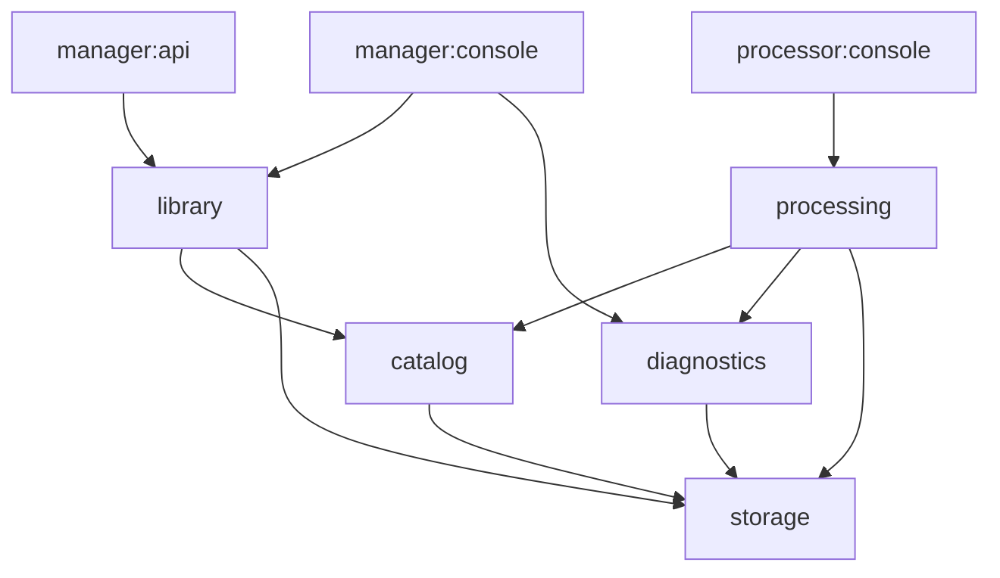

# backend のモジュール境界と公開契約

対象 Issue: [#129](https://github.com/pinfort/tsvideos/issues/129) / 親 Issue: [#128](https://github.com/pinfort/tsvideos/issues/128)

状態: 確定 (#129)。親 Issue #128 の分割方針を、2026-10-19 時点の実装と照合して具体化したもの。以降の子 Issue (#130〜#139) はこの文書を正本として作業し、設計を変えた場合はこの文書を同じ PR で更新する。

この文書では、**現状** (いまのコードがそうなっている事実) と**契約** (移行後に守る取り決め) を区別して書く。「契約」と明記していない記述は現状の説明である。この文書自体はコードもビルド設定も変更しない。

## 目次

1. [前提と移行規則](#1-前提と移行規則)
2. [目標モジュールと依存方向](#2-目標モジュールと依存方向)
3. [現状の組み立て](#3-現状の組み立て)
4. [現行コードの所属先](#4-現行コードの所属先)
5. [DB の所有権とモジュールをまたぐ SQL](#5-db-の所有権とモジュールをまたぐ-sql)
6. [ProgramCommand と CreatedFileCommand の公開操作](#6-programcommand-と-createdfilecommand-の公開操作)
7. [トランザクションと協調操作](#7-トランザクションと協調操作)
8. [NAS (storage) の公開契約](#8-nas-storage-の公開契約)
9. [動画の HTTP 配信](#9-動画の-http-配信)
10. [NAS と DB の失敗時の責任](#10-nas-と-db-の失敗時の責任)
11. [各モジュールの公開操作と結果型 (契約)](#11-各モジュールの公開操作と結果型-契約)
12. [子 Issue への引き継ぎ](#12-子-issue-への引き継ぎ)
13. [未決事項](#13-未決事項)

## 1. 前提と移行規則

親 Issue #128 の方針をそのまま維持する。

- 実行アプリは `manager:api`、`manager:console`、`processor:console` の 3 つのまま。DB は 1 つで、デプロイ方式も変えない。
- API 応答、CLI の出力と終了コード、dry-run、ロック、claim、復旧、中断、NAS の安全性、DB スキーマの意味を変えない。
- 原則 1 Issue = 1 PR。各段階でビルドとテストが通る状態を保つ。ファイルの移動と振る舞いの変更を同じ PR に混ぜず、テストと文書は移動と一緒に移す。
- 業務責務を第一の分割軸にする。各機能モジュールの内部を `api` / `application` / `domain` / `persistence` のパッケージに分けるが、それぞれを Gradle モジュールにはしない。
- 新たな汎用 common モジュールを受け皿にしない。

移行中の依存規則 (契約):

- **抽出済みの新モジュールから旧モジュール (`core`、`processor:infrastructure`、`manager:infrastructure`) への依存は禁止する。** 新モジュールが旧 core の型を必要とする場合は、その型の所有先をこの文書で決め、同じ PR で一緒に移す。
- 旧モジュールから抽出済みモジュールへの依存は許す (旧 core → storage など)。依存は常にこの片方向に限る。
- 境界の自動チェックはモジュールを抽出する PR で追加する (§11.7)。

## 2. 目標モジュールと依存方向

| モジュール | 責務 | 主な依存先 |
| --- | --- | --- |
| `catalog` | 録画・番組・分割ファイル・作成ファイルの台帳 (`executed_file` / `program` / `splitted_file` / `created_file`) と検出タグ/実施記録。両アプリが使う記録の整合性と、台帳行のロック・削除・移動の協調操作 | `storage` |
| `library` | 検索の用途別ビュー、統計、手動タグ/コレクション、重複レビュー、一括操作、クリーンアップ、ライブラリ健全性 | `catalog`, `storage` |
| `processing` | pipeline、ジョブ所有権、履歴、品質判定、再試行、中断、検証付きアップロード、reset、preflight、外部録画ツール・shell・Slack | `catalog`, `storage`, `diagnostics` |
| `storage` | NAS 上の読み出し・一時作成・検証・置換しない rename・削除・存在/サイズ確認。Samba (jcifs) 実装と NAS 設定 | 業務モジュールに依存しない |
| `diagnostics` | DB/NAS の環境診断と診断結果。Spring が起動できなくても使える入口 | `storage` |
| `database-schema` | 番号付き migration、テスト DDL 生成、DB テスト用資源。スキーマの単一の情報源 | 依存なし (データ操作 API を提供しない) |
| `console-common` (既存) | 両 CLI の端末 I/O | 業務モジュールに依存しない |

`processing` は `processor:infrastructure` と処理専用の core コードを統合した後継である。`manager:infrastructure` (Kotlin ソースなし、空の `application-infrastructure.yaml` のみ) は削除する。移行の完了時に `core` を廃止する。

矢印はコンパイル時依存 (契約)。

許可する依存と禁止する依存 (契約):

| 依存元 | 許可 | 禁止 |
| --- | --- | --- |
| `storage` | (業務モジュールなし) | すべての業務モジュール |
| `diagnostics` | `storage` | `catalog`, `library`, `processing` |
| `catalog` | `storage` | `library`, `processing`, `diagnostics` |
| `library` | `catalog`, `storage` | `processing`, `diagnostics` |
| `processing` | `catalog`, `storage`, `diagnostics` | `library` |
| `database-schema` | なし | すべて |
| `manager:api`, `manager:console` | 組み立て用に `library`, `catalog`, `storage`, `diagnostics`, `console-common` (console のみ) | `processing` (TsSplitter/Amatsukaze/tsselect と処理専用設定を実行時に含めない) |
| `processor:console` | 組み立て用に `processing`, `catalog`, `storage`, `diagnostics`, `console-common` | `library` |

上の図は親 Issue と同じく、実行アプリが設定や Bean を組み立てるための依存を省略している。実行アプリは表の「許可」の範囲で下位モジュールに直接依存してよい。`database-schema` は本番の依存先にならず、DB 統合テストの `testImplementation` からだけ参照する。

## 3. 現状の組み立て

Gradle モジュール ([settings.gradle.kts](../settings.gradle.kts)) とコンパイル時依存:

| モジュール | 依存 | 備考 |
| --- | --- | --- |
| `core` | jcifs-ng, mybatis-spring-boot, MariaDB driver (runtime) | `generateVersionProperties` と `generateTestDdl` タスクもここにある ([build.gradle.kts](../core/build.gradle.kts)) |
| `console-common` | なし | |
| `manager:infrastructure` | `core` | Kotlin ソースなし |
| `manager:api` | `core`, `manager:infrastructure` | [build.gradle.kts](../manager/api/build.gradle.kts) |
| `manager:console` | `core`, `console-common`, `manager:infrastructure` | [build.gradle.kts](../manager/console/build.gradle.kts) |
| `processor:infrastructure` | `core`, `me.pinfort:tsselect` | [build.gradle.kts](../processor/infrastructure/build.gradle.kts) |
| `processor:console` | `core`, `console-common`, `processor:infrastructure` | [build.gradle.kts](../processor/console/build.gradle.kts) |

Spring の組み立て:

- 3 つの実行アプリはすべて `scanBasePackages` に `me.pinfort.tsvideos.core` を含め、`@MapperScan("me.pinfort.tsvideos.core.external.database.mapper")` で全 Mapper を登録する ([ApiApplication](../manager/api/src/main/kotlin/me/pinfort/tsvideos/manager/api/ApiApplication.kt) と [MyBatisConfig](../manager/api/src/main/kotlin/me/pinfort/tsvideos/manager/api/config/MyBatisConfig.kt)、manager の [ConsoleApplication](../manager/console/src/main/kotlin/me/pinfort/tsvideos/manager/console/ConsoleApplication.kt)、processor の [ConsoleApplication](../processor/console/src/main/kotlin/me/pinfort/tsvideos/processor/console/ConsoleApplication.kt))。そのため **manager の 2 アプリにも `TsSplitterClient`、`AmatsukazeAddTaskClient`、`ProcessorToolConfigurationProperties` などの処理専用 Bean が登録される**。これが親 Issue の完了条件「manager の実行時依存に処理専用ツール/設定が入らない」に反する現状の主因である。
- `@ConfigurationPropertiesScan` は `me.pinfort.tsvideos.core.config` (manager はさらに存在しない `manager.infrastructure.config`) を対象にする。
- 設定は [application-core.yaml](../core/src/main/resources/application-core.yaml) に `spring.datasource`、`samba`、`processor-tool`、`processor-preflight` がまとめて入り、各アプリが `core` プロファイルを include する ([core の application.yaml](../core/src/main/resources/application.yaml)、[processor:console](../processor/console/src/main/resources/application.yaml)、[manager:console](../manager/console/src/main/resources/application.yaml)、[manager:api](../manager/api/src/main/resources/application.yml))。両 CLI は `lazy-initialization: true` を使う ([processor](../processor/console/src/main/resources/application-console.yaml)、[manager](../manager/console/src/main/resources/application-console.yaml))。
- `manager:console doctor` と `processor:console preflight` (および `process` の事前ゲート) は Spring コンテキストを作らずに診断部品を手で組み立てる ([DoctorBootstrap](../manager/console/src/main/kotlin/me/pinfort/tsvideos/manager/console/DoctorBootstrap.kt)、[PreflightBootstrap](../processor/console/src/main/kotlin/me/pinfort/tsvideos/processor/console/PreflightBootstrap.kt))。
- DataSource は Spring Boot 自動構成の Hikari 1 つ (`auto-commit: false`、最大 10 接続)。`PlatformTransactionManager` もアプリごとに自動構成の 1 つだけで、独自の DataSource/TransactionManager/SqlSessionFactory の Bean 定義はない。独自の `@Bean` は [LoggerConfig](../core/src/main/kotlin/me/pinfort/tsvideos/core/config/LoggerConfig.kt) の注入先ごとの slf4j `Logger` だけである。

## 4. 現行コードの所属先

本番ソースの全 Command・Mapper・DTO・設定・外部クライアントと、それらが使う補助クラスの移動先 (契約)。パスの基点は `core/src/main/kotlin/me/pinfort/tsvideos/core/` (`core/…` と略記) と `processor/infrastructure/src/main/kotlin/me/pinfort/tsvideos/processor/infrastructure/` (`pi/…` と略記)。「分割」は 1 つのクラスを複数の移動先に分けることを表す。

### 4.1 Command

| 現行クラス | 移動先 | 補足 |
| --- | --- | --- |
| [ProgramCommand](../core/src/main/kotlin/me/pinfort/tsvideos/core/command/ProgramCommand.kt) | `catalog` (分割) | 読み取り、登録/状態更新、協調削除/移動を用途別の公開操作に分ける (§6.1)。検索のライブラリ絞り込みは §13 U1 |
| [CreatedFileCommand](../core/src/main/kotlin/me/pinfort/tsvideos/core/command/CreatedFileCommand.kt) | `catalog` + `storage` + `manager:api` (分割) | 登録・削除・移動は catalog、NAS 操作は storage、HTTP の `Resource` 組み立ては manager:api (§6.2、§9) |
| [ExecutedFileCommand](../core/src/main/kotlin/me/pinfort/tsvideos/core/command/ExecutedFileCommand.kt) | `catalog` | `delete` はタグ/実施記録も消す |
| [SplittedFileCommand](../core/src/main/kotlin/me/pinfort/tsvideos/core/command/SplittedFileCommand.kt) | `catalog` | |
| [ExecutedFileTagCommand](../core/src/main/kotlin/me/pinfort/tsvideos/core/command/ExecutedFileTagCommand.kt) | `catalog` | 検出タグ。手動タグ (library) とは別物 |
| [BulkLibraryCommand](../core/src/main/kotlin/me/pinfort/tsvideos/core/command/BulkLibraryCommand.kt) | `library` | ロック取得と削除/移動は catalog の協調操作を呼ぶ形にする (§7.3) |
| [CleanupPlanCommand](../core/src/main/kotlin/me/pinfort/tsvideos/core/command/CleanupPlanCommand.kt) | `library` | |
| [DuplicateProgramCommand](../core/src/main/kotlin/me/pinfort/tsvideos/core/command/DuplicateProgramCommand.kt) | `library` | `ProgramMapper.selectAll` の代わりに catalog の読み取り操作を使う |
| [DuplicateReviewCommand](../core/src/main/kotlin/me/pinfort/tsvideos/core/command/DuplicateReviewCommand.kt) | `library` | `CreatedFileMapper.selectMovedByExecutedFileIds` の代わりに catalog の読み取り操作を使う |
| [LibraryOrganizationCommand](../core/src/main/kotlin/me/pinfort/tsvideos/core/command/LibraryOrganizationCommand.kt) | `library` | `program` 行のロックは catalog の操作を使う (§5.3) |
| [LibraryStatsCommand](../core/src/main/kotlin/me/pinfort/tsvideos/core/command/LibraryStatsCommand.kt) | `library` | 集計クエリは catalog の用途別読み取り操作にする (§5.2) |
| [StorageOverviewCommand](../core/src/main/kotlin/me/pinfort/tsvideos/core/command/StorageOverviewCommand.kt) | `library` | 同上 |
| [LibraryVerificationCommand](../core/src/main/kotlin/me/pinfort/tsvideos/core/command/LibraryVerificationCommand.kt) | `library` | NAS の低レベル確認は storage の `NasFileVerifier` 後継を使う |
| [LibraryHealthCommand / LibraryHealthScanCommand](../core/src/main/kotlin/me/pinfort/tsvideos/core/command/LibraryHealthCommand.kt) | `library` | |
| [HealthVerificationStore](../core/src/main/kotlin/me/pinfort/tsvideos/core/command/HealthVerificationStore.kt) | `library` | |
| [EnvironmentDiagnosticCommand](../core/src/main/kotlin/me/pinfort/tsvideos/core/command/EnvironmentDiagnosticCommand.kt) | `diagnostics` | Spring なしで構築できる状態を保つ |
| [ProcessingPreflightCommand](../core/src/main/kotlin/me/pinfort/tsvideos/core/command/ProcessingPreflightCommand.kt) | `processing` | diagnostics の `EnvironmentDiagnosticCommand` とツール検査を組み立てる |
| [ProcessingJobCommand](../core/src/main/kotlin/me/pinfort/tsvideos/core/command/ProcessingJobCommand.kt) / [ProcessingJobClaimCommand](../core/src/main/kotlin/me/pinfort/tsvideos/core/command/ProcessingJobClaimCommand.kt) | `processing` | |
| [ProcessingHistoryCommand](../core/src/main/kotlin/me/pinfort/tsvideos/core/command/ProcessingHistoryCommand.kt) | `processing` | |
| [RecordingQualityCommand](../core/src/main/kotlin/me/pinfort/tsvideos/core/command/RecordingQualityCommand.kt) | `processing` | |
| [VerifiedUploadCommand](../core/src/main/kotlin/me/pinfort/tsvideos/core/command/VerifiedUploadCommand.kt) | `processing` | claim・REGISTERED 判定・ローカル削除許可は processing が所有。NAS 操作は storage、`created_file` 登録は catalog (§7.6) |

### 4.2 Mapper と SQL

| 現行 Mapper | 参照するテーブル (書き込みは太字) | 移動先 |
| --- | --- | --- |
| [ProgramMapper](../core/src/main/kotlin/me/pinfort/tsvideos/core/external/database/mapper/ProgramMapper.kt) + [ProgramSearchSql](../core/src/main/kotlin/me/pinfort/tsvideos/core/external/database/mapper/ProgramSearchSql.kt) | **program**, executed_file, splitted_file, created_file, library_collection_program, library_tag_program | `catalog`。検索 SQL の library テーブル参照は catalog 抽出 (#135) より前に外す (§13 U1) |
| [ExecutedFileMapper](../core/src/main/kotlin/me/pinfort/tsvideos/core/external/database/mapper/ExecutedFileMapper.kt) | **executed_file** | `catalog` |
| [SplittedFileMapper](../core/src/main/kotlin/me/pinfort/tsvideos/core/external/database/mapper/SplittedFileMapper.kt) | **splitted_file** | `catalog` |
| [CreatedFileMapper](../core/src/main/kotlin/me/pinfort/tsvideos/core/external/database/mapper/CreatedFileMapper.kt) | **created_file**, splitted_file | `catalog` |
| [ExecutedFileTagMapper](../core/src/main/kotlin/me/pinfort/tsvideos/core/external/database/mapper/ExecutedFileTagMapper.kt) / [ExecutedFileCheckMapper](../core/src/main/kotlin/me/pinfort/tsvideos/core/external/database/mapper/ExecutedFileCheckMapper.kt) | **executed_file_tag**, **executed_file_check** | `catalog` |
| [BulkLibraryMapper](../core/src/main/kotlin/me/pinfort/tsvideos/core/external/database/mapper/BulkLibraryMapper.kt) | program, executed_file, splitted_file, created_file (読み取りと `FOR UPDATE`) | `catalog` (ロックと一括スナップショットの読み取りは台帳行に対する操作のため。library は公開操作経由で使う) |
| [StorageOverviewMapper](../core/src/main/kotlin/me/pinfort/tsvideos/core/external/database/mapper/StorageOverviewMapper.kt) | program, splitted_file, created_file | `catalog` の用途別読み取り操作 (library 向け) |
| [LibraryStatsMapper](../core/src/main/kotlin/me/pinfort/tsvideos/core/external/database/mapper/LibraryStatsMapper.kt) | program, executed_file, splitted_file, created_file | `catalog` の用途別読み取り操作 (library 向け) |
| [LibraryOrganizationMapper](../core/src/main/kotlin/me/pinfort/tsvideos/core/external/database/mapper/LibraryOrganizationMapper.kt) + [LibraryOrganizationSql](../core/src/main/kotlin/me/pinfort/tsvideos/core/external/database/mapper/LibraryOrganizationSql.kt) | **library_collection**, **library_tag**, **library_collection_program**, **library_tag_program**, program (件数/絞り込みの JOIN、`lockProgram` の `FOR UPDATE`、`findProgram`) | `library`。`lockProgram`/`findProgram` は catalog の操作に置き換え、JOIN は §5.2 の明示的な参照クエリとして残す |
| [LibraryHealthMapper](../core/src/main/kotlin/me/pinfort/tsvideos/core/external/database/mapper/LibraryHealthMapper.kt) | **health_verification_run**, **health_verification_finding**, program, executed_file | `library`。`failedPrograms` / `droppedPrograms` は catalog の読み取り操作に置き換える。`findingPrograms` は `health_verification_finding` の subquery を含むため SQL ごと catalog へは移さず、library が自分の findings から program ID を得て catalog の複数 ID 取得を呼ぶ形に分ける (§5.2) |
| [ProcessingJobMapper](../core/src/main/kotlin/me/pinfort/tsvideos/core/external/database/mapper/ProcessingJobMapper.kt) | **processing_job** | `processing` |
| [ProcessingHistoryMapper](../core/src/main/kotlin/me/pinfort/tsvideos/core/external/database/mapper/ProcessingHistoryMapper.kt) | **processing_history_identity**, **processing_attempt**, **processing_stage_event**, processing_job | `processing` |
| [RecordingQualityMapper](../core/src/main/kotlin/me/pinfort/tsvideos/core/external/database/mapper/RecordingQualityMapper.kt) | **processing_quality_report**, **processing_job**, processing_attempt | `processing` |
| [UploadManifestMapper](../core/src/main/kotlin/me/pinfort/tsvideos/core/external/database/mapper/UploadManifestMapper.kt) | **upload_manifest** | `processing` |
| [GeneratedKeyHolder](../core/src/main/kotlin/me/pinfort/tsvideos/core/external/database/mapper/GeneratedKeyHolder.kt) | — | 永続化を持つ各モジュールの `persistence` に internal で複製する (数行の補助型を共有モジュールにしない) |

Mapper は XML を使わず、すべてアノテーションまたは `*Sql` プロバイダで定義されている。移動時に MyBatis の namespace を書き換える XML はない。

### 4.3 DTO

| 現行 DTO | 移動先 | 補足 |
| --- | --- | --- |
| [ProgramDto](../core/src/main/kotlin/me/pinfort/tsvideos/core/external/database/dto/ProgramDto.kt), [ExecutedFileDto](../core/src/main/kotlin/me/pinfort/tsvideos/core/external/database/dto/ExecutedFileDto.kt), [SplittedFileDto](../core/src/main/kotlin/me/pinfort/tsvideos/core/external/database/dto/SplittedFileDto.kt), [CreatedFileDto](../core/src/main/kotlin/me/pinfort/tsvideos/core/external/database/dto/CreatedFileDto.kt), [ExecutedCreatedFileDto](../core/src/main/kotlin/me/pinfort/tsvideos/core/external/database/dto/ExecutedCreatedFileDto.kt) | `catalog` (internal) | **現状、`ExecutedFileDto`/`SplittedFileDto`/`CreatedFileDto` は [BulkSnapshot](../core/src/main/kotlin/me/pinfort/tsvideos/core/domain/BulkPlan.kt) を通じて `POST /api/v1/programs/bulk/preview` の JSON にそのまま出ている**。catalog の公開スナップショット型に置き換えるときは、JSON のプロパティ名・値・enum 名を変えない |
| [StatsDto](../core/src/main/kotlin/me/pinfort/tsvideos/core/external/database/dto/StatsDto.kt) (`StatsProgramDto`, `StatsFileDto`), [StorageReferenceDto](../core/src/main/kotlin/me/pinfort/tsvideos/core/external/database/dto/StorageReferenceDto.kt) | `catalog` (internal) | catalog の用途別読み取り操作の結果型に変換して公開する |
| [HealthDto](../core/src/main/kotlin/me/pinfort/tsvideos/core/external/database/dto/HealthDto.kt) (`HealthRunDto`, `HealthFindingDto`) | `library` (internal) | |

`ProcessingJob` や `UploadManifest` など processing の Mapper は DTO を介さずドメイン型へ直接マップしている。processing 内部に閉じるのでそのままでよい。

### 4.4 設定

| 現行 | 設定キー | 移動先 |
| --- | --- | --- |
| `spring.datasource.*` ([application-core.yaml](../core/src/main/resources/application-core.yaml)) | `DATABASE_*` | 実行アプリ (DataSource は §7.1 の共有契約) |
| [SambaConfigurationProperties](../core/src/main/kotlin/me/pinfort/tsvideos/core/config/SambaConfigurationProperties.kt) | `samba.*` | `storage` |
| [ProcessorToolConfigurationProperties](../core/src/main/kotlin/me/pinfort/tsvideos/core/config/ProcessorToolConfigurationProperties.kt) | `processor-tool.*` | `processing` |
| [ProcessingRetryConfigurationProperties](../core/src/main/kotlin/me/pinfort/tsvideos/core/config/ProcessingRetryConfigurationProperties.kt) | `processor-retry.*` | `processing` |
| [RecordingQualityConfigurationProperties](../core/src/main/kotlin/me/pinfort/tsvideos/core/config/RecordingQualityConfigurationProperties.kt) | `processor-quality.*` | `processing` |
| `processor-preflight.space-multiplier` (`ProcessingPreflightCommand` が `Environment` から読む) | | `processing` |
| `processor.upload.verify-sha256` (`VerifiedUploadCommand` の `@Value`) | | `processing` |
| `processor.shutdown.grace-seconds` ([ConsoleRunner](../processor/console/src/main/kotlin/me/pinfort/tsvideos/processor/console/ConsoleRunner.kt)) | | `processor:console` (現状どおり) |
| `SLACK_WEBHOOK_URL` ([SlackClient](../processor/infrastructure/src/main/kotlin/me/pinfort/tsvideos/processor/infrastructure/external/slack/SlackClient.kt)) | | `processing` |
| [DiagnosticEnvironment](../core/src/main/kotlin/me/pinfort/tsvideos/core/config/DiagnosticEnvironment.kt) | 引数・環境変数の解釈 | `diagnostics` |
| [LoggerConfig](../core/src/main/kotlin/me/pinfort/tsvideos/core/config/LoggerConfig.kt) | — | 実行アプリ。モジュールは slf4j の `Logger` 型の注入だけを要求し、Bean 定義には依存しない |

`application-core.yaml` は移行中に分割する。manager の実行アプリは `processor-tool` / `processor-preflight` を含む設定を include しない状態にする (#138、#139)。

### 4.5 外部クライアント

| 現行クラス | 外部 | 移動先 |
| --- | --- | --- |
| [SambaClient](../core/src/main/kotlin/me/pinfort/tsvideos/core/external/samba/SambaClient.kt) | jcifs | `storage` (internal 実装) |
| [NasComponent](../core/src/main/kotlin/me/pinfort/tsvideos/core/external/samba/NasComponent.kt) | jcifs | `storage` |
| [VerifiedUploadNas](../core/src/main/kotlin/me/pinfort/tsvideos/core/external/samba/VerifiedUploadNas.kt) | jcifs | `storage` |
| [NasFileVerifier](../core/src/main/kotlin/me/pinfort/tsvideos/core/external/samba/NasFileVerifier.kt) | jcifs | `storage` |
| [SmbFileResource](../core/src/main/kotlin/me/pinfort/tsvideos/core/external/samba/SmbFileResource.kt) | jcifs + Spring `Resource` | 廃止。storage の読み出しハンドルを `manager:api` が `Resource` に包む (§9) |
| [DiagnosticNasClient](../core/src/main/kotlin/me/pinfort/tsvideos/core/external/samba/DiagnosticNasClient.kt) | jcifs (短いタイムアウト付きの独立コンテキスト) | `storage` (Spring なしで使える接続口として公開) |
| [ShellClient](../core/src/main/kotlin/me/pinfort/tsvideos/core/external/shell/ShellClient.kt), [ShellComponent](../core/src/main/kotlin/me/pinfort/tsvideos/core/external/shell/ShellComponent.kt), [ShellResult](../core/src/main/kotlin/me/pinfort/tsvideos/core/external/shell/ShellResult.kt) | OS プロセス | `processing` |
| [TsSplitterClient](../core/src/main/kotlin/me/pinfort/tsvideos/core/external/tool/TsSplitterClient.kt), [AmatsukazeAddTaskClient](../core/src/main/kotlin/me/pinfort/tsvideos/core/external/tool/AmatsukazeAddTaskClient.kt) | Windows 専用ツール | `processing` |
| [DurationProbeClient](../core/src/main/kotlin/me/pinfort/tsvideos/core/external/tool/DurationProbeClient.kt), [RecordingStreamProbeClient](../core/src/main/kotlin/me/pinfort/tsvideos/core/external/tool/RecordingStreamProbeClient.kt), [VideoResolutionProbeClient](../core/src/main/kotlin/me/pinfort/tsvideos/core/external/tool/VideoResolutionProbeClient.kt) | ffprobe | `processing` |
| [TsSelectClient](../processor/infrastructure/src/main/kotlin/me/pinfort/tsvideos/processor/infrastructure/external/tsselect/TsSelectClient.kt) | `me.pinfort:tsselect` | `processing` |
| [EmergencyBroadcastDetector](../processor/infrastructure/src/main/kotlin/me/pinfort/tsvideos/processor/infrastructure/external/ts/EmergencyBroadcastDetector.kt), [AribCaptionData](../processor/infrastructure/src/main/kotlin/me/pinfort/tsvideos/processor/infrastructure/external/ts/AribCaptionData.kt), [TsUtil](../processor/infrastructure/src/main/kotlin/me/pinfort/tsvideos/processor/infrastructure/external/ts/TsUtil.kt) | TS 解析 (JVM 内) | `processing` |
| [SlackClient](../processor/infrastructure/src/main/kotlin/me/pinfort/tsvideos/processor/infrastructure/external/slack/SlackClient.kt) | Slack webhook | `processing` |

### 4.6 補助部品・ドメイン型・例外

| 現行 | 移動先 |
| --- | --- |
| `core/domain`: `Program`, `ProgramDetail`, `ExecutedFile`, `SplittedFile`, `CreatedFile`, `VideoResolution`, `ExecutedFileTag`/`ExecutedFileCheck`, `ProgramSearchQuery`/`ProgramSearchPage` | `catalog` (`ProgramSearchQuery` の `collectionId`/`libraryTagId` は §13 U1) |
| `core/domain`: `BulkPlan` 一式, `CleanupPlan` 一式, `DuplicateGroup`, `DuplicateReview`, `LibraryOrganization`, `LibraryStats`, `StorageOverview`, `LibraryHealth`, `VerificationReport` (`FileFinding`, `VerificationReport`) | `library` |
| `core/domain`: `VerificationStatus` | `storage` の低レベル結果型と library の結果型に分ける (§13 U2) |
| `core/domain`: `ProcessingJob`/`ProcessingIdentity`, `ProcessingHistory` 一式, `RecordingQuality` 一式, `RecordingQualityReport`, `UploadManifest`/`VerifiedUploadReceipt`, `FileName` | `processing` (`UploadManifest.nasType` は storage の公開値型に置き換える) |
| `core/domain`: `DiagnosticReport` 一式 | `diagnostics` |
| `core/domain`: `Sha256` (`hex`, `sha256Hex`) | `storage` (NAS 側のハッシュ計算に必要。processing は storage 経由で使う) |
| `core/component`: `DirectoryNameComponent`, `NormalizeComponent` | `catalog` (移動先パスの規則。library と processing も catalog 経由で使う) |
| `core/component`: `CompressComponent`, `MainSplittedFileFinderComponent`, `NasDestinationResolver`, `MimeTypeComponent`, `ValidateCompletedComponent`, `ProcessingCancellation`, `ProcessingRetry` 一式, `RecordingQualityInspector`, `RecordingInputs`, `LocalPreflightProbe`/`EncoderConnectivityProbe`, `RunningPlatformComponent` | `processing` |
| `core/component`: `DatabaseDiagnosticProbe`, `NasDiagnosticProbe`, `DiagnosticCancellation` | `diagnostics` (`NasDiagnosticProbe` が直接使う jcifs は storage の接続口に置き換える) |
| `core/exception`: `TsVideosException`, `InvalidFileNameException`, `InvalidEnvironmentException`, `ShellCommandTimeoutException`, `QualityReleaseRefusedException` | `processing` (利用者がすべて processing 側) |
| [ApplicationVersion](../core/src/main/kotlin/me/pinfort/tsvideos/core/version/ApplicationVersion.kt) と `generateVersionProperties` | 両 CLI 用。置き場所は §13 U3 |
| `pi/pipeline/*` (`FileProcessingPipeline`, `AfterEncodeRunner`, `PathProcessingRunner`, `ResetRunner`, `RollbackRunner`) | `processing` |
| [db/migrations](../core/src/main/resources/db/migrations/), `generateTestDdl`, `core/src/test/resources/ddl/02_insert_data.sql` | `database-schema` |
| [db/maintenance/processing_history_cleanup.sql](../core/src/main/resources/db/maintenance/processing_history_cleanup.sql) | 配布は `database-schema`、対象テーブルの所有は `processing` |

`manager:api`、`manager:console`、`processor:console` の Kotlin ソース (controller・response・CLI コマンド・Bootstrap・表示部品) は実行アプリに残る。

## 5. DB の所有権とモジュールをまたぐ SQL

### 5.1 テーブルの所有者 (契約)

DDL は [db/migrations](../core/src/main/resources/db/migrations/) にあり、`database-schema` が配布する。データの読み書き API は所有モジュールだけが提供する。

| テーブル | migration | 所有 |
| --- | --- | --- |
| `executed_file`, `splitted_file`, `created_file`, `program` | [001](../core/src/main/resources/db/migrations/001_base_schema.sql), [073](../core/src/main/resources/db/migrations/073_created_file_resolution.sql) | `catalog` |
| `executed_file_tag`, `executed_file_check` | [002](../core/src/main/resources/db/migrations/002_executed_file_tag.sql) | `catalog` |
| `health_verification_run`, `health_verification_finding` | [051](../core/src/main/resources/db/migrations/051_library_health.sql) | `library` |
| `library_collection`, `library_tag`, `library_collection_program`, `library_tag_program` | [053](../core/src/main/resources/db/migrations/053_library_organization.sql) | `library` |
| `processing_job` | [064](../core/src/main/resources/db/migrations/064_processing_job.sql) | `processing` |
| `processing_history_identity`, `processing_attempt`, `processing_stage_event` | [067](../core/src/main/resources/db/migrations/067_processing_history.sql) | `processing` |
| `processing_quality_report` | [071](../core/src/main/resources/db/migrations/071_recording_quality.sql) | `processing` |
| `upload_manifest` | [072](../core/src/main/resources/db/migrations/072_upload_manifest.sql) | `processing` |

### 5.2 モジュールをまたぐ読み取り

現状、所有者以外のテーブルを読む SQL は次のとおり。

| SQL | 呼び出し元 (現状の所属) | 読む他モジュールのテーブル | 契約での扱い |
| --- | --- | --- | --- |
| `ProgramSearchSql` の `collectionId`/`libraryTagId` 条件 | `ProgramCommand.search` (catalog) | library_collection_program, library_tag_program | **catalog から library への逆向き参照**。#135 より前に解消する (§13 U1) |
| `LibraryOrganizationSql.select` / `forProgram`、`findProgram` | `LibraryOrganizationCommand` (library) | program | library 所有の明示的な参照クエリとして残してよい (件数と絞り込みの JOIN のみ)。`findProgram` は catalog の存在確認操作に置き換える |
| `LibraryHealthMapper.failedPrograms` / `droppedPrograms` | `LibraryHealthCommand` (library) | program, executed_file | catalog の用途別読み取り操作 (状態/ドロップによる番組一覧) に置き換える |
| `LibraryHealthMapper.findingPrograms` | `LibraryHealthCommand.read` (library) | program, executed_file (条件に library 所有の `health_verification_finding` の subquery を含む) | **SQL ごと catalog へ移すと catalog が library のテーブルを参照する逆依存になるため移さない。** library が自分の Mapper で対象 run の findings (`program_id` を含む) を読み、その program ID 集合で catalog の「複数 ID による番組取得」(存在しない ID は結果に含めない) を呼ぶ。両方の読み取りは `LibraryHealthCommand.read` の `readOnly` + `REPEATABLE_READ` トランザクション内で行い、catalog の操作は `REQUIRED` で参加するので同じ read snapshot になる。結果に含まれない ID を「削除済みの番組」(`programRemoved`) とする現状の判定と、名前・並び順を変えない。ID が空なら catalog を呼ばない。library の参照クエリとしては残さない |
| `LibraryStatsMapper.programs` / `files` | `LibraryStatsCommand` (library) | program, executed_file, splitted_file, created_file | catalog の用途別集計操作にする (全件取得してアプリ側で集計し直さない) |
| `StorageOverviewMapper.references` | `StorageOverviewCommand` (library) | program, splitted_file, created_file | 同上 |
| `ProgramMapper.selectAll` / `selectAllIds` / `selectAllOrderById` | `DuplicateProgramCommand`, `CleanupPlanCommand`, `LibraryVerificationCommand` (library) | program, executed_file | catalog の読み取り操作 |
| `CreatedFileMapper.selectMovedByExecutedFileIds` / `selectAllWithExecutedFileId` | `DuplicateReviewCommand`, `LibraryVerificationCommand` (library) | created_file, splitted_file | catalog の読み取り操作 |
| `BulkLibraryMapper` の読み取り (`allFiles`, `createdFilesOfPrograms`, `references`) と `ExecutedFileMapper`/`SplittedFileMapper`/`CreatedFileMapper` の直接使用 | `BulkLibraryCommand` (library) | catalog の全テーブル | catalog の一括スナップショット操作 (§11.1) |
| `CreatedFileMapper.find` | `VerifiedUploadCommand` (processing) | created_file | catalog の読み取り操作 |

読み取りの契約:

- 台帳テーブルだけで完結する集計・一覧は catalog が用途別の読み取り操作として提供する。結果型は catalog の公開型で、Mapper/DTO を公開しない。
- 機能所有テーブルと台帳テーブルの JOIN が必要な読み取りは、機能を所有するモジュール (現状は library だけ) の persistence に置く**明示的な参照クエリ**に限る。この文書の表に載っているものだけを許し、追加する場合は表を更新する。参照クエリは読み取り専用で、台帳テーブルにロックをかけない。
- catalog の SQL は library/processing のテーブルを参照しない。

### 5.3 モジュールをまたぐ書き込み・ロック・FK

現状の書き込み経路 (他モジュールの所有テーブルへの書き込み):

| 経路 | 書き込み先 | 呼び出し元 |
| --- | --- | --- |
| `ExecutedFileCommand.insert` / `updateStatus` / `delete`、`ProgramCommand.insert` / `deleteByExecutedFileId` / `updateStatusByExecutedFileId` / `delete`、`SplittedFileCommand.insert` / `updateStatus` / `delete`、`ExecutedFileTagCommand.recordCheck` | catalog | processing (`FileProcessingPipeline`, `AfterEncodeRunner`, `ResetRunner`) |
| `CreatedFileCommand.insert`、`CreatedFileMapper.updateMimeIfMissing` / `updateResolutionIfMissing` (Mapper の直接使用) | created_file | processing (`VerifiedUploadCommand.register`) |
| `ProgramCommand.delete` / `moveCreatedFiles`、`CreatedFileCommand.delete` | catalog の全テーブル + NAS | library (`BulkLibraryCommand`)、manager:console (`Delete`, `Modify`) |
| `BulkLibraryMapper.lock*` (`SELECT … FOR UPDATE`) | catalog の行ロック | library (`BulkLibraryCommand`) |
| `LibraryOrganizationMapper.lockProgram` (`SELECT … FOR UPDATE`) | program の行ロック | library (`LibraryOrganizationCommand`) |
| FK `ON DELETE CASCADE` | library_collection_program, library_tag_program | catalog の `program` 削除 (`ProgramMapper.deleteById` / `deleteByExecutedFileId`) |

書き込みの契約:

- **他モジュールのテーブルへの書き込みは禁止する。** 書き込みは所有モジュールの公開操作を通す。processing と library は catalog の公開操作で台帳を変更し、catalog の Mapper を参照しない。
- 台帳行のロックも catalog の公開操作として提供する (§7.3)。library が `FOR UPDATE` の SQL を持たない。
- 唯一の例外として、`library_collection_program` / `library_tag_program` の `program_id` → `program(id)` の `ON DELETE CASCADE` を維持する。これは catalog のコードが library を知らずに済む宣言的な追従であり、catalog は library のテーブルを SQL で触らない。library は「番組が消えると関連付けも消える」ことを前提にする。cascade と関連付け操作のデッドロックを避けるため、library は関連付けの変更で **program → label** の順にロックする (現状の `assign` / `assignTag` の順序)。
- これ以外にモジュールをまたぐ FK はない。`health_verification_finding.program_id` / `file_id`、`processing_job.executed_file_id`、`upload_manifest.created_file_id`、`processing_stage_event.artifact_id` は台帳の ID を FK なしで保持する (履歴・証拠として台帳の削除後も残す設計)。モジュールをまたぐ FK を新たに追加しない。

現状の観察 (移行で変えない): 一括操作・CLI の番組削除 (`ProgramCommand.delete`) は processing の `processing_job` / `upload_manifest` を削除しない。これらを整理するのは `tvpcli reset` だけである。移行中にこの振る舞いを変えない (§13 U6)。

## 6. ProgramCommand と CreatedFileCommand の公開操作

本番コード (`src/main`) からの呼び出しを `rg` で網羅した結果。テストだけが呼ぶ操作も明記する。

### 6.1 ProgramCommand

| 操作 | トランザクション | 本番の呼び出し元と用途 | 移行後 (契約) |
| --- | --- | --- | --- |
| `search(query)` | `readOnly`, `REPEATABLE_READ` | [ProgramController.index](../manager/api/src/main/kotlin/me/pinfort/tsvideos/manager/api/controller/ProgramController.kt) (`GET /api/v1/programs`)、[Search](../manager/console/src/main/kotlin/me/pinfort/tsvideos/manager/console/commands/Search.kt) (CLI 検索)。件数とページを同じスナップショットで返す | catalog の検索。library 絞り込みは §13 U1 |
| `selectByName(name, limit, offset)` | なし | **本番の呼び出し元なし** (テストのみ) | 移動時に削除するか残すかを #134 で決める。削除は移動と別コミットにする |
| `find(id)` | なし | ProgramController.get、[Delete](../manager/console/src/main/kotlin/me/pinfort/tsvideos/manager/console/commands/Delete.kt) (`PROGRAM`)、[Modify](../manager/console/src/main/kotlin/me/pinfort/tsvideos/manager/console/commands/Modify.kt)、[ValidateCompletedComponent](../core/src/main/kotlin/me/pinfort/tsvideos/core/component/ValidateCompletedComponent.kt)、`BulkLibraryCommand` (プレビューの対象取得、適用時のロック後の再読込) | catalog の読み取り |
| `findByName(name)` | なし | [FileProcessingPipeline](../processor/infrastructure/src/main/kotlin/me/pinfort/tsvideos/processor/infrastructure/pipeline/FileProcessingPipeline.kt) (claim 前の名前衝突確認と、`inspect` での再確認) | catalog の読み取り |
| `findByExecutedFileId(id)` | なし | [AfterEncodeRunner](../processor/infrastructure/src/main/kotlin/me/pinfort/tsvideos/processor/infrastructure/pipeline/AfterEncodeRunner.kt) (`finishProcess`)、[ResetRunner](../processor/infrastructure/src/main/kotlin/me/pinfort/tsvideos/processor/infrastructure/pipeline/ResetRunner.kt) (`run` と中断 reset の完了判定) | catalog の読み取り |
| `updateStatusByExecutedFileId(id, status, dryRun)` | なし (文単位で確定) | AfterEncodeRunner (`COMPLETED` への完了、失敗時の `ERROR`) | catalog の登録系操作 (processing 向けの状態遷移) |
| `insert(name, executedFileId, dryRun)` | なし (文単位で確定) | FileProcessingPipeline (`registerRecording`) | catalog の登録操作 |
| `deleteByExecutedFileId(id, dryRun)` | なし (文単位で確定) | FileProcessingPipeline (`rollbackRegistration` の補償) | catalog の登録取り消し操作 |
| `videoFiles(program)` | なし | ProgramController.get (`videoFiles`)、Modify (移動予定の表示) | catalog の読み取り |
| `hasTsFile(program)` | なし | Search、[Duplicates](../manager/console/src/main/kotlin/me/pinfort/tsvideos/manager/console/commands/Duplicates.kt) (番組ごとに TS の有無を表示。1 番組 1 クエリ) | catalog の読み取り |
| `findDetail(id)` | なし | ProgramController.get、[Get](../manager/console/src/main/kotlin/me/pinfort/tsvideos/manager/console/commands/Get.kt)、Delete (`TS_FILES` の対象取得) | catalog の読み取り |
| `delete(program, dryRun)` | `REQUIRED` | Delete (`PROGRAM`、CLI の単独削除)、ResetRunner (`reset`)、`BulkLibraryCommand.applyOne` (`DELETE`) | catalog の協調削除 (§7.4) |
| `moveCreatedFiles(program, dir, dryRun)` | `REQUIRED` | Modify (`DIRECTORY_NAME`)、`BulkLibraryCommand.applyOne` (`MOVE`) | catalog の協調移動 (§7.4) |

### 6.2 CreatedFileCommand

| 操作 | トランザクション | 本番の呼び出し元と用途 | 移行後 (契約) |
| --- | --- | --- | --- |
| `selectBySplittedFileId(id)` | なし | ValidateCompletedComponent (完了判定の対象ファイル) | catalog の読み取り |
| `insert(...)` | なし (呼び出し元のトランザクションに乗る) | `VerifiedUploadCommand.registerOnce` (`REQUIRES_NEW` の中でマニフェストの REGISTERED と一緒に確定) | catalog の登録操作。`MANDATORY` (§7.6) |
| `updateStatus(...)` | なし | **本番の呼び出し元なし** (テストのみ) | #131 または #134 で扱いを決める |
| `findMp4File(id)` | なし | 内部 (`streamCreatedFile`) のみ | catalog の「配信できる動画」の読み取り (§9) |
| `streamCreatedFile(id)` | なし | [VideoFileController.stream](../manager/api/src/main/kotlin/me/pinfort/tsvideos/manager/api/controller/VideoFileController.kt) (`GET /api/v1/video/{id}/stream`) | catalog の読み取り + storage の読み出し + manager:api の `Resource` に分割 (#131、§9) |
| `delete(file, dryRun)` | `REQUIRED` | `ProgramCommand.delete`、Delete (`TS_FILES`、ファイルごとに独立したトランザクション) | catalog の協調削除 (storage の削除を呼ぶ) |
| `move(file, newFile, dryRun)` | `REQUIRED` | `ProgramCommand.moveCreatedFiles` のみ | catalog の内部操作 |
| `restoreMoved(moved)` | なし | `ProgramCommand.moveCreatedFiles` のみ (失敗時の巻き戻し) | catalog の内部操作 |

`delete` / `move` は戻り値として `SambaClient.NasType` を返す。本番の呼び出し元は戻り値を使っていないが、型は storage の公開値型に置き換える (#130)。dry-run では NAS を確認せず `VIDEO_STORE_NAS` を返す。

## 7. トランザクションと協調操作

### 7.1 共有 DataSource と TransactionManager

現状:

- 各実行アプリの DataSource と `PlatformTransactionManager` は 1 つずつ (§3)。すべての `@Transactional` と `TransactionTemplate` がこれを使う。
- Spring のトランザクション外で Mapper を呼ぶと、mybatis-spring の `SqlSessionTemplate` が呼び出しごとに commit する。Hikari の `auto-commit: false` でも、**トランザクション外の Command 呼び出しは文単位で確定する**。`FileProcessingPipeline` の登録段階 (`executed_file` → `program`) や `AfterEncodeRunner` の状態更新はこの動きに依存しており、失敗時は補償 (削除) か `ERROR` 化で対処する。

契約:

- モジュールは DataSource、`PlatformTransactionManager`、`SqlSessionFactory` を定義しない。実行アプリの自動構成による 1 組を全モジュールが共有する。実行アプリは自分が組み立てるモジュールの Mapper パッケージだけを `@MapperScan` に列挙する。
- トランザクション外での文単位の確定、既存の `REQUIRES_NEW` / `NOT_SUPPORTED` の境界は、移動と同時に変えない。

### 7.2 現行のトランザクション境界

| 場所 | 伝播 / 分離レベル | 意図 |
| --- | --- | --- |
| `ProgramCommand.search`, `DuplicateReviewCommand.review`, `LibraryStatsCommand.summarize`, `StorageOverviewCommand.overview`, `LibraryHealthCommand.read`, `LibraryOrganizationCommand.forProgram` | `REQUIRED`, `readOnly`, `REPEATABLE_READ` | 1 スナップショットでの一貫した読み取り |
| `ProgramCommand.delete` / `moveCreatedFiles`, `CreatedFileCommand.delete` / `move` | `REQUIRED` | 単独で呼ばれれば独自のトランザクション、一括適用からは参加 |
| `ExecutedFileTagCommand.recordCheck`, `ProcessingJobCommand` の更新系, `RecordingQualityCommand.record` / `release`, `LibraryOrganizationCommand` の更新系 | `REQUIRED` | 各操作を 1 トランザクションで確定 |
| `ProcessingJobClaimCommand.insert` / `retry`, `HealthVerificationStore` の全操作 | `REQUIRES_NEW` | 呼び出し元と独立に確定する短い記録 |
| `ProcessingHistoryCommand` (内部の `TransactionTemplate`) | `REQUIRES_NEW` (一部 `REPEATABLE_READ`) | 履歴の書き込みを処理本体と独立に確定 |
| `BulkLibraryCommand` の `read` / `write` テンプレート | `read`: `readOnly` + `REPEATABLE_READ`。`write`: `REQUIRES_NEW` + `REPEATABLE_READ` | 対象ごとに独立したトランザクション (§7.3) |
| `CleanupPlanCommand` の `read` テンプレート | `readOnly` + `REPEATABLE_READ` | 計画生成と dry-run |
| `VerifiedUploadCommand` (クラス) | `NOT_SUPPORTED`。内部の `TransactionTemplate` は `REQUIRES_NEW` | NAS 操作中に DB トランザクションを持たない (§7.6) |

### 7.3 BulkLibraryCommand

[BulkLibraryCommand](../core/src/main/kotlin/me/pinfort/tsvideos/core/command/BulkLibraryCommand.kt) と [BulkLibraryMapper](../core/src/main/kotlin/me/pinfort/tsvideos/core/external/database/mapper/BulkLibraryMapper.kt)。運用上の説明は [bulk-library.md](bulk-library.md)。

**preview**: 入力を検証し (1〜100 件の一意な正の ID、DELETE はディレクトリなし、MOVE はラベル検証と正規化)、`read` (`readOnly`, `REPEATABLE_READ`) の中で `allFiles()` を 1 回読み、対象ごとに program / executed / split / created のスナップショット、移動先、共有参照、適格性、SHA-256 フィンガープリントを作る。ロックは取らない。

**apply** (`applyGuarded(input, guard = null)`):

1. 入力を検証し、全対象のフィンガープリントがそろっていることを確認する。
2. MOVE の選択全体の移動先件数 (`proposed`) を、別の `read` トランザクションで 1 回だけ計算する。
3. 対象ごとに `write` (`REQUIRES_NEW`, `REPEATABLE_READ`) を 1 つ開く。**ロックを対象をまたいで保持しない**。スレッドが割り込まれていれば新しい対象を始めない。
4. 対象トランザクション内のロック順序 (すべて `innodb_lock_wait_timeout = 10` の `SELECT … FOR UPDATE`):
   1. `lockFiles()`: `created_file` 全行 (正規化後のエイリアス衝突を防ぐため、全件スキャンの next-key ロック)
   2. ガード付きのときだけ `lockAllPrograms()` → `lockAllExecuted()` → `lockAllSplits()` の全行ロックをとり、`guard(id, 成功済み ID)` を評価する (拒否なら変更せずその結果を返す)
   3. `lockProgram(id)` (消えていれば NOT_FOUND)
   4. `lockExecuted(executedFileId)` → `lockSplits(executedFileId)` → `lockReferences(executedFileId)` (同じ executed を参照する program)
5. ロック下でスナップショットを作り直し (`target`)、フィンガープリントが違えば STALE、不適格なら FAILED を返す。
6. 一致すれば `mutating = true` にしてから `ProgramCommand.delete` または `moveCreatedFiles` を呼ぶ。これらは `REQUIRED` なので対象トランザクションに参加し、行ロックは NAS 操作が終わり commit されるまで保持される。
7. 例外の分類: `PessimisticLockingFailureException` は変更前なら「Library is busy」の FAILED、変更後なら「NAS が部分的に変わった可能性」の FAILED。その他の例外も `mutating` で同様に分ける。原因の連鎖に `InterruptedException` があれば割り込みフラグを立て直す。ガード付き呼び出しは割り込みで `BulkInterruptedException` (完了済みの結果を保持) を投げて全体を止める。

ロック順序 (契約): 現行の正確な順序は手順 4 のとおり **`created_file` 全体 → (ガード付きのみ `program` 全体 → `executed_file` 全体 → `splitted_file` 全体) → 対象 `program` → `executed_file` → `splitted_file` → 同じ executed を参照する `program` 群 (`lockReferences`)** であり、catalog のロック操作はこの列をそのまま保つ。`lockReferences` は `splitted_file` の後に `program` を再びロックするので、「created_file → program → executed_file → splitted_file」は台帳テーブル間の**基礎順序** (最初のロックを取る順) の要約であって、厳密な全順序ではない。台帳行をロックする協調操作はこの基礎順序で取り始め、`lockReferences` の後置を含む上の列を省略・並べ替えしない。この順序と 10 秒の待機上限は catalog のロック操作が守り、library はそれを呼ぶだけにする。`LibraryOrganizationCommand.assign` / `assignTag` も `program` を `FOR UPDATE` でロックする (待機上限は指定せずサーバーの既定値) が、触るのは `program` 1 行と label 行で、program → label の順に取る。

NAS の副作用と復旧: 削除/移動の NAS 操作は DB トランザクションで戻らない。NAS の手順がすべて成功した後に commit が失敗した場合も補償しない。移動はファイル単位で巻き戻しを試みる (§7.4)。結果は FAILED として返り、利用者は再プレビューと `tvmcli verify` で整合させる。詳細は [bulk-library.md](bulk-library.md) を正とする。

### 7.4 ProgramCommand.delete / moveCreatedFiles

`delete(program)` (`REQUIRED`) は次の順で実行する。

1. `executed_file` を読む (なければ例外)。`splitted_file` と `created_file` の行を読む。
2. 各 `splitted_file` の行を削除する (`SplittedFileCommand.delete`、ローカルファイルは触らない)。
3. 各 `created_file` について `CreatedFileCommand.delete` (`REQUIRED` で参加): **行を削除してから** `NasComponent.deleteResource` で NAS 上のファイルを削除する。VIDEO → ORIGINAL の順に探し、両方になければ例外。例外は `RuntimeException` に包んでロールバック対象にする。
4. `ExecutedFileCommand.delete` (タグ/実施記録 → `executed_file` 行)。
5. `program` 行を削除する。DB の FK cascade で手動コレクション/タグの関連付けも消える。

途中で NAS 削除が失敗すると DB はすべてロールバックされるが、それより前に消した NAS ファイルは戻らない。

`moveCreatedFiles(program, dir)` (`REQUIRED`) は各 `created_file` について `CreatedFileCommand.move` (行の `file` を更新してから `NasComponent.moveResource` で検証付き移動) を行い、完了した移動を記録する。途中で失敗すると、完了済みの移動を新しいものから順に `restoreMoved` で戻し (戻しの失敗はログのみ)、例外を再送出して DB をロールバックする。`moveResource` 自体は、排他的に作成した移動先を、移動元が無傷と確認できたときだけ削除する。

契約: この 2 つは catalog の協調操作として、現状と同じ「DB の行を変更してから NAS を変更する」順序、`REQUIRED` の参加、巻き戻しの挙動を保つ。NAS 操作は storage の公開操作で行う。

### 7.5 CleanupPlanCommand (ガード付き apply)

[CleanupPlanCommand](../core/src/main/kotlin/me/pinfort/tsvideos/core/command/CleanupPlanCommand.kt) の `apply` は計画を検証し、dry-run なら `read` の中で各対象を現状と照合するだけで終わる。通常は `BulkLibraryCommand.applyGuarded` に DELETE として渡し、ガードで `checkCurrent` を実行する。ガードは §7.3 の全行ロックの下で、残りの対象・グループ・保持対象を `generate` で作り直し、計画と一致しなければ STALE を返す。`applyGuarded` は現状 `internal` で、同じ core モジュール内の `CleanupPlanCommand` だけが呼ぶ。

契約: `CleanupPlanCommand` と `BulkLibraryCommand` は同じ library モジュールに置き、ガード付き apply は library 内部の操作のまま (`internal`) にする。ガードが必要とする全行ロックは catalog のロック操作で提供する。

### 7.6 VerifiedUploadCommand

[VerifiedUploadCommand](../core/src/main/kotlin/me/pinfort/tsvideos/core/command/VerifiedUploadCommand.kt) と [VerifiedUploadNas](../core/src/main/kotlin/me/pinfort/tsvideos/core/external/samba/VerifiedUploadNas.kt)。運用上の説明は [verified-uploads.md](verified-uploads.md)、再試行は [processing-retries.md](processing-retries.md)。

トランザクション:

- クラスに `@Transactional(propagation = NOT_SUPPORTED)` が付いており、公開操作は呼び出し元のトランザクションを一時停止する。DB への読み書きはすべて内部の `REQUIRES_NEW` テンプレートで、**1 回の読み取りまたは 1 回の状態遷移ごとに短いトランザクションを確定する**。NAS 操作中に DB トランザクションも行ロックも持たない。
- 状態遷移は `manifests.transition(id, token, from, to)` の compare-and-set で、更新件数が 1 でなければ例外にする。

claim: `withClaim` が UUID のトークンで `manifests.claim` (未 claim の行だけ更新) し、処理後に `release` する。失敗時もトークンを解放しようとし、解放の失敗は元の例外に suppressed として付けて `RetryRefusedException` も添える。成功後の解放失敗は例外として返す (claim が空いたように振る舞わせない)。`retireAfterReset` は解放せず行を削除する。

`upload` の順序 (NAS 副作用の前に必ず状態を永続化する):

1. マニフェストを探すか作る (`NEW`)。ソースのフィンガープリントと SHA-256 を記録し、ハッシュ中の変更を拒否する。`DuplicateKeyException` は競合した挿入として読み直し、宛先が他ジョブの所有なら例外。
2. claim。`FINALIZED` / `REGISTERED` ならリモートを再検証して終わる。
3. 中断からの回復: `FINALIZING` は自動再試行を拒否。`CREATING` は一時パスが存在しないときだけ `NEW` に戻す。`TRANSFERRING` は所有済みの一時パスを削除して `NEW` に戻す。
4. `NEW` なら、最終パスが存在しないことを確認 → `CREATING` → 一時パスを `O_CREAT | O_EXCL` で排他的に開いた時点で `TRANSFERRING` → 送信バイトの SHA-256 を記録値と照合 → リモートのサイズ (と任意で SHA-256) を検証 → `TEMP_VERIFIED`。
5. 最終パスが存在しないことを再確認 → `FINALIZING` → 置き換えなしの rename (`renameTo(target, false)`) → 最終パスを検証 → `FINALIZED`。
6. 割り込みで止まった場合の後始末 (`discardOwnedTemporary`) は、一時ファイルの所有が確定している状態 (`OWNED_TEMPORARY` = `TRANSFERRING` / `TEMP_VERIFIED`) だけを対象にし、所有している一時ファイルを削除して `NEW` に戻す。`CREATING` (一時ファイルを作れたか不明) と `FINALIZING` (rename が済んだか不明) は曖昧な状態としてそのまま保持し、次回の回復 (手順 3) や運用者の確認に委ねる。つまり割り込みで常に `NEW` に戻るわけではない。後始末自体が失敗した場合は、その例外を元の例外に suppressed として付けて証拠を残す。

`register` は claim の下でリモートを再検証し、`REGISTERED` 済みなら既存の `created_file` 行が今回の登録と一致することを確認する (mime / 解像度が未設定なら埋める)。未登録なら **1 つの `REQUIRES_NEW` トランザクションの中で** `CreatedFileCommand.insert` と `manifests.register` (claim 下で `REGISTERED` と `created_file_id` を記録) を実行し、両方を同時に確定させる。`deleteLocal` は `REGISTERED`・行の一致・リモート検証・ローカルの SHA-256 再確認の後でだけローカルを消す。

再試行: `upload` / `register` / `verifyRegistered` は `ProcessingRetry` で包まれ、未 claim かつ安全な状態のときだけ一時的な失敗を再試行する。

reset との協調 ([ResetRunner](../processor/infrastructure/src/main/kotlin/me/pinfort/tsvideos/processor/infrastructure/pipeline/ResetRunner.kt)): `prepareReset` (ジョブを RESETTING) → `validateReset` (claim・曖昧な状態・未登録の最終成果物がないこと) → `ProgramCommand.delete` → `retireAfterReset` (行が消え最終パスがないことを確認し、所有済みの一時ファイルだけ消してマニフェストを削除) → ローカル分割ファイルの削除 → `ProcessingJobCommand.reset`。途中で失敗したら同じ reset を再実行し、RESETTING のジョブから完了させる。

契約:

- `VerifiedUploadCommand` は processing に置き、`NOT_SUPPORTED` + 状態遷移ごとの `REQUIRES_NEW`、claim の CAS、「永続化 → NAS 副作用 → 短い DB 更新」の順序を変えない。
- `created_file` の登録は catalog の公開操作で行い、その操作は **`MANDATORY`** にする (登録トランザクションの外で呼ばれたら失敗させる)。catalog はこの操作の中で独自に commit しない。`find` と、mime / 解像度を未設定のときだけ埋める更新も catalog の公開操作にし、processing は `CreatedFileMapper` を参照しない。
- NAS の操作 (存在確認、サイズ、SHA-256、排他的作成と転送、置き換えなしの rename、削除) は storage の公開操作にする。どのストアに対する操作かを常に明示し、別のストアへのフォールバックをしない (現状の `VerifiedUploadNas` の性質)。

### 7.7 協調操作の参加条件 (契約)

catalog が提供する、呼び出し元のトランザクションに参加する操作 (以下、協調操作) は次の条件を満たす。

1. 共有の `PlatformTransactionManager` だけを使う (§7.1)。
2. 伝播は 2 種類に限る。
   - **`REQUIRED`**: 単独でも呼ばれる操作 (`delete` / `move` 系。CLI の単独削除や reset から呼ばれる)。呼び出し元にトランザクションがあれば参加し、なければ自分で開く。現状の挙動と同じ。
   - **`MANDATORY`**: 呼び出し元のロックやトランザクションがあって初めて正しい操作 (台帳行のロック、ロック下での削除/移動、アップロード登録時の `created_file` 挿入)。トランザクションの外で呼ばれたら失敗させる。
3. 内部で `REQUIRES_NEW` / `NOT_SUPPORTED` を開かない。途中で commit しない。例外を握りつぶさず、Spring がロールバック対象と判断できる例外 (非検査例外) として呼び出し元へ伝える。
4. 分離レベルは最も外側のトランザクションが決める (一括適用は `REPEATABLE_READ`)。参加する操作は独自の分離レベルを要求しない。
5. ロック順序 §7.3 と、関連付けの program → label の順序を守る。ロックの待機上限は現状の値 (台帳の一括ロックは 10 秒) を保つ。
6. 同じトランザクションの中で NAS の副作用を伴う場合、DB の行を先に変更し、NAS の変更を後にする。NAS が失敗すれば例外でロールバックされる。NAS の成功後の DB 失敗は補償しない (移動の巻き戻しを除く)。
7. 結果は catalog の公開型で返し、Mapper/DTO を返さない。

## 8. NAS (storage) の公開契約

### 8.1 現状の実装型の漏出

#130 で解消する、jcifs (Samba 実装) の型が公開シグネチャに出ている箇所:

| 箇所 | 漏れている型 |
| --- | --- |
| `SambaClient.videoStoreNas()` / `originalStoreNas()` | `jcifs.SmbResource` (呼び出し元: `NasComponent`, `VerifiedUploadNas`, `NasFileVerifier`, `CreatedFileCommand.streamCreatedFile`) |
| `SambaClient.NasType` | Samba クライアントの入れ子 enum が業務の値型になっている。使用箇所: `UploadManifest.nasType`、`VerifiedUploadCommand.upload`、`NasDestinationResolver.resolve`、`FileProcessingPipeline`、`AfterEncodeRunner`、`CreatedFileCommand.delete` / `move` の戻り値、`NasComponent`、`VerifiedUploadNas` |
| `NasComponent.getResource()` | `jcifs.SmbResource` (本番の呼び出し元なし) |
| `SmbFileResource` | `jcifs.SmbResource` をコンストラクタに取る public クラス |
| `CreatedFileCommand.streamCreatedFile` | `jcifs.CIFSException` を catch している |
| `DiagnosticNasClient.Connection.root` | `jcifs.SmbResource` (`NasDiagnosticProbe` が直接 jcifs の API と `SmbConstants` を使う) |

### 8.2 公開値型と操作 (契約)

- ストアの種類は storage の公開 enum (以下 `NasStore`) にする。**定数名 `VIDEO_STORE_NAS` と `ORIGINAL_STORE_NAS` は変えない**。`upload_manifest.nas_type` に enum 名がそのまま保存されている ([072](../core/src/main/resources/db/migrations/072_upload_manifest.sql) のコメント) ため、改名にはデータ移行が必要になる。適用済み migration のコメントは書き換えず、この文書で `SambaClient.NasType` → `NasStore` の対応を記録する。
- 公開操作は、ストアを明示して共有ルートからの相対パス (baseDir を含む) を受け取る。jcifs の型、`CIFSContext`、URL・資格情報を公開シグネチャに出さない。
- 現状の操作の意味を保つ。
  - 存在確認・サイズ・SHA-256・排他的作成と転送 (所有を得た時点のコールバックと進捗)・置き換えなしの rename・削除 (`VerifiedUploadNas` 相当、ストア明示、フォールバックなし)
  - VIDEO → ORIGINAL の順に探す削除と検証付き移動 (`NasComponent.deleteResource` / `moveResource` 相当。パス検証、ディレクトリ拒否、排他的作成、読み戻しの SHA-256、移動元の再 stat、失敗時の後始末)
  - 登録パスを VIDEO → ORIGINAL の順に確認する存在確認 (`resourceExists`) と、まとめて確認するためのセッション付き検証 (`NasFileVerifier` 相当)
  - baseDir を含む保存パスの組み立て (`resolvePathUnderBaseDir`)
  - 読み出し用ハンドル (§9)
  - Spring なしで使える、短いタイムアウトの診断用接続と、診断が必要とする読み取り・書き込み試験の操作 (`DiagnosticNasClient` / `NasDiagnosticProbe` が使う jcifs 操作の置き換え)
- 例外は storage が定義する型にし、メッセージに URL や資格情報を含めない (現状の `NasFileVerifier` / 診断と同じ方針)。
- アップロードの claim、REGISTERED の判定、ローカル削除の許可は processing、番組に関連付けた健全性の結果は library が所有する。storage はこれらを知らない。
- 本番の呼び出し元がない `NasComponent.matchesSize` / `getResource` / `uploadResource` を storage の公開操作として引き継ぐかどうかは #130/#132 で決める。削除する場合は移動と別コミットにする。

現状の資源の寿命: `NasComponent` は Bean 生成時に両ストアのルート (`SmbFile`) を作って保持し、閉じない。`VerifiedUploadNas` は操作ごとにルートと解決したリソースを `use` で閉じる。`NasFileVerifier` はセッション単位でルートを開いて閉じる。storage に統合するときは、各操作の観測できる挙動 (フォールバックの有無、パス検証、エラー時の後始末) を変えずに寿命を明示する (§13 U7)。

## 9. 動画の HTTP 配信

### 9.1 現状

`GET /api/v1/video/{id}/stream` ([VideoFileController](../manager/api/src/main/kotlin/me/pinfort/tsvideos/manager/api/controller/VideoFileController.kt)) → `CreatedFileCommand.streamCreatedFile(id)`:

1. `findMp4File(id)`: `created_file` 行がない、または `mime` が `video/mp4` でなければ `null`。
2. `sambaClient.videoStoreNas()` で新しいルートを作り、パスの `\` を `/` に置き換えて解決し、`length()` を読み、[SmbFileResource](../core/src/main/kotlin/me/pinfort/tsvideos/core/external/samba/SmbFileResource.kt) に包んで返す。**VIDEO_STORE_NAS だけを見る** (ORIGINAL へのフォールバックはない)。
3. `CIFSException` (NAS に到達できない、ファイルがない、など) は `null` になる。
4. controller は `null` なら **404**。`Content-Type` は常に `video/mp4`。
5. Range: `headers.range.firstOrNull()` が `null` なら 200 で全体の `ResourceRegion`、あれば 206 で**最初の範囲だけ**の `ResourceRegion`。Range ヘッダの解析失敗や範囲外 (`IllegalArgumentException`) は **416** と `Content-Range: bytes */<length>`。成功時は `Accept-Ranges: bytes`。
6. 本文は controller の戻り後に Spring の `ResourceRegionHttpMessageConverter` が書き出す。`SmbFileResource.getInputStream()` は呼ばれるたびに新しい SMB 入力ストリームを開き、converter が書き出し後にそのストリームを閉じる。**解決した `SmbResource` と、呼び出しごとに作るルートの `SmbFile` は明示的に閉じていない。**
7. ストリーム開始前の CIFS 以外の例外は Spring の既定処理 (500) になる。書き出し中の例外は応答が確定した後なので、接続の中断として現れる。
8. `contentLength` は解決時に読んだ長さで固定され、配信中のファイル変更は検出しない。

### 9.2 契約 (#131 で実施)

| 責務 | 所有 |
| --- | --- |
| 配信してよい動画か (`created_file` が存在し `mime = video/mp4`) とその保存パス・ストアの判定 | `catalog` の読み取り操作 |
| NAS 上のファイルを開き、長さと、呼ぶたびに新しい入力ストリームを返す読み出しハンドル (`AutoCloseable`) を返す | `storage` |
| Spring `Resource` / `ResourceRegion` の組み立て、Range の解釈、200/206/404/416 とヘッダ、例外から HTTP 応答への変換 | `manager:api` |

- catalog と storage は Spring Web の型 (`Resource` など) を公開しない。
- 応答の挙動は §9.1 のとおり維持する: 対象は VIDEO_STORE_NAS のみ、最初の Range だけを返す、`Content-Type: video/mp4`、416 時の `Content-Range`、NAS に到達できない場合も現状どおり 404 (503 などへの変更は別 Issue の振る舞い変更として扱う)。
- ハンドルの寿命 (close 契約):
  - **寿命の所有者は manager:api**、内部資源 (解決した `SmbResource`、ルートの `SmbFile`、開いた入力ストリーム) の解放の実装は storage が持つ。storage のハンドルの `close()` は、まだ開いているストリームを含む内部資源をすべて解放し、**二重呼び出ししても安全** (2 回目以降は何もしない) にする。
  - ハンドルは複数回 `open` (新しい入力ストリームの取得) できる契約なので、**最初のストリームを閉じた時点でハンドルを破棄しない**。ハンドルは応答の寿命に合わせて、HTTP 応答の処理が終わった時点 (正常終了・例外・中断のいずれでも) に 1 回 close する。個々のストリームの close はそのストリームだけを解放する。
  - ハンドルを controller の戻り前に閉じてはならない (本文は戻り後に書き出されるため)。
  - 次のすべての経路でハンドル・ルート・ストリームを確実に解放する: 正常に書き出し終えた場合 / 416 や 404 など本文ストリームを開かずに応答する場合 / `getInputStream` (storage の `open`) が失敗した場合 / 本文の書き出し中に失敗した場合 / クライアントの切断やリクエストのキャンセル。ハンドルを開いた後に controller 内で例外になった場合も同様。
- 例外の変換は manager:api に置く。storage の「見つからない」「到達できない」は 404 に、それ以外は既定処理に任せる。
- #131 の検証には、上の各経路 (正常終了、416 などストリームを開かない応答、`open` 失敗、書き出し失敗、クライアント切断/キャンセル) でハンドルの `close()` が呼ばれ内部資源が解放されること、`close()` の二重呼び出しが安全なこと、1 つのハンドルから複数回 `open` できることを含める。

## 10. NAS と DB の失敗時の責任

| フロー | DB の確定単位 | NAS の副作用 | 失敗時の責任 (現状。移行で変えない) |
| --- | --- | --- | --- |
| `process` 登録〜圧縮 ([FileProcessingPipeline](../processor/infrastructure/src/main/kotlin/me/pinfort/tsvideos/processor/infrastructure/pipeline/FileProcessingPipeline.kt)) | 文単位 / 各 Command | なし | `RollbackRunner` が段階を逆順に補償 (分割ファイルと行の削除、部分アーカイブの削除、`program` → `executed_file` の削除)。補償が全部成功し NAS に何も届いていなければジョブを RETRYABLE に戻す |
| `process` アップロード以降 | `VerifiedUploadCommand` の短いトランザクション | 検証付きアップロード | ロールバックしない。マニフェスト・登録・分割の証拠を残し、ジョブは整合が必要な状態のまま。復旧は [verified-uploads.md](verified-uploads.md)、[processing-idempotency.md](processing-idempotency.md) |
| `after-encode` ([AfterEncodeRunner](../processor/infrastructure/src/main/kotlin/me/pinfort/tsvideos/processor/infrastructure/pipeline/AfterEncodeRunner.kt)) | 文単位 + アップロードの短いトランザクション | 検証付きアップロード、ローカル削除 | ロールバックしない。ログ、Slack、`program` を ERROR (完了済みなら COMPLETED のまま)。コールバックの claim は finally で解放 |
| `reset` ([ResetRunner](../processor/infrastructure/src/main/kotlin/me/pinfort/tsvideos/processor/infrastructure/pipeline/ResetRunner.kt)) | `ProgramCommand.delete` の 1 トランザクション + processing の短いトランザクション | `created_file` の NAS 削除、所有済み一時ファイルの削除 | ロールバックしない。`program.delete` の途中失敗では DB は戻るが消した NAS ファイルは戻らない。program 削除後の失敗は RESETTING のジョブから同じ reset を再実行する |
| 一括 DELETE / MOVE (`BulkLibraryCommand`) | 対象ごとの `REQUIRES_NEW` | 削除、検証付き移動 | DB は対象ごとにロールバック。NAS は削除なら戻らず、移動ならファイル単位で巻き戻しを試みる。FAILED に「部分的に変わった可能性」を明示 |
| `tvmcli cleanup apply` | 一括と同じ (ガード付き) | 削除 | 同上。割り込みで全体を止め、完了済みの結果を返す |
| `tvmcli delete program` / `modify` | `ProgramCommand.delete` / `moveCreatedFiles` の 1 トランザクション | 削除、検証付き移動 | 一括と同じ規則。削除済み NAS は戻らない |
| `tvmcli delete ts_files` | ファイルごとの `CreatedFileCommand.delete` | 削除 | ファイルごとに独立。NAS 削除の失敗はその行のロールバックだけ |
| 動画配信 | 読み取りのみ | 読み取りのみ | §9 |

契約: 移動の PR では、どのフローでもロールバックの範囲、補償の順序、ジョブ/マニフェストの状態遷移、エラーメッセージを変えない。責任の所在が新しいモジュールに移っても、上の表の「失敗時の責任」を担う呼び出し元は同じフロー (processing の pipeline、library の一括操作、実行アプリの CLI) のままとする。

## 11. 各モジュールの公開操作と結果型 (契約)

公開するのは各モジュールの `api` パッケージの操作と、そのモジュールが所有するモデル (または明示的な結果型) だけである。Mapper、DTO、内部サービスは `internal` にするか、境界チェックで外部からの参照を禁止する。最初からすべてのクラスに interface を作る必要はない。

### 11.1 catalog

- 読み取り: 番組の検索 (catalog の条件のみ) / ID・名前・`executed_file_id` による取得、詳細 (`ProgramDetail`: 作成ファイル、検出タグ、実施記録)、番組の作成ファイル一覧と TS の有無、録画・分割ファイルの取得、配信できる動画の判定 (§9)、library 向けの用途別読み取り (統計の集計元、保存領域の参照、重複検出の入力、検証対象、状態/ドロップ別の番組、複数 ID による番組取得 (存在しない ID は結果に含めない。健全性の findings の名前解決に使う、§5.2)、存在確認)。catalog の読み取りは呼び出し元の読み取りトランザクションに参加し、library と同じ snapshot で読めるようにする。
- 登録 (processing 向け): 録画の登録と状態更新、番組の登録/取り消し/状態遷移、分割ファイルの登録/状態更新/削除、作成ファイルの登録 (`MANDATORY`) と未設定メタデータの補完、検出結果の記録。
- 協調操作 (library・CLI・reset 向け): 台帳行のロック (§7.3 の順序と待機上限、`MANDATORY`)、一括スナップショット (プレビュー/再検証用、`BulkSnapshot` の後継)、番組の協調削除と協調移動 (`REQUIRED`)、作成ファイルの単独削除 (`REQUIRED`)。
- 結果型: `Program`、`ProgramDetail`、`ExecutedFile`、`SplittedFile`、`CreatedFile`、検索ページ、スナップショット型。**`BulkSnapshot` の後継は、一括プレビューの JSON 形を変えない** (§4.3)。

### 11.2 library

- `BulkLibraryCommand` (preview / apply)、`CleanupPlanCommand` (plan / apply、ガード付き apply は internal)、`DuplicateProgramCommand` / `DuplicateReviewCommand`、`LibraryOrganizationCommand`、`LibraryStatsCommand`、`StorageOverviewCommand`、`LibraryVerificationCommand`、`LibraryHealthCommand` / `LibraryHealthScanCommand` / `HealthVerificationStore` の現行の公開操作。
- 結果型: `BulkPlan` / `BulkResult` / `BulkOutcome`、`CleanupPlan`、`DuplicateGroup` / `DuplicateReview`、`LibraryLabel` / `ProgramOrganization`、`LibraryStats`、`StorageOverview`、`VerificationReport`、`LibraryHealth`。例外型 (`InvalidBulkRequestException`、`BulkInterruptedException`、`LibraryItemNotFoundException`、`DuplicateLibraryNameException`、`HealthScanAlreadyRunning`、`CleanupResourceMissing`) も公開する (controller/CLI が HTTP や終了コードに変換するため)。

### 11.3 processing

- pipeline の入口 (`PathProcessingRunner`、`AfterEncodeRunner`、`ResetRunner`)、`ProcessingHistoryCommand` の読み取り (`history` / `status`)、`RecordingQualityCommand` (`reports` / `release`)、`VerifiedUploadCommand` の復旧操作 (`claimed` / `releaseAbandonedClaim`、記録済みの復旧 API `cleanupTemporary`)、`ProcessingJobCommand` の CLI 向け読み取り、`ProcessingPreflightCommand`、`ProcessingCancellation`。
- processor:console が使う結果型と例外型 (`QualityReleaseRefusedException` など)。

### 11.4 storage

§8.2 の操作と `NasStore`、storage の例外型、読み出しハンドル、診断用接続。Spring の `Resource` と jcifs の型は公開しない。

### 11.5 diagnostics

`EnvironmentDiagnosticCommand`、`DatabaseDiagnosticProbe`、`NasDiagnosticProbe`、`DiagnosticEnvironment`、`DiagnosticReport` 一式。**Spring コンテキストなしでコンストラクタだけで組み立てられること**を保つ (`DoctorBootstrap` / `PreflightBootstrap` が手で組み立てる)。

### 11.6 database-schema

migration ファイル、テスト DDL の生成タスク、DB テスト用の共通資源 (Testcontainers の初期化スクリプト、シードデータ)。データ操作 API は持たない。migration の順序と内容、生成 DDL、`docker-compose.test.yml` のマウント先を一致させる (#133)。

### 11.7 境界の自動チェック

抽出の PR ごとに次を追加する。

- 新モジュールの `build.gradle.kts` が旧モジュール (`core`、`processor:infrastructure`、`manager:infrastructure`) と、§2 で禁止された業務モジュールに依存していないこと。
- モジュール外から Mapper、DTO、`persistence` / 内部パッケージを参照していないこと (`implementation` だけでは Kotlin の public 宣言への参照を防げないため、`internal` 化に加えてテストまたはビルドタスクで検証する。手段は #135 で決め、#139 で全モジュールに固定する)。
- manager の実行アプリの実行時クラスパスに処理専用の依存 (tsselect など) と処理専用の設定クラスが含まれないこと (#138、#139)。

## 12. 子 Issue への引き継ぎ

| Issue | この文書から引き継ぐ内容 |
| --- | --- |
| #130 NAS の公開型から Samba 実装を除く | §8.1 の漏出をすべて解消し、`NasStore` (定数名は不変) と storage の例外型を導入する。`CIFSException` の catch は storage 側の例外に置き換え、配信の 404 の挙動を保つ。モジュールの抽出はまだしないので、この Issue を妨げる未決事項はない |
| #131 作成ファイルの登録・NAS 操作・HTTP 配信を分離 | §6.2 と §9.2。`streamCreatedFile` を catalog の判定 + storage の読み出しハンドル + manager:api の `Resource` に分ける。`SmbFileResource` を廃止し、ハンドルの寿命を明示する。`VerifiedUploadCommand` の `CreatedFileMapper` 直接使用を catalog の操作 (`MANDATORY` 登録を含む) に置き換える準備をする |
| #132 storage を抽出 | §4.5、§8。`NasComponent`・`VerifiedUploadNas`・`NasFileVerifier`・`SambaClient`・`DiagnosticNasClient`・`SambaConfigurationProperties`・`Sha256` を移す。storage は業務モジュールに依存しない。NAS 操作・移動・削除の既存テストを移す |
| #133 migration と DB テスト資源を分離 | §11.6。`generateTestDdl`、`02_insert_data.sql`、`docker-compose.test.yml` のマウントを database-schema に合わせる |
| #134 catalog の公開操作を整理 | §6、§11.1。§13 U1 (検索の library 絞り込み) を決着させる。`selectByName` / `CreatedFileCommand.updateStatus` の扱いを決める。library 向けの用途別読み取りとロック操作を用意する |
| #135 catalog を抽出 | §4、§5。catalog の SQL が library のテーブルを参照しない状態にしてから移す。境界チェックの手段を決める |
| #136 diagnostics を抽出 | §11.5。Spring なしの doctor/preflight の起動を確認する。jcifs の直接使用を storage の診断用接続に置き換える |
| #137 library へ移す | §4.1、§5.2、§7.3、§7.5。Mapper の直接使用を catalog の公開操作に置き換える。`BulkSnapshot` の JSON 形を保つ |
| #138 processing へ統合 | §4.1、§4.5、§7.6、§10。`processor:infrastructure` と処理専用 core コードを統合する。`application-core.yaml` の処理専用設定を分ける |
| #139 旧モジュールを廃止 | §2、§11.7。`core`・`manager:infrastructure` を削除し、AGENTS.md/CLAUDE.md、README、スキャン設定、配布・コンテナ設定を更新する |

## 13. 未決事項

いずれも #130 (最初の作業) を妨げない。決着させる Issue と、決めるときの制約を記す。

| ID | 内容 | 決める Issue | 制約 |
| --- | --- | --- | --- |
| U1 | 番組検索の `collectionId` / `libraryTagId` 絞り込みの置き場所。案: (a) catalog の検索は台帳の条件だけにし、library が台帳テーブルを読む明示的な参照クエリ (§5.2) で絞り込み付き検索を提供する。(b) catalog が絞り込み用の拡張点を持ち library が実装する | #134 | #135 より前に、catalog の SQL とドメイン型が library のテーブルと概念を参照しない状態にする。`GET /api/v1/programs` と CLI 検索の結果・件数・並び順・ページングを変えない |
| U2 | `VerificationStatus` を storage の低レベル結果と library の結果に分ける方法 | #132, #137 | `health_verification_finding.status` に保存される値、API/CLI の出力、`tvmcli verify` の終了コード 4 の意味を変えない |
| U3 | `ApplicationVersion` と `version.properties` 生成の置き場所 (console-common か、ビルド設定の共通化か) | #139 | 新たな汎用 common モジュールを作らない。`--version` の出力を変えない |
| U4 | 本番の呼び出し元がない操作 (`ProgramCommand.selectByName`、`CreatedFileCommand.updateStatus`、`NasComponent.matchesSize` / `getResource` / `uploadResource`、`ProcessingJobCommand.reconcileSubmission`) を残すか削除するか | #130〜#138 の各移動 | 削除は移動と別コミットにし、記録済みの復旧 API (`VerifiedUploadCommand.cleanupTemporary`) は残す |
| U5 | 番組の詳細・一覧の画面向けの形 (`ProgramDetail` などを catalog の型のまま公開するか、library のビューにするか) | #134, #137 | API 応答の JSON 形を変えない |
| U6 | 一括操作・CLI の番組削除が `processing_job` / `upload_manifest` を残す現状の扱い | 本移行の対象外 (別 Issue) | 移行中は変えない |
| U7 | storage 内の SMB ルートの寿命の統一 (`NasComponent` の常駐ルートと、操作ごとに閉じる `VerifiedUploadNas`) | #132 | フォールバックの有無、パス検証、失敗時の後始末を変えない |
| U8 | 配信で NAS に到達できない場合を 404 から別の状態コードにするか | 本移行の対象外 (別 Issue) | #131 では 404 を維持する |
