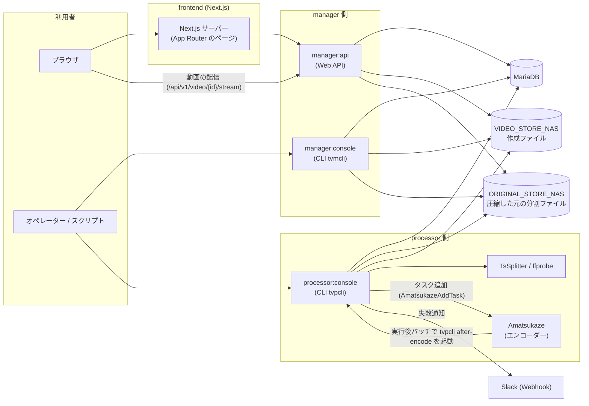
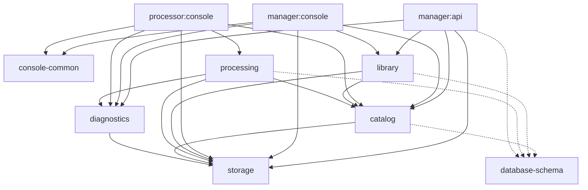
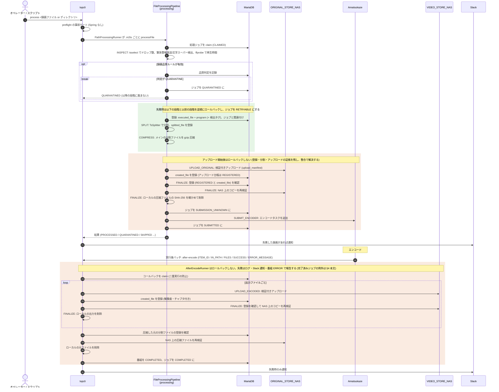

# アーキテクチャ

tsvideos の現在の構造を、人が全体を把握するためにまとめた文書。2026-10-28 時点のコード (各 `build.gradle.kts`、[module-graph.gradle.kts](../backend/module-graph.gradle.kts)、各実行アプリの起動クラスと設定) を確かめて書いている。

この文書は全体像と各部品の位置付けを説明するためのもので、規則の正本ではない。許可するプロジェクト依存の正本は [module-graph.gradle.kts](../backend/module-graph.gradle.kts) の `ModuleGraphRules`、モジュール境界・テーブル所有権・トランザクション境界の契約の正本は [backend/docs/module-boundaries.md](../backend/docs/module-boundaries.md) で、本書と食い違う場合はそちらに従う。各機能の仕様・運用手順は [backend/docs/](../backend/docs/README.md) の個別文書にある。ここでは詳細を繰り返さず、それらへの入口を示す。用語は [ubiquitous-language.md](ubiquitous-language.md) に従う。

## 目次

1. [全体像とコンポーネント](#1-全体像とコンポーネント)
2. [backend のモジュールと依存方向](#2-backend-のモジュールと依存方向)
3. [公開と内部の境界](#3-公開と内部の境界)
4. [録画処理の流れとロールバック境界](#4-録画処理の流れとロールバック境界)
5. [運用コマンドの位置付け](#5-運用コマンドの位置付け)
6. [永続化](#6-永続化)
7. [frontend](#7-frontend)
8. [設定・ログ・停止・リトライ](#8-設定ログ停止リトライ)
9. [テスト戦略](#9-テスト戦略)
10. [再編の履歴](#10-再編の履歴)

## 1. 全体像とコンポーネント

tsvideos は、TS 抜きした録画を処理して保管する **processor** 側と、保管済みの番組を管理・閲覧する **manager** 側に分かれる。両者は同じ MariaDB を共有し、互いを直接は呼び出さない。

下図の矢印は「呼び出し・接続する側 → 呼び出される側」を表す。データの流れる向きではない。

| コンポーネント | 役割 | 詳細 |
| --- | --- | --- |
| frontend | 番組の検索・詳細・再生、コレクション/手動タグ、重複レビュー、ストレージ概要、ライブラリの健全性の画面。backend へは HTTP だけで接続する | [frontend/README.md](../frontend/README.md)、[§7](#7-frontend) |
| `manager:api` | frontend 向けの Web API (`/api/v1/...`)。動画を NAS から読み出して配信する。Docker イメージとして配布する ([backend/Dockerfile](../backend/Dockerfile)) | [backend/README.md](../backend/README.md) |
| `manager:console` (`tvmcli`) | 番組の検索・取得・変更・削除、重複一覧、統計、環境診断 (`doctor`)、NAS 整合性検証 (`verify`)、整理プラン (`cleanup plan` / `apply`) | [backend/manager/console/README.md](../backend/manager/console/README.md) |
| `processor:console` (`tvpcli`) | 録画の処理 (`process`)、エンコード後処理 (`after-encode`)、リセット、復旧・参照用の運用コマンド。録画とツールのある処理用マシンで動かす (ツールパスの既定値は Windows) | [backend/README.md の processor:console](../backend/README.md#processorconsole-tvpcli)、[§5](#5-運用コマンドの位置付け) |
| MariaDB | 台帳・タグ・処理ジョブ・履歴・アップロード台帳・ライブラリ管理のデータ。スキーマは `database-schema` の番号付き migration | [§6](#6-永続化) |
| NAS (Samba) | `ORIGINAL_STORE_NAS` に圧縮した元の分割ファイル、`VIDEO_STORE_NAS` に作成ファイルを保管する。Samba (jcifs) でのアクセスは `storage` モジュールだけが行う。例外として `tvpcli chapters backfill` は、ffprobe に読ませるため、オペレーターが明示したローカル/UNC の共有ルート (`--video-store-root`) 経由で作成ファイルを読む | [verified-uploads.md](../backend/docs/verified-uploads.md) |
| Amatsukaze | TS のエンコード。processor がタスクを追加し、エンコード完了後に Amatsukaze の実行後バッチが `tvpcli after-encode` を起動する | [§4](#4-録画処理の流れとロールバック境界) |
| TsSplitter / ffprobe / tsselect | 分割 (外部プロセス)、再生時間・解像度・チャプタの取得 (外部プロセス)、ドロップ数の計測 (JVM 内のライブラリ `me.pinfort:tsselect`) | [processing/README.md](../backend/processing/README.md) |
| Slack | processor の失敗通知。`SLACK_WEBHOOK_URL` が未設定なら通知しない | — |

## 2. backend のモジュールと依存方向

backend は Gradle のマルチモジュール構成で、[settings.gradle.kts](../backend/settings.gradle.kts) が 10 個のモジュールを含む。業務モジュール (`storage`・`catalog`・`library`・`diagnostics`・`processing`) と資源モジュール (`database-schema`)、CLI 共通部品 (`console-common`)、3 つの実行アプリ (`manager:api`・`manager:console`・`processor:console`) からなる。

下図の実線の矢印は本番の設定 (`implementation`) で宣言したプロジェクト依存 (依存元 → 依存先) で、各 `build.gradle.kts` に書かれているものをすべて描いている。点線は DB テストだけが使うテストフィクスチャ (`testImplementation(testFixtures(project(":database-schema")))`) への依存である。

| モジュール | 責務 |
| --- | --- |
| `storage` | NAS の公開契約 (`storage.api`: `NasStore`、`NasComponent`、`NasFileVerifier`、`VerifiedUploadNas`、SHA-256 など) と internal の Samba (jcifs) 実装、`samba.*` 設定。プロジェクト依存なし |
| `database-schema` | 番号付き migration (スキーマの単一の情報源)、保守用 SQL、テスト DDL の生成 (`generateTestDdl`) とテスト用データ。データ操作 API も本番の依存先も持たない |
| `catalog` | 台帳 (`executed_file` / `program` / `splitted_file` / `created_file`) と検出タグ/実施記録の操作。両アプリが使う記録の整合性と、台帳行のロック・削除・移動の協調操作 |
| `library` | manager 側の管理機能: 番組検索 (手動コレクション/タグでの絞り込み)、統計、ストレージ概要、手動分類、重複検出/重複レビュー、一括操作、整理プラン、健全性・整合性検証 |
| `diagnostics` | DB/NAS の環境診断。Spring コンテキストなしで組み立てられ、`tvmcli doctor` と `tvpcli preflight` が使う |
| `processing` | processor 側の処理: パイプライン、エンコード後処理、リセット、処理ジョブの所有権、処理履歴、録画品質、再試行、中断、検証付きアップロード、preflight、外部ツール/shell、TS 解析、Slack 通知 |
| `console-common` | 両 CLI が共有する Clikt/端末入出力の部品と `--version` の情報 (`ApplicationVersion`) |
| `manager:api` | Spring MVC の薄い層 (`controller` / `response` / `exception`)。業務ロジックは catalog と library の公開操作に置き、コントローラーには持たせない |
| `manager:console` | Clikt の CLI (`commands/`)。`manager:api` と同じ catalog・library の公開操作を使う |
| `processor:console` | Clikt の CLI (`commands/`)。processing の公開 API (`PathProcessingRunner` などの入口と公開操作) を呼ぶ非 Web の Spring Boot アプリ |

依存の要点:

- 業務ロジックの置き場所: 台帳の業務ロジックは `catalog`、NAS の低レベル操作は `storage` に置く。`library` と `processing` は台帳の Mapper/DTO ではなく catalog の公開操作を使う。API の手動コレクション/タグでの絞り込みは library の `LibraryProgramSearchCommand` が持ち、catalog の `ProgramCommand.search` は台帳の条件だけを受け取る。
- `console-common` には両 CLI が実際に使うものだけを置く。`manager:api` は依存しない。
- **manager は processing を含まない**。`manager:api` と `manager:console` は processing に依存せず、スキャン・Mapper 登録・`processing` プロファイルの include もしない。TsSplitter/Amatsukaze/tsselect と処理専用の設定は manager の実行時に存在しない。
- **processor は library を含まない**。processor が使う台帳操作は catalog にある。
- `database-schema` は本番の依存先にならない。DB 統合テストだけがテストフィクスチャを参照する。

これらはビルドの `check` に含まれる検査で強制される。詳細と各検査の対象は [module-boundaries.md §11.7](../backend/docs/module-boundaries.md#117-境界の自動チェック) を参照。

| 検査 | 適用先 | 拒否するもの |
| --- | --- | --- |
| `checkModuleGraph` ([module-graph.gradle.kts](../backend/module-graph.gradle.kts)) | 3 つの実行アプリ | 廃止したモジュールの復活、上図にないプロジェクト依存、各アプリの解決後の実行時クラスパスに入る禁止プロジェクト (manager: processing、processor: library) と manager の `me.pinfort:tsselect`、3 アプリの `application-datasource.yaml` の差異、検査を適用しない実行アプリ |
| `checkProcessingRuntimeIsolation` ([processing/runtime-isolation.gradle.kts](../backend/processing/runtime-isolation.gradle.kts)) | manager の 2 アプリ | 推移的な依存を含め、実行時クラスパスに processing が入ること |
| `checkDatabaseSchemaRuntimeIsolation` ([database-schema/runtime-isolation.gradle.kts](../backend/database-schema/runtime-isolation.gradle.kts)) | 3 つの実行アプリ | 実行時クラスパスに database-schema やそのテストフィクスチャが入ること |
| `check<Module>Boundaries` (各モジュールの `build.gradle.kts`) | storage・database-schema・catalog・library・diagnostics・processing | 許可外の依存、他モジュールからの internal パッケージの参照など |

新しいモジュールや依存を加えるときは、`ModuleGraphRules` の表と [module-boundaries.md §2](../backend/docs/module-boundaries.md#2-目標モジュールと依存方向) を一緒に更新し、本節の図とモジュール表も合わせて直す。

## 3. 公開と内部の境界

各業務モジュールは内部を `api` / `domain` / `persistence` などのパッケージに分け、**利用側に公開するのは `api` と `domain` だけ**にしている (Gradle モジュールにはしない)。

| モジュール | 公開 | 内部 (他モジュールから参照しない) |
| --- | --- | --- |
| `storage` | `storage.api` | Samba 実装と NAS 設定 |
| `catalog` | `catalog.api`、`catalog.domain` | MyBatis の Mapper・DTO (`persistence`) |
| `library` | `library.api`、`library.domain` | MyBatis の Mapper (`persistence`) |
| `diagnostics` | `diagnostics.api`、`diagnostics.domain` | それ以外のパッケージ |
| `processing` | `processing.api` (下位の `api.config` / `api.shell` / `api.tool` を含む)、`processing.domain` | パイプライン (`pipeline`)、tsselect (`external.tsselect`)、TS 解析 (`external.ts`)、Slack (`external.slack`)、Mapper (`persistence`) |

- Mapper のパッケージ名は internal なので、実行アプリは公開定数 `CatalogPersistence.MAPPER_PACKAGE` / `LibraryPersistence.MAPPER_PACKAGE` / `ProcessingPersistence.MAPPER_PACKAGE` で `@MapperScan` に登録する。
- internal の型 (Mapper、`FileProcessingPipeline`、`SlackClient`) を引数に取る公開クラスのコンストラクタは `internal` で、モジュールの外では Spring の Bean として注入する。
- 業務モジュールは DataSource・トランザクションマネージャ・`SqlSessionFactory`・`Logger` の Bean を定義しない。実行アプリが組み立てる ([§8](#8-設定ログ停止リトライ))。

catalog の公開操作 (`ProgramCommand`、`CreatedFileCatalog`、`ProgramInventory`、`LedgerSnapshots`、`LedgerLocks`、`CatalogStatistics` など) とトランザクション伝播の契約は [module-boundaries.md §6・§7・§11](../backend/docs/module-boundaries.md#11-各モジュールの公開操作と結果型-契約)、NAS の公開契約は [§8](../backend/docs/module-boundaries.md#8-nas-storage-の公開契約) を参照。

## 4. 録画処理の流れとロールバック境界

録画 1 件の処理は、`tvpcli process` が行う前半 (パイプライン) と、Amatsukaze のエンコード完了後に `tvpcli after-encode` が行う後半 (エンコード後処理) に分かれる。両者を処理ジョブ (`processing_job`) がつなぐ。

下図の実線の矢印は呼び出し (ローカルのファイル操作は自分自身への矢印)、点線の矢印は戻り値である。緑の区間は失敗時にロールバックする範囲、橙の区間はロールバックしない範囲を示す。

ロールバック境界の考え方:

- **パイプラインの登録・分割・圧縮**は、その段階と以前の段階を逆順に取り消す (`RollbackRunner`)。外部へ何も出ていないので、ロールバックが完了すればジョブを RETRYABLE にして再実行できる。
- **アップロード開始以降**は巻き戻さない。NAS へ出たファイル・Amatsukaze に渡った入力を消すと、成功していたかもしれない外部効果の証拠を失うためである。ジョブは CLAIMED や SUBMISSION_UNKNOWN のまま残り、オペレーターが [processing-idempotency.md](../backend/docs/processing-idempotency.md) の手順で整合させる。
- **エンコード後処理**も巻き戻さない。アップロードとローカル削除の後で取り消せないためで、通常は番組を ERROR にして通知する。ただし完了済みの結果は壊さない。すでに COMPLETED のジョブへの遅延・重複したコールバックは拒否して既存の結果を保ち、番組を COMPLETED にした後の履歴の保存やジョブの完了記録の失敗では番組を COMPLETED のまま報告する (ジョブの完了記録の失敗はコールバックの再実行で解消する)。
- NAS への保管はどちらも検証付きアップロード (`VerifiedUploadCommand`) を通る。所有権を `upload_manifest` に記録してから一時ファイルへ排他作成・転送・検証し、上書きしない rename の後に登録する。ローカルファイルは登録と SHA-256 の再確認が済むまで消さない ([verified-uploads.md](../backend/docs/verified-uploads.md))。
- `--dry-run` は検査だけを行い、登録・NAS・Amatsukaze への書き込みをしない。

同じ録画を二重に処理しないための処理ジョブの同一性と状態は [processing-idempotency.md](../backend/docs/processing-idempotency.md)、試行と段階の記録は [processing-history.md](../backend/docs/processing-history.md)、品質ルールと隔離は [recording-quality.md](../backend/docs/recording-quality.md) を参照。

## 5. 運用コマンドの位置付け

`tvpcli` (processor:console) のサブコマンドは、処理の本線・取り消し・復旧・参照に分かれる。すべて processing の公開 API を呼ぶ。

| 分類 | コマンド | 位置付け | 詳細 |
| --- | --- | --- | --- |
| 事前確認 | `preflight` | 入力・ツール・容量・DB/NAS・エンコーダー接続を検査する。Spring を起動せずに組み立てる。`process` の前にも同じ検査が事前ゲートとして走る | [processing-preflight.md](../backend/docs/processing-preflight.md) |
| 本線 | `process` | パイプライン (§4 の前半) | [backend/README.md](../backend/README.md#processorconsole-tvpcli) |
| 本線 | `after-encode` | エンコード後処理 (§4 の後半)。Amatsukaze の実行後バッチから呼ばれる | 同上 |
| 取り消し | `reset` | 1 つの録画の番組・生成物 (DB 行、NAS のコピー、ローカルの分割ファイル) をすべて削除し処理前に戻す。元の録画は残す。確認を求め、ロールバックしない | 同上 |
| 復旧 | `release-claim` | クラッシュしたプロセスが残したアップロード台帳のクレームを解放する (全 processor 停止後に実行)。状態と NAS は変えない | [verified-uploads.md](../backend/docs/verified-uploads.md) |
| 復旧 | `quality release` | 隔離 (QUARANTINED) したジョブを RETRYABLE に戻す | [recording-quality.md](../backend/docs/recording-quality.md) |
| 補完 | `chapters backfill` | 未取得の mp4 のチャプタを、ローカル/UNC の共有ルート経由で取得して記録する | [video-chapters.md](../backend/docs/video-chapters.md) |
| 参照 | `status` / `history` / `quality report` | 処理ジョブの状態・試行履歴・品質判定の記録を読み取り専用で表示する (`--json` あり) | [processing-history.md](../backend/docs/processing-history.md) |

書き込むサブコマンドは `-d` / `--dry-run` を受け付ける。

`tvmcli` (manager:console) と `manager:api` は、処理済みの番組を管理する同じ catalog・library の公開操作を、CLI と HTTP の 2 つの入口から使う。`tvmcli` の `doctor` (環境診断) は Spring を起動せずに組み立て、設定が壊れていても診断できる。`verify` は NAS 上の作成ファイルの存在とサイズを読み取り専用で確かめ、`cleanup plan` / `apply` は人が確認した JSON の整理プランを、一括操作のガード付き適用で削除する。API 側の一括操作と健全性検証は [bulk-library.md](../backend/docs/bulk-library.md)・[library-health.md](../backend/docs/library-health.md) を参照。

## 6. 永続化

DB は MariaDB 1 つで、全テーブルの DDL は `database-schema` の [db/migrations](../backend/database-schema/src/main/resources/db/migrations/) にある。データの読み書き API はテーブルを所有するモジュールだけが提供する (所有表は [module-boundaries.md §5.1](../backend/docs/module-boundaries.md#51-テーブルの所有者-契約))。DB アクセスは JPA/Hibernate ではなく MyBatis の Mapper を直接使う。

| まとまり | テーブル | 所有 | 内容 |
| --- | --- | --- | --- |
| 台帳 | `executed_file`、`program`、`splitted_file`、`created_file`、`created_file_path_guard`、`created_file_chapter` | `catalog` | 録画・番組・分割ファイル・作成ファイル (NAS 上の保管先、解像度、チャプタ) |
| 検出タグ | `executed_file_tag`、`executed_file_check` | `catalog` | 検出処理が付けたタグと、実行した検出処理の記録。「検出なし」と「未検査」を区別する。新しい検出処理は定数を加えて `ExecutedFileTagCommand.recordCheck` を呼ぶだけで、スキーマ変更は要らない |
| 手動分類 | `library_collection`、`library_tag`、`library_collection_program`、`library_tag_program` | `library` | 運用者が付けるコレクション/手動タグ。検出タグとは別物 ([library-organization.md](../backend/docs/library-organization.md)) |
| 健全性 | `health_verification_run`、`health_verification_finding` | `library` | 明示的な NAS 検証の実行と結果 ([library-health.md](../backend/docs/library-health.md)) |
| 処理ジョブ | `processing_job` | `processing` | 録画 1 件の処理状況と所有権。状態は CLAIMED / RETRYABLE / QUARANTINED / SUBMISSION_UNKNOWN / SUBMITTED / REJECTED / COMPLETED / RESETTING ([processing-idempotency.md](../backend/docs/processing-idempotency.md)) |
| 処理履歴 | `processing_history_identity`、`processing_attempt`、`processing_stage_event` | `processing` | 試行と段階の記録。診断用の証拠で、ファイル削除や外部操作の再実行の根拠にはしない ([processing-history.md](../backend/docs/processing-history.md)) |
| 録画品質 | `processing_quality_report` | `processing` | 品質ルールの判定結果 ([recording-quality.md](../backend/docs/recording-quality.md)) |
| アップロード台帳 | `upload_manifest` | `processing` | 成果物ごとの NAS 保管の所有権と状態 (NEW → CREATING → TRANSFERRING → TEMP_VERIFIED → FINALIZING → FINALIZED → REGISTERED) ([verified-uploads.md](../backend/docs/verified-uploads.md)) |

NAS の実ファイルと DB の行をまとめて確定する分散トランザクションはなく、NAS の効果は DB のロールバックでは戻らない。DB トランザクションと NAS 操作の関係は機能ごとに異なる。

- **検証付きアップロード** (`VerifiedUploadCommand`): 呼び出し元のトランザクションを一時停止し、NAS 操作中は DB トランザクションも行ロックも持たない。状態遷移ごとに短いトランザクションで確定し、NAS 副作用の前に状態を永続化する。
- **番組の協調削除・移動** (`ProgramCommand.delete` / `moveCreatedFiles`、`reset` と `tvmcli delete program` / `modify` が使う): 1 つの DB トランザクションの中で NAS の削除・移動を行う。途中で失敗すると DB は戻るが、削除済みの NAS ファイルは戻らない (移動はファイル単位で巻き戻しを試みる)。
- **一括 DELETE / MOVE** (`BulkLibraryCommand`、`tvmcli cleanup apply`): 対象ごとの `REQUIRES_NEW` トランザクションで行ロックを取り、その中で上の協調操作を呼ぶ。ロックは NAS 操作が終わって commit されるまで保持する。失敗は「部分的に変わった可能性」を示す FAILED で返す。

フローごとのトランザクション境界と失敗時の責任分担は [module-boundaries.md §7](../backend/docs/module-boundaries.md#7-トランザクションと協調操作)・[§10](../backend/docs/module-boundaries.md#10-nas-と-db-の失敗時の責任) に定めている。

## 7. frontend

- Next.js の App Router。ページは `frontend/app/**`、共通 UI は `frontend/components/`。ページはサーバーコンポーネントとして Next.js サーバー側で `manager:api` を呼ぶ。
- backend の呼び出しはすべて `frontend/lib/api/` を通す (`client.ts` の `fetchJson` / `ApiError` と、エンドポイントごとのラッパー)。コンポーネントやページから直接 `fetch` しない。
- 動画の再生・ダウンロードは、ブラウザが `manager:api` から動画のバイト列を直接取得する (Next.js を経由しない)。そのため `NEXT_PUBLIC_API_BASE_URL` (既定 `http://localhost:8080`) はブラウザから到達できる URL にする。
- 再生履歴はブラウザのローカルにだけ保存する。

画面ごとの説明は [frontend/README.md](../frontend/README.md) を参照。

## 8. 設定・ログ・停止・リトライ

**組み立てと設定**。3 つの実行アプリはそれぞれ自分の組み立てを持つ。

- DataSource は Spring Boot 自動構成の Hikari 1 つで、トランザクションマネージャと `SqlSessionFactory` もアプリごとに 1 つ。全モジュールの Mapper がそれを共有する。設定は各アプリの `application-datasource.yaml` (`datasource` プロファイル) にあり、3 つを同じ内容に保つ (`checkModuleGraph` が検査する)。MariaDB ドライバは各アプリが `runtimeOnly` で宣言する。
- NAS の `samba.*` は storage の `application-storage.yaml` (`storage` プロファイル)、処理ツールの `processor-tool.*` / `processor-preflight.*` は processing の `application-processing.yaml` (`processing` プロファイル) にある。`processing` プロファイルを include するのは `processor:console` だけである。
- 接続先やツールのパスは環境変数で上書きする。一覧は [backend/README.md](../backend/README.md#ローカルでの動作確認) と [processing/README.md](../backend/processing/README.md#組み立て) を参照。

**ログ**。各アプリの `config/LoggerConfig` が注入先ごとの slf4j `Logger` (prototype) を提供する。両 CLI は `logback-spring.xml` でログを標準エラーへ WARN 以上だけ出し、標準出力をコマンドの結果 (`--json` を含む) に使う。

**停止**。`tvpcli` は SIGINT/SIGTERM を受けると `ProcessingCancellation` に停止を求め、処理は次の確認点で止まる。試行は INTERRUPTED として記録し、ロールバックせずに途中の証拠を残して終了コード 130 (シグナルによっては 143) で終わる。全体の猶予は `PROCESSOR_SHUTDOWN_GRACE_SECONDS` ([graceful-shutdown.md](../backend/docs/graceful-shutdown.md))。

**リトライ**。暗黙の再処理はしない。検証付きアップロードの `upload` / `register` / `verifyRegistered` だけが、型で分類した一時的なネットワーク/DB 接続の失敗を、台帳が安全な状態のあいだに限り `ProcessingRetry` (`processor-retry.*`) で再試行する ([processing-retries.md](../backend/docs/processing-retries.md))。それ以外の失敗はジョブの状態に残し、オペレーターが再実行または整合を判断する。

## 9. テスト戦略

| 対象 | 方法 | 実行 |
| --- | --- | --- |
| backend の単体テスト | Kotest + MockK (Mockito はビルドで除外している) | `./gradlew test` |
| backend の DB テスト | Testcontainers で MariaDB を起動する (Docker が必要)。初期化スクリプトは migration から `database-schema:generateTestDdl` で生成し、テスト用データとともにテストフィクスチャで配る | 同上 |
| NAS の結合テスト | Samba コンテナを使う (検証付きアップロードなど) | 同上 |
| モジュール境界 | §2 の検査タスク。検査ルール自体も、違反を含むフィクスチャを確実に検出することを先に確かめる | `./gradlew check` / `build` |
| 組み立て | `ApiApplicationTest` が、manager:api が processing のプロファイル・設定・クラスなしで起動することを確かめる | `./gradlew manager:api:test` |
| backend のスタイル | ktlint | `./gradlew ktlintCheck` |
| frontend | Vitest + Testing Library + jsdom。すべてのコンポーネント・ページ・lib に同じ場所の `*.test.ts(x)` を置く | `pnpm test`、`pnpm typecheck`、`pnpm lint` |

CI ([.github/workflows](../.github/workflows/)) は backend でビルド・ktlint・テスト、frontend で型検査・ビルド・lint・テストを実行する。ローカルで DB と NAS を使うときはルートの `docker-compose.test.yml` を起動する。

## 10. 再編の履歴

backend は、かつて共有の `core` と各側の `infrastructure` モジュールにコードを集めていた。親 Issue #128 の方針 ([module-boundaries.md §1](../backend/docs/module-boundaries.md#1-前提と移行規則)) に沿って業務責務ごとのモジュールへ分割し、現在の構成になった。主な節目:

| Issue | 変更 |
| --- | --- |
| #132・#133・#135・#136 | `storage`・`database-schema`・`catalog`・`diagnostics` を抽出 |
| #157〜#159 | manager の管理機能を `library` に抽出 (検索・統計・分類・重複レビュー、一括操作・整理、健全性・検証) |
| #164 | 処理専用のコード (ジョブ所有権・履歴・品質・再試行・中断・preflight・外部ツール/shell) を `core` から `processing` に抽出 |
| #165 | 検証付きアップロード (`VerifiedUploadCommand`・`UploadManifest`・`UploadManifestMapper`) を `processing` に移し、manager の 2 アプリから processing への依存・スキャン・`processing` プロファイルをなくした |
| #166 | `processor:infrastructure` (パイプライン・reset・after-encode・tsselect・TS 解析・Slack) を `processing` に統合してモジュールを削除。入口を `processing.api` の `PathProcessingRunner` / `AfterEncodeRunner` / `ResetRunner` にした |
| #139 | 最後まで残った `core` と `manager:infrastructure` を削除。`ApplicationVersion` を `console-common` へ、`LoggerConfig` と DataSource の設定を各実行アプリへ移し、`checkModuleGraph` で旧モジュールの復活と許可外の依存を拒否するようにした |

モジュール再編とは別に、ドロップ数の計測は Windows 専用の `tsDropChkx64.exe` を呼ぶ旧 `DropChkClient` から、JVM 内で `me.pinfort:tsselect` の `tsDump` モードを使う `TsSelectClient` に置き換えている。

各段階の詳細は [module-boundaries.md](../backend/docs/module-boundaries.md) の §3・§11.8 と [processing/README.md](../backend/processing/README.md) に残っている。
